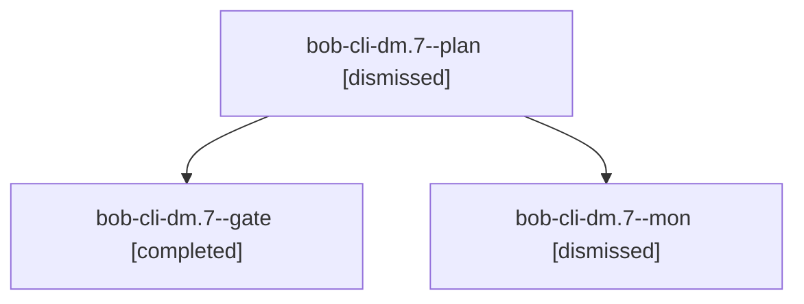

# Session: bob-cli-dm.7

[Agent Hoods](../README.md) / [bbugyi200](../users/bbugyi200/README.md) / [apollo](../users/bbugyi200/machines/apollo/README.md) / [bob-cli-dm](../users/bbugyi200/machines/apollo/hoods/bob-cli-dm/README.md) / bob-cli-dm.7

Owner: `bbugyi200.apollo` · Hood: `bob-cli-dm` · Members: 3 · Bead: [bob-cli-dm.7](https://github.com/bobs-org/bob-cli--beads/blob/main/pages/bob-cli-dm/bob-cli-dm.7.md)

## Lineage

The diagram is an optional enhancement; the ordered table below contains the same lineage in accessible text.

| Role | Agent | State | Model / provider | Timing | Commits | Prompt | Chat |
|---|---|---|---|---|---:|---|---|
| plan | bob-cli-dm.7--plan | dismissed | gpt-6-astra / codex | 2026-10-28T22:43:40.570221 → 2026-10-28T22:50:52.419305 | 0 | [Prompt](../agents/bbugyi200.apollo.bob-cli-dm.7--plan/prompt.md) | [Chat](../agents/bbugyi200.apollo.bob-cli-dm.7--plan/chat.md) |
| gate | bob-cli-dm.7--gate | completed | gpt-6-astra / codex | 2026-10-29T02:50:31.147735+00:00 → 2026-10-29T02:50:46.925195+00:00 | 0 | — | [Chat](../agents/bbugyi200.apollo.bob-cli-dm.7--gate/chat.md) |
| mon | bob-cli-dm.7--mon | dismissed | gpt-6-astra / codex | 2026-10-28T22:50:44.732824 → 2026-10-28T22:52:14.833861 | 0 | — | [Chat](../agents/bbugyi200.apollo.bob-cli-dm.7--mon/chat.md) |

## Neighbors

| Agent | Relation | State |
|---|---|---|
| [bob-cli-dm.7.1.1](../agents/bbugyi200.apollo.bob-cli-dm.7.1.1/README.md) | descendant | dismissed |
| [bob-cli-dm.7.1.2](../agents/bbugyi200.apollo.bob-cli-dm.7.1.2/README.md) | descendant | dismissed |
| [bob-cli-dm.7.1.3](../agents/bbugyi200.apollo.bob-cli-dm.7.1.3/README.md) | descendant | dismissed |
| [bob-cli-dm.7.1.4](../agents/bbugyi200.apollo.bob-cli-dm.7.1.4/README.md) | descendant | dismissed |
| [bob-cli-dm.7.1.land](bbugyi200.apollo.bob-cli-dm.7.1.land.md) (session · 3) | descendant | completed 2, dismissed 1 |
| [bob-cli-dm.1](bbugyi200.apollo.bob-cli-dm.1.md) (session · 3) | bob-cli-dm hood | completed 1, dismissed 2 |
| [bob-cli-dm.1.1.1](bbugyi200.apollo.bob-cli-dm.1.1.1.md) (session · 3) | bob-cli-dm hood | completed 1, dismissed 2 |
| [bob-cli-dm.1.1.2](bbugyi200.apollo.bob-cli-dm.1.1.2.md) (session · 7) | bob-cli-dm hood | completed 1, dismissed 4, failed 2 |
| [bob-cli-dm.1.1.3](../agents/bbugyi200.apollo.bob-cli-dm.1.1.3/README.md) | bob-cli-dm hood | dismissed |
| [bob-cli-dm.1.1.land](bbugyi200.apollo.bob-cli-dm.1.1.land.md) (session · 3) | bob-cli-dm hood | completed 2, dismissed 1 |
| [bob-cli-dm.2](bbugyi200.apollo.bob-cli-dm.2.md) (session · 3) | bob-cli-dm hood | completed 1, dismissed 2 |
| [bob-cli-dm.3](../agents/bbugyi200.apollo.bob-cli-dm.3/README.md) | bob-cli-dm hood | dismissed |
| [bob-cli-dm.4](bbugyi200.apollo.bob-cli-dm.4.md) (session · 5) | bob-cli-dm hood | completed 2, dismissed 2, failed 1 |
| [bob-cli-dm.5](bbugyi200.apollo.bob-cli-dm.5.md) (session · 3) | bob-cli-dm hood | completed 1, dismissed 2 |
| [bob-cli-dm.5.1.1](../agents/bbugyi200.apollo.bob-cli-dm.5.1.1/README.md) | bob-cli-dm hood | dismissed |
| [bob-cli-dm.5.1.2](../agents/bbugyi200.apollo.bob-cli-dm.5.1.2/README.md) | bob-cli-dm hood | dismissed |
| [bob-cli-dm.5.1.3](../agents/bbugyi200.apollo.bob-cli-dm.5.1.3/README.md) | bob-cli-dm hood | dismissed |
| [bob-cli-dm.5.1.land](bbugyi200.apollo.bob-cli-dm.5.1.land.md) (session · 3) | bob-cli-dm hood | completed 2, dismissed 1 |
| [bob-cli-dm.6](bbugyi200.apollo.bob-cli-dm.6.md) (session · 3) | bob-cli-dm hood | completed 1, dismissed 2 |
| [bob-cli-dm.6.1.1](../agents/bbugyi200.apollo.bob-cli-dm.6.1.1/README.md) | bob-cli-dm hood | dismissed |
| [bob-cli-dm.6.1.2](../agents/bbugyi200.apollo.bob-cli-dm.6.1.2/README.md) | bob-cli-dm hood | dismissed |
| [bob-cli-dm.6.1.3](../agents/bbugyi200.apollo.bob-cli-dm.6.1.3/README.md) | bob-cli-dm hood | dismissed |
| [bob-cli-dm.6.1.land](bbugyi200.apollo.bob-cli-dm.6.1.land.md) (session · 9) | bob-cli-dm hood | completed 4, dismissed 4, failed 1 |
| [bob-cli-dm.8](../agents/bbugyi200.apollo.bob-cli-dm.8/README.md) | bob-cli-dm hood | dismissed |
| [bob-cli-dm.9](../agents/bbugyi200.apollo.bob-cli-dm.9/README.md) | bob-cli-dm hood | dismissed |
| [bob-cli-dm.land](../agents/bbugyi200.apollo.bob-cli-dm.land/README.md) | bob-cli-dm hood | dismissed |
