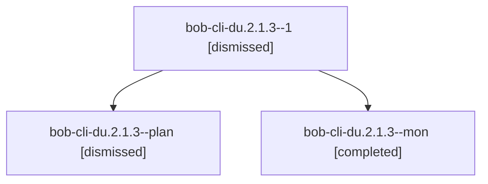

# Session: bob-cli-du.2.1.3

[Agent Hoods](../README.md) / [bbugyi200](../users/bbugyi200/README.md) / [apollo](../users/bbugyi200/machines/apollo/README.md) / [bob-cli-du](../users/bbugyi200/machines/apollo/hoods/bob-cli-du/README.md) / bob-cli-du.2.1.3

Owner: `bbugyi200.apollo` · Hood: `bob-cli-du` · Members: 3 · Bead: [bob-cli-du.2.1.3](https://github.com/bobs-org/bob-cli--beads/blob/main/pages/bob-cli-du/bob-cli-du.2.1.3.md)

## Lineage

The diagram is an optional enhancement; the ordered table below contains the same lineage in accessible text.

| Role | Agent | State | Model / provider | Timing | Commits | Prompt | Chat |
|---|---|---|---|---|---:|---|---|
| 1 | bob-cli-du.2.1.3--1 | dismissed | grok-4.6 / grok | 2026-10-28T17:26:19.811554 → 2026-10-28T17:35:15.274918 | [1](../agents/bbugyi200.apollo.bob-cli-du.2.1.3--1/README.md#commits) | [Prompt](../agents/bbugyi200.apollo.bob-cli-du.2.1.3--1/prompt.md) | [Chat](../agents/bbugyi200.apollo.bob-cli-du.2.1.3--1/chat.md) |
| plan | bob-cli-du.2.1.3--plan | dismissed | grok-4.6 / grok | 2026-10-28T16:27:45.836692 → 2026-10-28T17:22:08.264627 | 0 | [Prompt](../agents/bbugyi200.apollo.bob-cli-du.2.1.3--plan/prompt.md) | [Chat](../agents/bbugyi200.apollo.bob-cli-du.2.1.3--plan/chat.md) |
| mon | bob-cli-du.2.1.3--mon | completed | grok-4.6 / grok | 2026-10-28T21:21:01.844327+00:00 → 2026-10-28T21:26:19.888413+00:00 | 0 | — | [Chat](../agents/bbugyi200.apollo.bob-cli-du.2.1.3--mon/chat.md) |

## Commits

| Role | Repo | Commit | Subject | Committed |
|---|---|---|---|---|
| 1 | — | `4be0224` | feat(capture): complete relation sources in the staged transaction | 2026-10-28 17:31:56 EDT |

## Neighbors

| Agent | Relation | State |
|---|---|---|
| [bob-cli-du.2](bbugyi200.apollo.bob-cli-du.2.md) (session · 3) | ancestor | completed 1, dismissed 2 |
| [bob-cli-du.2.1.1](../agents/bbugyi200.apollo.bob-cli-du.2.1.1/README.md) | bob-cli-du.2.1 hood | dismissed |
| [bob-cli-du.2.1.2](../agents/bbugyi200.apollo.bob-cli-du.2.1.2/README.md) | bob-cli-du.2.1 hood | dismissed |
| [bob-cli-du.2.1.4](../agents/bbugyi200.apollo.bob-cli-du.2.1.4/README.md) | bob-cli-du.2.1 hood | dismissed |
| [bob-cli-du.2.1.land](bbugyi200.apollo.bob-cli-du.2.1.land.md) (session · 3) | bob-cli-du.2.1 hood | completed 2, dismissed 1 |
| [bob-cli-du.1](../agents/bbugyi200.apollo.bob-cli-du.1/README.md) | bob-cli-du hood | dismissed |
| [bob-cli-du.3](../agents/bbugyi200.apollo.bob-cli-du.3/README.md) | bob-cli-du hood | dismissed |
| [bob-cli-du.4](bbugyi200.apollo.bob-cli-du.4.md) (session · 3) | bob-cli-du hood | completed 2, dismissed 1 |
| [bob-cli-du.5](../agents/bbugyi200.apollo.bob-cli-du.5/README.md) | bob-cli-du hood | dismissed |
| [bob-cli-du.6](bbugyi200.apollo.bob-cli-du.6.md) (session · 5) | bob-cli-du hood | completed 3, dismissed 2 |
| [bob-cli-du.7](../agents/bbugyi200.apollo.bob-cli-du.7/README.md) | bob-cli-du hood | dismissed |
| [bob-cli-du.8](../agents/bbugyi200.apollo.bob-cli-du.8/README.md) | bob-cli-du hood | dismissed |
| [bob-cli-du.9](bbugyi200.apollo.bob-cli-du.9.md) (session · 7) | bob-cli-du hood | completed 3, dismissed 4 |
| [bob-cli-du.land](bbugyi200.apollo.bob-cli-du.land.md) (session · 3) | bob-cli-du hood | completed 2, dismissed 1 |
