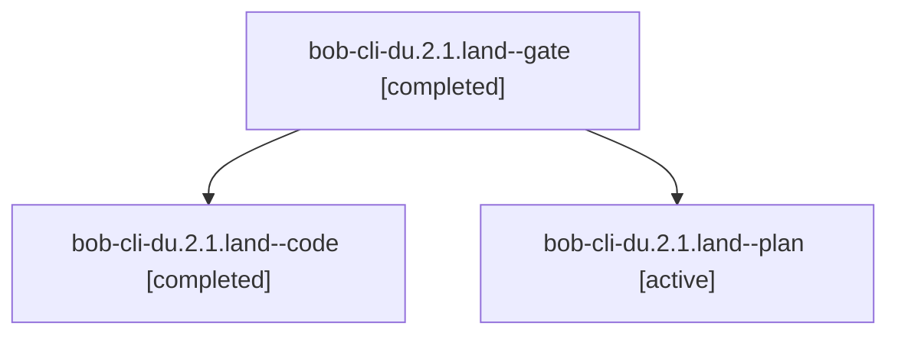

# Session: bob-cli-du.2.1.land

[Agent Hoods](../README.md) / [bbugyi200](../users/bbugyi200/README.md) / [apollo](../users/bbugyi200/machines/apollo/README.md) / [bob-cli-du](../users/bbugyi200/machines/apollo/hoods/bob-cli-du/README.md) / bob-cli-du.2.1.land

Owner: `bbugyi200.apollo` · Hood: `bob-cli-du` · Members: 3 · Bead: [bob-cli-du.2.1](https://github.com/bobs-org/bob-cli--beads/blob/main/pages/bob-cli-du/bob-cli-du.2.1.md)

## Lineage

The diagram is an optional enhancement; the ordered table below contains the same lineage in accessible text.

| Role | Agent | State | Model / provider | Timing | Commits | Prompt | Chat |
|---|---|---|---|---|---:|---|---|
| gate | bob-cli-du.2.1.land--gate | completed | gpt-6-astra / codex | 2026-10-28T22:18:13.849550+00:00 → 2026-10-28T22:18:26.017452+00:00 | 0 | — | [Chat](../agents/bbugyi200.apollo.bob-cli-du.2.1.land--gate/chat.md) |
| code | bob-cli-du.2.1.land--code | completed | muse-spark-1.3-contributor / muse | 2026-10-28T22:18:41.190222+00:00 → 2026-10-28T23:38:32.444691+00:00 | [1](../agents/bbugyi200.apollo.bob-cli-du.2.1.land--code/README.md#commits) | — | [Chat](../agents/bbugyi200.apollo.bob-cli-du.2.1.land--code/chat.md) |
| plan | bob-cli-du.2.1.land--plan | active | gpt-6-astra / codex | 2026-10-28T22:07:13.615785+00:00 | 0 | [Prompt](../agents/bbugyi200.apollo.bob-cli-du.2.1.land--plan/prompt.md) | [Chat](../agents/bbugyi200.apollo.bob-cli-du.2.1.land--plan/chat.md) |

## Commits

| Role | Repo | Commit | Subject | Committed |
|---|---|---|---|---|
| code | — | `d1f445c` | feat(capture): land complete-label closeout with edge grouping, scoped warnings, and acceptance | 2026-10-28 19:35:21 EDT |

## Neighbors

| Agent | Relation | State |
|---|---|---|
| [bob-cli-du.2](bbugyi200.apollo.bob-cli-du.2.md) (session · 3) | ancestor | active 2, completed 1 |
| [bob-cli-du.2.1.1](../agents/bbugyi200.apollo.bob-cli-du.2.1.1/README.md) | bob-cli-du.2.1 hood | active |
| [bob-cli-du.2.1.2](../agents/bbugyi200.apollo.bob-cli-du.2.1.2/README.md) | bob-cli-du.2.1 hood | dismissed |
| [bob-cli-du.2.1.3](bbugyi200.apollo.bob-cli-du.2.1.3.md) (session · 3) | bob-cli-du.2.1 hood | active 2, completed 1 |
| [bob-cli-du.2.1.4](../agents/bbugyi200.apollo.bob-cli-du.2.1.4/README.md) | bob-cli-du.2.1 hood | active |
| [bob-cli-du.1](../agents/bbugyi200.apollo.bob-cli-du.1/README.md) | bob-cli-du hood | active |
| [bob-cli-du.3](../agents/bbugyi200.apollo.bob-cli-du.3/README.md) | bob-cli-du hood | active |
| [bob-cli-du.4](bbugyi200.apollo.bob-cli-du.4.md) (session · 3) | bob-cli-du hood | active 1, completed 2 |
| [bob-cli-du.5](../agents/bbugyi200.apollo.bob-cli-du.5/README.md) | bob-cli-du hood | active |
| [bob-cli-du.6](bbugyi200.apollo.bob-cli-du.6.md) (session · 5) | bob-cli-du hood | active 2, completed 3 |
| [bob-cli-du.7](../agents/bbugyi200.apollo.bob-cli-du.7/README.md) | bob-cli-du hood | active |
| [bob-cli-du.8](../agents/bbugyi200.apollo.bob-cli-du.8/README.md) | bob-cli-du hood | active |
| [bob-cli-du.9](bbugyi200.apollo.bob-cli-du.9.md) (session · 7) | bob-cli-du hood | active 4, completed 3 |
| [bob-cli-du.land](bbugyi200.apollo.bob-cli-du.land.md) (session · 3) | bob-cli-du hood | active 1, completed 2 |
