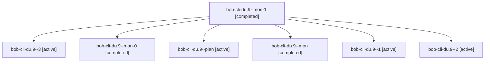

# Session: bob-cli-du.9

[Agent Hoods](../README.md) / [bbugyi200](../users/bbugyi200/README.md) / [apollo](../users/bbugyi200/machines/apollo/README.md) / [bob-cli-du](../users/bbugyi200/machines/apollo/hoods/bob-cli-du/README.md) / bob-cli-du.9

Owner: `bbugyi200.apollo` · Hood: `bob-cli-du` · Members: 7 · Bead: [bob-cli-du.9](https://github.com/bobs-org/bob-cli--beads/blob/main/pages/bob-cli-du/bob-cli-du.9.md)

## Lineage

The diagram is an optional enhancement; the ordered table below contains the same lineage in accessible text.

| Role | Agent | State | Model / provider | Timing | Commits | Prompt | Chat |
|---|---|---|---|---|---:|---|---|
| mon-1 | bob-cli-du.9--mon-1 | completed | gpt-6-luna / codex | 2026-10-29T02:09:05.178549+00:00 → 2026-10-29T02:12:35.017973+00:00 | 0 | — | [Chat](../agents/bbugyi200.apollo.bob-cli-du.9--mon-1/chat.md) |
| 3 | bob-cli-du.9--3 | active | gpt-6-luna / codex | 2026-10-29T02:12:34.891085+00:00 | [1](../agents/bbugyi200.apollo.bob-cli-du.9--3/README.md#commits) | [Prompt](../agents/bbugyi200.apollo.bob-cli-du.9--3/prompt.md) | [Chat](../agents/bbugyi200.apollo.bob-cli-du.9--3/chat.md) |
| mon-0 | bob-cli-du.9--mon-0 | completed | gpt-6-luna / codex | 2026-10-29T01:50:22.795769+00:00 → 2026-10-29T01:55:31.235942+00:00 | 0 | — | [Chat](../agents/bbugyi200.apollo.bob-cli-du.9--mon-0/chat.md) |
| plan | bob-cli-du.9--plan | active | gpt-6-luna / codex | 2026-10-29T01:31:24.908371+00:00 | 0 | [Prompt](../agents/bbugyi200.apollo.bob-cli-du.9--plan/prompt.md) | [Chat](../agents/bbugyi200.apollo.bob-cli-du.9--plan/chat.md) |
| mon | bob-cli-du.9--mon | completed | gpt-6-luna / codex | 2026-10-29T01:40:51.564481+00:00 → 2026-10-29T01:46:08.402905+00:00 | 0 | — | [Chat](../agents/bbugyi200.apollo.bob-cli-du.9--mon/chat.md) |
| 1 | bob-cli-du.9--1 | active | gpt-6-luna / codex | 2026-10-29T01:46:08.192801+00:00 | 0 | [Prompt](../agents/bbugyi200.apollo.bob-cli-du.9--1/prompt.md) | [Chat](../agents/bbugyi200.apollo.bob-cli-du.9--1/chat.md) |
| 2 | bob-cli-du.9--2 | active | gpt-6-luna / codex | 2026-10-29T01:55:31.027536+00:00 | 0 | [Prompt](../agents/bbugyi200.apollo.bob-cli-du.9--2/prompt.md) | [Chat](../agents/bbugyi200.apollo.bob-cli-du.9--2/chat.md) |

## Commits

| Role | Repo | Commit | Subject | Committed |
|---|---|---|---|---|
| 3 | bob-cli | [`7d3ce70`](https://github.com/bobs-org/bob-cli/commit/7d3ce705618cb9be501abda82db15f30dc14e2c0) | docs(relations): mark complete-label nav support shipped | 2026-10-28 22:25:51 EDT |

## Neighbors

| Agent | Relation | State |
|---|---|---|
| [bob-cli-du.1](../agents/bbugyi200.apollo.bob-cli-du.1/README.md) | bob-cli-du hood | active |
| [bob-cli-du.2](bbugyi200.apollo.bob-cli-du.2.md) (session · 3) | bob-cli-du hood | active 2, completed 1 |
| [bob-cli-du.2.1.1](../agents/bbugyi200.apollo.bob-cli-du.2.1.1/README.md) | bob-cli-du hood | active |
| [bob-cli-du.2.1.2](../agents/bbugyi200.apollo.bob-cli-du.2.1.2/README.md) | bob-cli-du hood | active |
| [bob-cli-du.2.1.3](bbugyi200.apollo.bob-cli-du.2.1.3.md) (session · 3) | bob-cli-du hood | active 2, completed 1 |
| [bob-cli-du.2.1.4](../agents/bbugyi200.apollo.bob-cli-du.2.1.4/README.md) | bob-cli-du hood | active |
| [bob-cli-du.2.1.land](bbugyi200.apollo.bob-cli-du.2.1.land.md) (session · 3) | bob-cli-du hood | active 1, completed 2 |
| [bob-cli-du.3](../agents/bbugyi200.apollo.bob-cli-du.3/README.md) | bob-cli-du hood | active |
| [bob-cli-du.4](bbugyi200.apollo.bob-cli-du.4.md) (session · 3) | bob-cli-du hood | active 1, completed 2 |
| [bob-cli-du.5](../agents/bbugyi200.apollo.bob-cli-du.5/README.md) | bob-cli-du hood | active |
| [bob-cli-du.6](bbugyi200.apollo.bob-cli-du.6.md) (session · 5) | bob-cli-du hood | active 2, completed 3 |
| [bob-cli-du.7](../agents/bbugyi200.apollo.bob-cli-du.7/README.md) | bob-cli-du hood | active |
| [bob-cli-du.8](../agents/bbugyi200.apollo.bob-cli-du.8/README.md) | bob-cli-du hood | active |
| [bob-cli-du.land](bbugyi200.apollo.bob-cli-du.land.md) (session · 3) | bob-cli-du hood | active 1, completed 2 |
