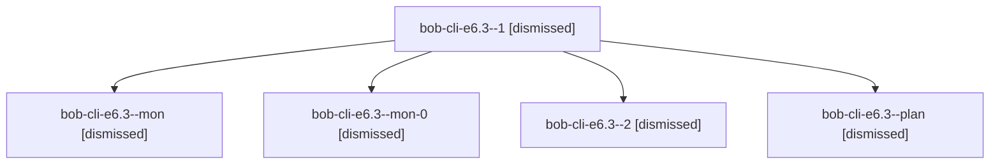

# Session: bob-cli-e6.3

[Agent Hoods](../README.md) / [bbugyi200](../users/bbugyi200/README.md) / [apollo](../users/bbugyi200/machines/apollo/README.md) / [bob-cli-e6](../users/bbugyi200/machines/apollo/hoods/bob-cli-e6/README.md) / bob-cli-e6.3

Owner: `bbugyi200.apollo` · Hood: `bob-cli-e6` · Members: 5 · Bead: [bob-cli-e6.3](https://github.com/bobs-org/bob-cli--beads/blob/main/pages/bob-cli-e6/bob-cli-e6.3.md)

## Lineage

The diagram is an optional enhancement; the ordered table below contains the same lineage in accessible text.

| Role | Agent | State | Model / provider | Timing | Commits | Prompt | Chat |
|---|---|---|---|---|---:|---|---|
| 1 | bob-cli-e6.3--1 | dismissed | grok-4.6 / grok | 2026-10-29T18:52:21.873353 → 2026-10-29T19:09:45.411395 | 0 | [Prompt](../agents/bbugyi200.apollo.bob-cli-e6.3--1/prompt.md) | [Chat](../agents/bbugyi200.apollo.bob-cli-e6.3--1/chat.md) |
| mon | bob-cli-e6.3--mon | dismissed | grok-4.6 / grok | 2026-10-29T18:27:17.705424 → 2026-10-29T18:33:05.999223 | 0 | — | [Chat](../agents/bbugyi200.apollo.bob-cli-e6.3--mon/chat.md) |
| mon-0 | bob-cli-e6.3--mon-0 | dismissed | grok-4.6 / grok | 2026-10-29T19:08:24.680466 → 2026-10-29T19:16:24.714759 | 0 | — | [Chat](../agents/bbugyi200.apollo.bob-cli-e6.3--mon-0/chat.md) |
| 2 | bob-cli-e6.3--2 | dismissed | grok-4.6 / grok | 2026-10-29T19:34:18.926337 → 2026-10-29T19:52:06.787182 | [1](../agents/bbugyi200.apollo.bob-cli-e6.3--2/README.md#commits) | [Prompt](../agents/bbugyi200.apollo.bob-cli-e6.3--2/prompt.md) | [Chat](../agents/bbugyi200.apollo.bob-cli-e6.3--2/chat.md) |
| plan | bob-cli-e6.3--plan | dismissed | grok-4.6 / grok | 2026-10-29T17:56:12.406609 → 2026-10-29T18:29:16.081634 | 0 | [Prompt](../agents/bbugyi200.apollo.bob-cli-e6.3--plan/prompt.md) | [Chat](../agents/bbugyi200.apollo.bob-cli-e6.3--plan/chat.md) |

## Commits

| Role | Repo | Commit | Subject | Committed |
|---|---|---|---|---|
| 2 | — | `c0f9439` | feat(types): add bob types migrate for legacy theme spellings | 2026-10-29 19:48:39 EDT |

## Neighbors

| Agent | Relation | State |
|---|---|---|
| [bob-cli-e6.1](bbugyi200.apollo.bob-cli-e6.1.md) (session · 5) | bob-cli-e6 hood | dismissed 5 |
| [bob-cli-e6.10](../agents/bbugyi200.apollo.bob-cli-e6.10/README.md) | bob-cli-e6 hood | dismissed |
| [bob-cli-e6.11](../agents/bbugyi200.apollo.bob-cli-e6.11/README.md) | bob-cli-e6 hood | dismissed |
| [bob-cli-e6.12](../agents/bbugyi200.apollo.bob-cli-e6.12/README.md) | bob-cli-e6 hood | dismissed |
| [bob-cli-e6.13](../agents/bbugyi200.apollo.bob-cli-e6.13/README.md) | bob-cli-e6 hood | dismissed |
| [bob-cli-e6.14](../agents/bbugyi200.apollo.bob-cli-e6.14/README.md) | bob-cli-e6 hood | dismissed |
| [bob-cli-e6.15](../agents/bbugyi200.apollo.bob-cli-e6.15/README.md) | bob-cli-e6 hood | dismissed |
| [bob-cli-e6.16](../agents/bbugyi200.apollo.bob-cli-e6.16/README.md) | bob-cli-e6 hood | dismissed |
| [bob-cli-e6.2](../agents/bbugyi200.apollo.bob-cli-e6.2/README.md) | bob-cli-e6 hood | dismissed |
| [bob-cli-e6.4](bbugyi200.apollo.bob-cli-e6.4.md) (session · 3) | bob-cli-e6 hood | dismissed 3 |
| [bob-cli-e6.5](../agents/bbugyi200.apollo.bob-cli-e6.5/README.md) | bob-cli-e6 hood | dismissed |
| [bob-cli-e6.6](../agents/bbugyi200.apollo.bob-cli-e6.6/README.md) | bob-cli-e6 hood | dismissed |
| [bob-cli-e6.7](../agents/bbugyi200.apollo.bob-cli-e6.7/README.md) | bob-cli-e6 hood | dismissed |
| [bob-cli-e6.8](../agents/bbugyi200.apollo.bob-cli-e6.8/README.md) | bob-cli-e6 hood | dismissed |
| [bob-cli-e6.9](../agents/bbugyi200.apollo.bob-cli-e6.9/README.md) | bob-cli-e6 hood | dismissed |
| [bob-cli-e6.land](../agents/bbugyi200.apollo.bob-cli-e6.land/README.md) | bob-cli-e6 hood | dismissed |
