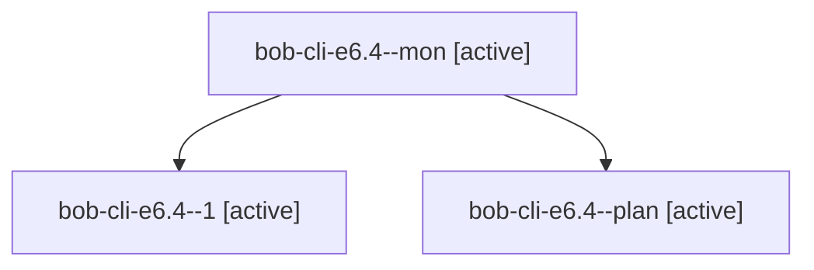

# Session: bob-cli-e6.4

[Agent Hoods](../README.md) / [bbugyi200](../users/bbugyi200/README.md) / [apollo](../users/bbugyi200/machines/apollo/README.md) / [bob-cli-e6](../users/bbugyi200/machines/apollo/hoods/bob-cli-e6/README.md) / bob-cli-e6.4

Owner: `bbugyi200.apollo` · Hood: `bob-cli-e6` · Members: 3 · Bead: [bob-cli-e6.4](https://github.com/bobs-org/bob-cli--beads/blob/main/pages/bob-cli-e6/bob-cli-e6.4.md)

## Lineage

The diagram is an optional enhancement; the ordered table below contains the same lineage in accessible text.

| Role | Agent | State | Model / provider | Timing | Commits | Prompt | Chat |
|---|---|---|---|---|---:|---|---|
| mon | bob-cli-e6.4--mon | active | gpt-6-luna / codex | 2026-10-29T22:25:19.509724+00:00 | 0 | — | [Chat](../agents/bbugyi200.apollo.bob-cli-e6.4--mon/chat.md) |
| 1 | bob-cli-e6.4--1 | active | gpt-6-luna / codex | 2026-10-29T22:37:10.797593+00:00 | [1](../agents/bbugyi200.apollo.bob-cli-e6.4--1/README.md#commits) | [Prompt](../agents/bbugyi200.apollo.bob-cli-e6.4--1/prompt.md) | [Chat](../agents/bbugyi200.apollo.bob-cli-e6.4--1/chat.md) |
| plan | bob-cli-e6.4--plan | active | gpt-6-luna / codex | 2026-10-29T22:12:16.111849+00:00 | 0 | [Prompt](../agents/bbugyi200.apollo.bob-cli-e6.4--plan/prompt.md) | [Chat](../agents/bbugyi200.apollo.bob-cli-e6.4--plan/chat.md) |

## Commits

| Role | Repo | Commit | Subject | Committed |
|---|---|---|---|---|
| 1 | bob-cli | [`66ddba9`](https://github.com/bobs-org/bob-cli/commit/66ddba93b03804bc07abd581ef7cb22ccd35d984) | feat(config): add global default task type | 2026-10-29 19:01:21 EDT |

## Neighbors

| Agent | Relation | State |
|---|---|---|
| [bob-cli-e6.1](bbugyi200.apollo.bob-cli-e6.1.md) (session · 5) | bob-cli-e6 hood | active 5 |
| [bob-cli-e6.10](../agents/bbugyi200.apollo.bob-cli-e6.10/README.md) | bob-cli-e6 hood | active |
| [bob-cli-e6.11](../agents/bbugyi200.apollo.bob-cli-e6.11/README.md) | bob-cli-e6 hood | active |
| [bob-cli-e6.12](../agents/bbugyi200.apollo.bob-cli-e6.12/README.md) | bob-cli-e6 hood | active |
| [bob-cli-e6.13](../agents/bbugyi200.apollo.bob-cli-e6.13/README.md) | bob-cli-e6 hood | active |
| [bob-cli-e6.14](../agents/bbugyi200.apollo.bob-cli-e6.14/README.md) | bob-cli-e6 hood | active |
| [bob-cli-e6.15](../agents/bbugyi200.apollo.bob-cli-e6.15/README.md) | bob-cli-e6 hood | active |
| [bob-cli-e6.16](../agents/bbugyi200.apollo.bob-cli-e6.16/README.md) | bob-cli-e6 hood | active |
| [bob-cli-e6.2](../agents/bbugyi200.apollo.bob-cli-e6.2/README.md) | bob-cli-e6 hood | active |
| [bob-cli-e6.3](bbugyi200.apollo.bob-cli-e6.3.md) (session · 5) | bob-cli-e6 hood | active 5 |
| [bob-cli-e6.5](../agents/bbugyi200.apollo.bob-cli-e6.5/README.md) | bob-cli-e6 hood | active |
| [bob-cli-e6.6](../agents/bbugyi200.apollo.bob-cli-e6.6/README.md) | bob-cli-e6 hood | active |
| [bob-cli-e6.7](../agents/bbugyi200.apollo.bob-cli-e6.7/README.md) | bob-cli-e6 hood | active |
| [bob-cli-e6.8](../agents/bbugyi200.apollo.bob-cli-e6.8/README.md) | bob-cli-e6 hood | active |
| [bob-cli-e6.9](../agents/bbugyi200.apollo.bob-cli-e6.9/README.md) | bob-cli-e6 hood | active |
| [bob-cli-e6.land](../agents/bbugyi200.apollo.bob-cli-e6.land/README.md) | bob-cli-e6 hood | active |
