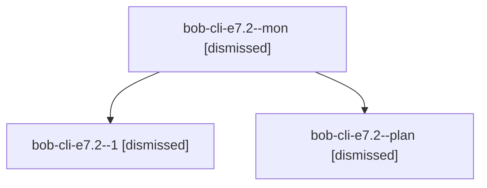

# Session: bob-cli-e7.2

[Agent Hoods](../README.md) / [bbugyi200](../users/bbugyi200/README.md) / [apollo](../users/bbugyi200/machines/apollo/README.md) / [bob-cli-e7](../users/bbugyi200/machines/apollo/hoods/bob-cli-e7/README.md) / bob-cli-e7.2

Owner: `bbugyi200.apollo` · Hood: `bob-cli-e7` · Members: 3 · Bead: [bob-cli-e7.2](https://github.com/bobs-org/bob-cli--beads/blob/main/pages/bob-cli-e7/bob-cli-e7.2.md)

## Lineage

The diagram is an optional enhancement; the ordered table below contains the same lineage in accessible text.

| Role | Agent | State | Model / provider | Timing | Commits | Prompt | Chat |
|---|---|---|---|---|---:|---|---|
| mon | bob-cli-e7.2--mon | dismissed | grok-4.6 / grok | 2026-10-29T17:46:22.880744 → 2026-10-29T17:50:59.333932 | 0 | — | [Chat](../agents/bbugyi200.apollo.bob-cli-e7.2--mon/chat.md) |
| 1 | bob-cli-e7.2--1 | dismissed | grok-4.6 / grok | 2026-10-29T17:52:14.786010 → 2026-10-29T18:13:42.219047 | [1](../agents/bbugyi200.apollo.bob-cli-e7.2--1/README.md#commits) | [Prompt](../agents/bbugyi200.apollo.bob-cli-e7.2--1/prompt.md) | [Chat](../agents/bbugyi200.apollo.bob-cli-e7.2--1/chat.md) |
| plan | bob-cli-e7.2--plan | dismissed | grok-4.6 / grok | 2026-10-29T17:04:00.157368 → 2026-10-29T17:47:33.508886 | 0 | [Prompt](../agents/bbugyi200.apollo.bob-cli-e7.2--plan/prompt.md) | [Chat](../agents/bbugyi200.apollo.bob-cli-e7.2--plan/chat.md) |

## Commits

| Role | Repo | Commit | Subject | Committed |
|---|---|---|---|---|
| 1 | — | `53bf3df` | feat(capture): add wikilink\_task (( completion contract | 2026-10-29 18:09:17 EDT |

## Neighbors

| Agent | Relation | State |
|---|---|---|
| [bob-cli-e7.1](bbugyi200.apollo.bob-cli-e7.1.md) (session · 3) | bob-cli-e7 hood | dismissed 3 |
| [bob-cli-e7.3](../agents/bbugyi200.apollo.bob-cli-e7.3/README.md) | bob-cli-e7 hood | dismissed |
| [bob-cli-e7.4](../agents/bbugyi200.apollo.bob-cli-e7.4/README.md) | bob-cli-e7 hood | dismissed |
| [bob-cli-e7.land](bbugyi200.apollo.bob-cli-e7.land.md) (session · 4) | bob-cli-e7 hood | completed 2, dismissed 2 |
