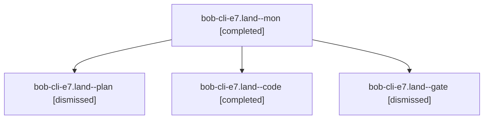

# Session: bob-cli-e7.land

[Agent Hoods](../README.md) / [bbugyi200](../users/bbugyi200/README.md) / [apollo](../users/bbugyi200/machines/apollo/README.md) / [bob-cli-e7](../users/bbugyi200/machines/apollo/hoods/bob-cli-e7/README.md) / bob-cli-e7.land

Owner: `bbugyi200.apollo` · Hood: `bob-cli-e7` · Members: 4 · Bead: [bob-cli-e7](https://github.com/bobs-org/bob-cli--beads/blob/main/pages/bob-cli-e7/README.md)

## Lineage

The diagram is an optional enhancement; the ordered table below contains the same lineage in accessible text.

| Role | Agent | State | Model / provider | Timing | Commits | Prompt | Chat |
|---|---|---|---|---|---:|---|---|
| mon | bob-cli-e7.land--mon | completed | muse-spark-1.3-contributor / muse | 2026-10-30T01:11:18.705672+00:00 → 2026-10-30T01:12:36.852567+00:00 | 0 | — | [Chat](../agents/bbugyi200.apollo.bob-cli-e7.land--mon/chat.md) |
| plan | bob-cli-e7.land--plan | dismissed | gpt-6-astra / codex | 2026-10-29T20:07:23.843806 → 2026-10-29T21:13:37.119451 | 0 | [Prompt](../agents/bbugyi200.apollo.bob-cli-e7.land--plan/prompt.md) | [Chat](../agents/bbugyi200.apollo.bob-cli-e7.land--plan/chat.md) |
| code | bob-cli-e7.land--code | completed | muse-spark-1.3-contributor / muse | 2026-10-30T00:19:49.277991+00:00 → 2026-10-30T01:13:37.076177+00:00 | 0 | — | [Chat](../agents/bbugyi200.apollo.bob-cli-e7.land--code/chat.md) |
| gate | bob-cli-e7.land--gate | dismissed | gpt-6-astra / codex | 2026-10-29T20:19:17.462673 → 2026-10-29T20:19:33 | 0 | — | [Chat](../agents/bbugyi200.apollo.bob-cli-e7.land--gate/chat.md) |

## Neighbors

| Agent | Relation | State |
|---|---|---|
| [bob-cli-e7.1](bbugyi200.apollo.bob-cli-e7.1.md) (session · 3) | bob-cli-e7 hood | dismissed 3 |
| [bob-cli-e7.2](bbugyi200.apollo.bob-cli-e7.2.md) (session · 3) | bob-cli-e7 hood | dismissed 3 |
| [bob-cli-e7.3](../agents/bbugyi200.apollo.bob-cli-e7.3/README.md) | bob-cli-e7 hood | dismissed |
| [bob-cli-e7.4](../agents/bbugyi200.apollo.bob-cli-e7.4/README.md) | bob-cli-e7 hood | dismissed |
