# Session: bob-cli-e8.2

[Agent Hoods](../README.md) / [bbugyi200](../users/bbugyi200/README.md) / [apollo](../users/bbugyi200/machines/apollo/README.md) / [bob-cli-e8](../users/bbugyi200/machines/apollo/hoods/bob-cli-e8/README.md) / bob-cli-e8.2

Owner: `bbugyi200.apollo` · Hood: `bob-cli-e8` · Members: 15 · Bead: [bob-cli-e8.2](https://github.com/bobs-org/bob-cli--beads/blob/main/pages/bob-cli-e8/bob-cli-e8.2.md)

## Lineage

```mermaid
flowchart TD
  n0["bob-cli-e8.2--mon-5 [active]"]
  n1["bob-cli-e8.2--3 [active]"]
  n0 --> n1
  n2["bob-cli-e8.2--mon-4 [active]"]
  n0 --> n2
  n3["bob-cli-e8.2--mon-3 [active]"]
  n0 --> n3
  n4["bob-cli-e8.2--6 [active]"]
  n0 --> n4
  n5["bob-cli-e8.2--mon [active]"]
  n0 --> n5
  n6["bob-cli-e8.2--mon-1 [active]"]
  n0 --> n6
  n7["bob-cli-e8.2--plan [active]"]
  n0 --> n7
  n8["bob-cli-e8.2--4 [active]"]
  n0 --> n8
  n9["bob-cli-e8.2--2 [active]"]
  n0 --> n9
  n10["bob-cli-e8.2--mon-0 [active]"]
  n0 --> n10
  n11["bob-cli-e8.2--mon-2 [active]"]
  n0 --> n11
  n12["bob-cli-e8.2--1 [active]"]
  n0 --> n12
  n13["bob-cli-e8.2--7 [active]"]
  n0 --> n13
  n14["bob-cli-e8.2--5 [active]"]
  n0 --> n14
```

The diagram is an optional enhancement; the ordered table below contains the same lineage in accessible text.

| Role | Agent | State | Model / provider | Timing | Commits | Prompt | Chat |
|---|---|---|---|---|---:|---|---|
| mon-5 | bob-cli-e8.2--mon-5 | active | gpt-6-luna / codex | 2026-10-29T23:56:51.025424+00:00 | 0 | — | [Chat](../agents/bbugyi200.apollo.bob-cli-e8.2--mon-5/chat.md) |
| 3 | bob-cli-e8.2--3 | active | gpt-6-luna / codex | 2026-10-29T23:10:35.431318+00:00 | 0 | [Prompt](../agents/bbugyi200.apollo.bob-cli-e8.2--3/prompt.md) | [Chat](../agents/bbugyi200.apollo.bob-cli-e8.2--3/chat.md) |
| mon-4 | bob-cli-e8.2--mon-4 | active | gpt-6-luna / codex | 2026-10-29T23:49:58.042256+00:00 | 0 | — | [Chat](../agents/bbugyi200.apollo.bob-cli-e8.2--mon-4/chat.md) |
| mon-3 | bob-cli-e8.2--mon-3 | active | gpt-6-luna / codex | 2026-10-29T23:27:39.018683+00:00 | 0 | — | [Chat](../agents/bbugyi200.apollo.bob-cli-e8.2--mon-3/chat.md) |
| 6 | bob-cli-e8.2--6 | active | gpt-6-luna / codex | 2026-10-29T23:54:41.592174+00:00 | 0 | [Prompt](../agents/bbugyi200.apollo.bob-cli-e8.2--6/prompt.md) | [Chat](../agents/bbugyi200.apollo.bob-cli-e8.2--6/chat.md) |
| mon | bob-cli-e8.2--mon | active | gpt-6-luna / codex | 2026-10-29T22:20:57.868068+00:00 | 0 | — | [Chat](../agents/bbugyi200.apollo.bob-cli-e8.2--mon/chat.md) |
| mon-1 | bob-cli-e8.2--mon-1 | active | gpt-6-luna / codex | 2026-10-29T22:48:11.354681+00:00 | 0 | — | [Chat](../agents/bbugyi200.apollo.bob-cli-e8.2--mon-1/chat.md) |
| plan | bob-cli-e8.2--plan | active | gpt-6-luna / codex | 2026-10-29T22:12:48.824985+00:00 | 0 | [Prompt](../agents/bbugyi200.apollo.bob-cli-e8.2--plan/prompt.md) | [Chat](../agents/bbugyi200.apollo.bob-cli-e8.2--plan/chat.md) |
| 4 | bob-cli-e8.2--4 | active | gpt-6-luna / codex | 2026-10-29T23:25:38.405498+00:00 | 0 | [Prompt](../agents/bbugyi200.apollo.bob-cli-e8.2--4/prompt.md) | [Chat](../agents/bbugyi200.apollo.bob-cli-e8.2--4/chat.md) |
| 2 | bob-cli-e8.2--2 | active | gpt-6-luna / codex | 2026-10-29T22:46:00.911621+00:00 | 0 | [Prompt](../agents/bbugyi200.apollo.bob-cli-e8.2--2/prompt.md) | [Chat](../agents/bbugyi200.apollo.bob-cli-e8.2--2/chat.md) |
| mon-0 | bob-cli-e8.2--mon-0 | active | gpt-6-luna / codex | 2026-10-29T22:26:32.529207+00:00 | 0 | — | [Chat](../agents/bbugyi200.apollo.bob-cli-e8.2--mon-0/chat.md) |
| mon-2 | bob-cli-e8.2--mon-2 | active | gpt-6-luna / codex | 2026-10-29T23:13:30.082044+00:00 | 0 | — | [Chat](../agents/bbugyi200.apollo.bob-cli-e8.2--mon-2/chat.md) |
| 1 | bob-cli-e8.2--1 | active | gpt-6-luna / codex | 2026-10-29T22:24:48.492065+00:00 | 0 | [Prompt](../agents/bbugyi200.apollo.bob-cli-e8.2--1/prompt.md) | [Chat](../agents/bbugyi200.apollo.bob-cli-e8.2--1/chat.md) |
| 7 | bob-cli-e8.2--7 | active | gpt-6-luna / codex | 2026-10-30T00:01:01.466807+00:00 | [1](../agents/bbugyi200.apollo.bob-cli-e8.2--7/README.md#commits) | [Prompt](../agents/bbugyi200.apollo.bob-cli-e8.2--7/prompt.md) | [Chat](../agents/bbugyi200.apollo.bob-cli-e8.2--7/chat.md) |
| 5 | bob-cli-e8.2--5 | active | gpt-6-luna / codex | 2026-10-29T23:48:19.514788+00:00 | 0 | [Prompt](../agents/bbugyi200.apollo.bob-cli-e8.2--5/prompt.md) | [Chat](../agents/bbugyi200.apollo.bob-cli-e8.2--5/chat.md) |

## Commits

| Role | Repo | Commit | Subject | Committed |
|---|---|---|---|---|
| 7 | bob-cli | [`41338bc`](https://github.com/bobs-org/bob-cli/commit/41338bcfdf28959528b3f94471e2f16928ae53b6) | feat(task-relations): parse and preserve text mentions | 2026-10-29 20:03:12 EDT |

## Neighbors

| Agent | Relation | State |
|---|---|---|
| [bob-cli-e8.1](../agents/bbugyi200.apollo.bob-cli-e8.1/README.md) | bob-cli-e8 hood | active |
| [bob-cli-e8.3](../agents/bbugyi200.apollo.bob-cli-e8.3/README.md) | bob-cli-e8 hood | active |
| [bob-cli-e8.4](../agents/bbugyi200.apollo.bob-cli-e8.4/README.md) | bob-cli-e8 hood | active |
| [bob-cli-e8.5](../agents/bbugyi200.apollo.bob-cli-e8.5/README.md) | bob-cli-e8 hood | active |
| [bob-cli-e8.6](../agents/bbugyi200.apollo.bob-cli-e8.6/README.md) | bob-cli-e8 hood | active |
| [bob-cli-e8.7](../agents/bbugyi200.apollo.bob-cli-e8.7/README.md) | bob-cli-e8 hood | active |
| [bob-cli-e8.8](../agents/bbugyi200.apollo.bob-cli-e8.8/README.md) | bob-cli-e8 hood | active |
| [bob-cli-e8.9](bbugyi200.apollo.bob-cli-e8.9.md) (session · 7) | bob-cli-e8 hood | active 7 |
| [bob-cli-e8.land](../agents/bbugyi200.apollo.bob-cli-e8.land/README.md) | bob-cli-e8 hood | active |
