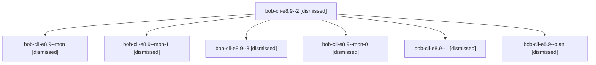

# Session: bob-cli-e8.9

[Agent Hoods](../README.md) / [bbugyi200](../users/bbugyi200/README.md) / [apollo](../users/bbugyi200/machines/apollo/README.md) / [bob-cli-e8](../users/bbugyi200/machines/apollo/hoods/bob-cli-e8/README.md) / bob-cli-e8.9

Owner: `bbugyi200.apollo` · Hood: `bob-cli-e8` · Members: 7 · Bead: [bob-cli-e8.9](https://github.com/bobs-org/bob-cli--beads/blob/main/pages/bob-cli-e8/bob-cli-e8.9.md)

## Lineage

The diagram is an optional enhancement; the ordered table below contains the same lineage in accessible text.

| Role | Agent | State | Model / provider | Timing | Commits | Prompt | Chat |
|---|---|---|---|---|---:|---|---|
| 2 | bob-cli-e8.9--2 | dismissed | gpt-6-luna / codex | 2026-10-30T09:54:40.810705 → 2026-10-30T10:00:17.613298 | 0 | [Prompt](../agents/bbugyi200.apollo.bob-cli-e8.9--2/prompt.md) | [Chat](../agents/bbugyi200.apollo.bob-cli-e8.9--2/chat.md) |
| mon | bob-cli-e8.9--mon | dismissed | gpt-6-luna / codex | 2026-10-30T09:47:53.519945 → 2026-10-30T09:49:11.688337 | 0 | — | [Chat](../agents/bbugyi200.apollo.bob-cli-e8.9--mon/chat.md) |
| mon-1 | bob-cli-e8.9--mon-1 | dismissed | gpt-6-luna / codex | 2026-10-30T09:59:57.311188 → 2026-10-30T10:01:17.831624 | 0 | — | [Chat](../agents/bbugyi200.apollo.bob-cli-e8.9--mon-1/chat.md) |
| 3 | bob-cli-e8.9--3 | dismissed | gpt-6-luna / codex | 2026-10-30T10:02:49.352121 → 2026-10-30T10:29:09.587809 | [1](../agents/bbugyi200.apollo.bob-cli-e8.9--3/README.md#commits) | [Prompt](../agents/bbugyi200.apollo.bob-cli-e8.9--3/prompt.md) | [Chat](../agents/bbugyi200.apollo.bob-cli-e8.9--3/chat.md) |
| mon-0 | bob-cli-e8.9--mon-0 | dismissed | gpt-6-luna / codex | 2026-10-30T09:52:12.497549 → 2026-10-30T09:53:12.228450 | 0 | — | [Chat](../agents/bbugyi200.apollo.bob-cli-e8.9--mon-0/chat.md) |
| 1 | bob-cli-e8.9--1 | dismissed | gpt-6-luna / codex | 2026-10-30T09:50:30.885232 → 2026-10-30T09:52:20.218316 | 0 | [Prompt](../agents/bbugyi200.apollo.bob-cli-e8.9--1/prompt.md) | [Chat](../agents/bbugyi200.apollo.bob-cli-e8.9--1/chat.md) |
| plan | bob-cli-e8.9--plan | dismissed | gpt-6-luna / codex | 2026-10-30T09:43:40.215811 → 2026-10-30T09:48:00.975614 | 0 | [Prompt](../agents/bbugyi200.apollo.bob-cli-e8.9--plan/prompt.md) | [Chat](../agents/bbugyi200.apollo.bob-cli-e8.9--plan/chat.md) |

## Commits

| Role | Repo | Commit | Subject | Committed |
|---|---|---|---|---|
| 3 | — | `b081097` | feat(task-mentions): enable linked-from mentions by default | 2026-10-30 10:28:00 EDT |

## Neighbors

| Agent | Relation | State |
|---|---|---|
| [bob-cli-e8.1](../agents/bbugyi200.apollo.bob-cli-e8.1/README.md) | bob-cli-e8 hood | dismissed |
| [bob-cli-e8.2](bbugyi200.apollo.bob-cli-e8.2.md) (session · 15) | bob-cli-e8 hood | active 1, dismissed 14 |
| [bob-cli-e8.3](../agents/bbugyi200.apollo.bob-cli-e8.3/README.md) | bob-cli-e8 hood | dismissed |
| [bob-cli-e8.4](../agents/bbugyi200.apollo.bob-cli-e8.4/README.md) | bob-cli-e8 hood | dismissed |
| [bob-cli-e8.5](../agents/bbugyi200.apollo.bob-cli-e8.5/README.md) | bob-cli-e8 hood | active |
| [bob-cli-e8.6](../agents/bbugyi200.apollo.bob-cli-e8.6/README.md) | bob-cli-e8 hood | dismissed |
| [bob-cli-e8.7](../agents/bbugyi200.apollo.bob-cli-e8.7/README.md) | bob-cli-e8 hood | dismissed |
| [bob-cli-e8.8](../agents/bbugyi200.apollo.bob-cli-e8.8/README.md) | bob-cli-e8 hood | dismissed |
| [bob-cli-e8.land](../agents/bbugyi200.apollo.bob-cli-e8.land/README.md) | bob-cli-e8 hood | dismissed |
