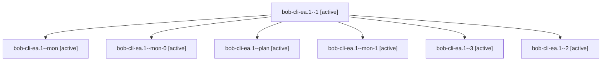

# Session: bob-cli-ea.1

[Agent Hoods](../README.md) / [bbugyi200](../users/bbugyi200/README.md) / [apollo](../users/bbugyi200/machines/apollo/README.md) / [bob-cli-ea](../users/bbugyi200/machines/apollo/hoods/bob-cli-ea/README.md) / bob-cli-ea.1

Owner: `bbugyi200.apollo` · Hood: `bob-cli-ea` · Members: 7 · Bead: [bob-cli-ea.1](https://github.com/bobs-org/bob-cli--beads/blob/main/pages/bob-cli-ea/bob-cli-ea.1.md)

## Lineage

The diagram is an optional enhancement; the ordered table below contains the same lineage in accessible text.

| Role | Agent | State | Model / provider | Timing | Commits | Prompt | Chat |
|---|---|---|---|---|---:|---|---|
| 1 | bob-cli-ea.1--1 | active | grok-4.6 / grok | 2026-10-30T00:14:01.896129+00:00 | 0 | [Prompt](../agents/bbugyi200.apollo.bob-cli-ea.1--1/prompt.md) | [Chat](../agents/bbugyi200.apollo.bob-cli-ea.1--1/chat.md) |
| mon | bob-cli-ea.1--mon | active | grok-4.6 / grok | 2026-10-30T00:11:34.998881+00:00 | 0 | — | [Chat](../agents/bbugyi200.apollo.bob-cli-ea.1--mon/chat.md) |
| mon-0 | bob-cli-ea.1--mon-0 | active | grok-4.6 / grok | 2026-10-30T00:18:03.685747+00:00 | 0 | — | [Chat](../agents/bbugyi200.apollo.bob-cli-ea.1--mon-0/chat.md) |
| plan | bob-cli-ea.1--plan | active | grok-4.6 / grok | 2026-10-29T23:59:54.859000+00:00 | 0 | [Prompt](../agents/bbugyi200.apollo.bob-cli-ea.1--plan/prompt.md) | [Chat](../agents/bbugyi200.apollo.bob-cli-ea.1--plan/chat.md) |
| mon-1 | bob-cli-ea.1--mon-1 | active | grok-4.6 / grok | 2026-10-30T01:31:34.369125+00:00 | 0 | — | [Chat](../agents/bbugyi200.apollo.bob-cli-ea.1--mon-1/chat.md) |
| 3 | bob-cli-ea.1--3 | active | grok-4.6 / grok | 2026-10-30T01:47:27.038487+00:00 | [1](../agents/bbugyi200.apollo.bob-cli-ea.1--3/README.md#commits) | [Prompt](../agents/bbugyi200.apollo.bob-cli-ea.1--3/prompt.md) | [Chat](../agents/bbugyi200.apollo.bob-cli-ea.1--3/chat.md) |
| 2 | bob-cli-ea.1--2 | active | grok-4.6 / grok | 2026-10-30T01:13:43.760345+00:00 | 0 | [Prompt](../agents/bbugyi200.apollo.bob-cli-ea.1--2/prompt.md) | [Chat](../agents/bbugyi200.apollo.bob-cli-ea.1--2/chat.md) |

## Commits

| Role | Repo | Commit | Subject | Committed |
|---|---|---|---|---|
| 3 | bob-cli | [`1dc5fa4`](https://github.com/bobs-org/bob-cli/commit/1dc5fa427d63cb6382859f7cf1bf4cd58fcda808) | docs(homes): record meet as a top-level violet area | 2026-10-29 22:02:24 EDT |

## Neighbors

| Agent | Relation | State |
|---|---|---|
| [bob-cli-ea.2](bbugyi200.apollo.bob-cli-ea.2.md) (session · 9) | bob-cli-ea hood | active 9 |
| [bob-cli-ea.3](../agents/bbugyi200.apollo.bob-cli-ea.3/README.md) | bob-cli-ea hood | active |
| [bob-cli-ea.4](bbugyi200.apollo.bob-cli-ea.4.md) (session · 7) | bob-cli-ea hood | active 7 |
| [bob-cli-ea.5](bbugyi200.apollo.bob-cli-ea.5.md) (session · 3) | bob-cli-ea hood | active 3 |
| [bob-cli-ea.6](../agents/bbugyi200.apollo.bob-cli-ea.6/README.md) | bob-cli-ea hood | active |
| [bob-cli-ea.7](../agents/bbugyi200.apollo.bob-cli-ea.7/README.md) | bob-cli-ea hood | active |
| [bob-cli-ea.8](../agents/bbugyi200.apollo.bob-cli-ea.8/README.md) | bob-cli-ea hood | active |
| [bob-cli-ea.9](../agents/bbugyi200.apollo.bob-cli-ea.9/README.md) | bob-cli-ea hood | active |
| [bob-cli-ea.land](../agents/bbugyi200.apollo.bob-cli-ea.land/README.md) | bob-cli-ea hood | active |
