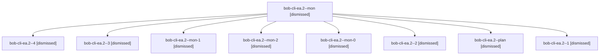

# Session: bob-cli-ea.2

[Agent Hoods](../README.md) / [bbugyi200](../users/bbugyi200/README.md) / [apollo](../users/bbugyi200/machines/apollo/README.md) / [bob-cli-ea](../users/bbugyi200/machines/apollo/hoods/bob-cli-ea/README.md) / bob-cli-ea.2

Owner: `bbugyi200.apollo` · Hood: `bob-cli-ea` · Members: 9 · Bead: [bob-cli-ea.2](https://github.com/bobs-org/bob-cli--beads/blob/main/pages/bob-cli-ea/bob-cli-ea.2.md)

## Lineage

The diagram is an optional enhancement; the ordered table below contains the same lineage in accessible text.

| Role | Agent | State | Model / provider | Timing | Commits | Prompt | Chat |
|---|---|---|---|---|---:|---|---|
| mon | bob-cli-ea.2--mon | dismissed | gpt-6-luna / codex | 2026-10-29T20:06:24.607253 → 2026-10-29T20:10:29.272328 | 0 | — | [Chat](../agents/bbugyi200.apollo.bob-cli-ea.2--mon/chat.md) |
| 4 | bob-cli-ea.2--4 | dismissed | gpt-6-luna / codex | 2026-10-29T22:47:35.121112 → 2026-10-29T22:55:04.086375 | [1](../agents/bbugyi200.apollo.bob-cli-ea.2--4/README.md#commits) | [Prompt](../agents/bbugyi200.apollo.bob-cli-ea.2--4/prompt.md) | [Chat](../agents/bbugyi200.apollo.bob-cli-ea.2--4/chat.md) |
| 3 | bob-cli-ea.2--3 | dismissed | gpt-6-luna / codex | 2026-10-29T21:46:10.565482 → 2026-10-29T21:50:09.186762 | 0 | [Prompt](../agents/bbugyi200.apollo.bob-cli-ea.2--3/prompt.md) | [Chat](../agents/bbugyi200.apollo.bob-cli-ea.2--3/chat.md) |
| mon-1 | bob-cli-ea.2--mon-1 | dismissed | gpt-6-luna / codex | 2026-10-29T21:36:02.334812 → 2026-10-29T21:40:02.861679 | 0 | — | [Chat](../agents/bbugyi200.apollo.bob-cli-ea.2--mon-1/chat.md) |
| mon-2 | bob-cli-ea.2--mon-2 | dismissed | gpt-6-luna / codex | 2026-10-29T21:49:00.454447 → 2026-10-29T21:56:03.511685 | 0 | — | [Chat](../agents/bbugyi200.apollo.bob-cli-ea.2--mon-2/chat.md) |
| mon-0 | bob-cli-ea.2--mon-0 | dismissed | gpt-6-luna / codex | 2026-10-29T20:31:26.834932 → 2026-10-29T20:34:50.378246 | 0 | — | [Chat](../agents/bbugyi200.apollo.bob-cli-ea.2--mon-0/chat.md) |
| 2 | bob-cli-ea.2--2 | dismissed | gpt-6-luna / codex | 2026-10-29T21:33:16.926249 → 2026-10-29T21:38:46.970343 | 0 | [Prompt](../agents/bbugyi200.apollo.bob-cli-ea.2--2/prompt.md) | [Chat](../agents/bbugyi200.apollo.bob-cli-ea.2--2/chat.md) |
| plan | bob-cli-ea.2--plan | dismissed | gpt-6-luna / codex | 2026-10-29T19:52:18.459944 → 2026-10-29T20:07:50.024350 | 0 | [Prompt](../agents/bbugyi200.apollo.bob-cli-ea.2--plan/prompt.md) | [Chat](../agents/bbugyi200.apollo.bob-cli-ea.2--plan/chat.md) |
| 1 | bob-cli-ea.2--1 | dismissed | gpt-6-luna / codex | 2026-10-29T20:28:35.958931 → 2026-10-29T20:32:46.942885 | 0 | [Prompt](../agents/bbugyi200.apollo.bob-cli-ea.2--1/prompt.md) | [Chat](../agents/bbugyi200.apollo.bob-cli-ea.2--1/chat.md) |

## Commits

| Role | Repo | Commit | Subject | Committed |
|---|---|---|---|---|
| 4 | — | `4f2828e` | feat(capture): close event tasks by meeting clock | 2026-10-29 22:50:50 EDT |

## Neighbors

| Agent | Relation | State |
|---|---|---|
| [bob-cli-ea.1](bbugyi200.apollo.bob-cli-ea.1.md) (session · 7) | bob-cli-ea hood | dismissed 7 |
| [bob-cli-ea.3](../agents/bbugyi200.apollo.bob-cli-ea.3/README.md) | bob-cli-ea hood | dismissed |
| [bob-cli-ea.4](bbugyi200.apollo.bob-cli-ea.4.md) (session · 7) | bob-cli-ea hood | dismissed 7 |
| [bob-cli-ea.5](bbugyi200.apollo.bob-cli-ea.5.md) (session · 3) | bob-cli-ea hood | dismissed 3 |
| [bob-cli-ea.6](../agents/bbugyi200.apollo.bob-cli-ea.6/README.md) | bob-cli-ea hood | dismissed |
| [bob-cli-ea.7](../agents/bbugyi200.apollo.bob-cli-ea.7/README.md) | bob-cli-ea hood | dismissed |
| [bob-cli-ea.8](../agents/bbugyi200.apollo.bob-cli-ea.8/README.md) | bob-cli-ea hood | dismissed |
| [bob-cli-ea.9](../agents/bbugyi200.apollo.bob-cli-ea.9/README.md) | bob-cli-ea hood | dismissed |
| [bob-cli-ea.land](../agents/bbugyi200.apollo.bob-cli-ea.land/README.md) | bob-cli-ea hood | dismissed |
