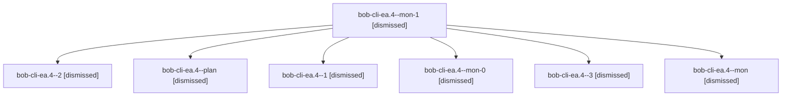

# Session: bob-cli-ea.4

[Agent Hoods](../README.md) / [bbugyi200](../users/bbugyi200/README.md) / [apollo](../users/bbugyi200/machines/apollo/README.md) / [bob-cli-ea](../users/bbugyi200/machines/apollo/hoods/bob-cli-ea/README.md) / bob-cli-ea.4

Owner: `bbugyi200.apollo` · Hood: `bob-cli-ea` · Members: 7 · Bead: [bob-cli-ea.4](https://github.com/bobs-org/bob-cli--beads/blob/main/pages/bob-cli-ea/bob-cli-ea.4.md)

## Lineage

The diagram is an optional enhancement; the ordered table below contains the same lineage in accessible text.

| Role | Agent | State | Model / provider | Timing | Commits | Prompt | Chat |
|---|---|---|---|---|---:|---|---|
| mon-1 | bob-cli-ea.4--mon-1 | dismissed | grok-4.6 / grok | 2026-10-29T22:05:49.821672 → 2026-10-29T22:14:45.105578 | 0 | — | [Chat](../agents/bbugyi200.apollo.bob-cli-ea.4--mon-1/chat.md) |
| 2 | bob-cli-ea.4--2 | dismissed | grok-4.6 / grok | 2026-10-29T21:55:58.730095 → 2026-10-29T22:06:59.634335 | 0 | [Prompt](../agents/bbugyi200.apollo.bob-cli-ea.4--2/prompt.md) | [Chat](../agents/bbugyi200.apollo.bob-cli-ea.4--2/chat.md) |
| plan | bob-cli-ea.4--plan | dismissed | grok-4.6 / grok | 2026-10-29T20:03:02.860510 → 2026-10-29T21:14:39.099293 | 0 | [Prompt](../agents/bbugyi200.apollo.bob-cli-ea.4--plan/prompt.md) | [Chat](../agents/bbugyi200.apollo.bob-cli-ea.4--plan/chat.md) |
| 1 | bob-cli-ea.4--1 | dismissed | grok-4.6 / grok | 2026-10-29T21:19:59.740162 → 2026-10-29T21:42:14.120024 | 0 | [Prompt](../agents/bbugyi200.apollo.bob-cli-ea.4--1/prompt.md) | [Chat](../agents/bbugyi200.apollo.bob-cli-ea.4--1/chat.md) |
| mon-0 | bob-cli-ea.4--mon-0 | dismissed | grok-4.6 / grok | 2026-10-29T21:39:17.991571 → 2026-10-29T21:44:49.061582 | 0 | — | [Chat](../agents/bbugyi200.apollo.bob-cli-ea.4--mon-0/chat.md) |
| 3 | bob-cli-ea.4--3 | dismissed | grok-4.6 / grok | 2026-10-29T22:55:10.832935 → 2026-10-29T23:31:59.922863 | [1](../agents/bbugyi200.apollo.bob-cli-ea.4--3/README.md#commits) | [Prompt](../agents/bbugyi200.apollo.bob-cli-ea.4--3/prompt.md) | [Chat](../agents/bbugyi200.apollo.bob-cli-ea.4--3/chat.md) |
| mon | bob-cli-ea.4--mon | dismissed | grok-4.6 / grok | 2026-10-29T21:13:30.440889 → 2026-10-29T21:18:32.015612 | 0 | — | [Chat](../agents/bbugyi200.apollo.bob-cli-ea.4--mon/chat.md) |

## Commits

| Role | Repo | Commit | Subject | Committed |
|---|---|---|---|---|
| 3 | — | `26e6b1d` | feat(gcal): add bob gcal login, logout, doctor, and calendars | 2026-10-29 23:27:30 EDT |

## Neighbors

| Agent | Relation | State |
|---|---|---|
| [bob-cli-ea.1](bbugyi200.apollo.bob-cli-ea.1.md) (session · 7) | bob-cli-ea hood | dismissed 7 |
| [bob-cli-ea.2](bbugyi200.apollo.bob-cli-ea.2.md) (session · 9) | bob-cli-ea hood | dismissed 9 |
| [bob-cli-ea.3](../agents/bbugyi200.apollo.bob-cli-ea.3/README.md) | bob-cli-ea hood | dismissed |
| [bob-cli-ea.5](bbugyi200.apollo.bob-cli-ea.5.md) (session · 3) | bob-cli-ea hood | dismissed 3 |
| [bob-cli-ea.6](../agents/bbugyi200.apollo.bob-cli-ea.6/README.md) | bob-cli-ea hood | dismissed |
| [bob-cli-ea.7](../agents/bbugyi200.apollo.bob-cli-ea.7/README.md) | bob-cli-ea hood | dismissed |
| [bob-cli-ea.8](../agents/bbugyi200.apollo.bob-cli-ea.8/README.md) | bob-cli-ea hood | dismissed |
| [bob-cli-ea.9](../agents/bbugyi200.apollo.bob-cli-ea.9/README.md) | bob-cli-ea hood | dismissed |
| [bob-cli-ea.land](../agents/bbugyi200.apollo.bob-cli-ea.land/README.md) | bob-cli-ea hood | dismissed |
