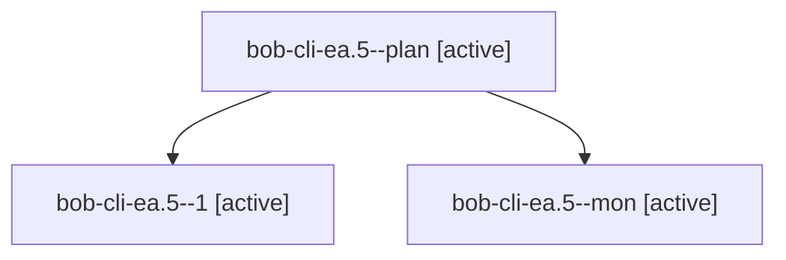

# Session: bob-cli-ea.5

[Agent Hoods](../README.md) / [bbugyi200](../users/bbugyi200/README.md) / [apollo](../users/bbugyi200/machines/apollo/README.md) / [bob-cli-ea](../users/bbugyi200/machines/apollo/hoods/bob-cli-ea/README.md) / bob-cli-ea.5

Owner: `bbugyi200.apollo` · Hood: `bob-cli-ea` · Members: 3 · Bead: [bob-cli-ea.5](https://github.com/bobs-org/bob-cli--beads/blob/main/pages/bob-cli-ea/bob-cli-ea.5.md)

## Lineage

The diagram is an optional enhancement; the ordered table below contains the same lineage in accessible text.

| Role | Agent | State | Model / provider | Timing | Commits | Prompt | Chat |
|---|---|---|---|---|---:|---|---|
| plan | bob-cli-ea.5--plan | active | gpt-6-luna / codex | 2026-10-30T03:32:17.920232+00:00 | 0 | [Prompt](../agents/bbugyi200.apollo.bob-cli-ea.5--plan/prompt.md) | [Chat](../agents/bbugyi200.apollo.bob-cli-ea.5--plan/chat.md) |
| 1 | bob-cli-ea.5--1 | active | gpt-6-luna / codex | 2026-10-30T04:05:21.937548+00:00 | [1](../agents/bbugyi200.apollo.bob-cli-ea.5--1/README.md#commits) | [Prompt](../agents/bbugyi200.apollo.bob-cli-ea.5--1/prompt.md) | [Chat](../agents/bbugyi200.apollo.bob-cli-ea.5--1/chat.md) |
| mon | bob-cli-ea.5--mon | active | gpt-6-luna / codex | 2026-10-30T03:45:40.858428+00:00 | 0 | — | [Chat](../agents/bbugyi200.apollo.bob-cli-ea.5--mon/chat.md) |

## Commits

| Role | Repo | Commit | Subject | Committed |
|---|---|---|---|---|
| 1 | bob-cli | [`44058f6`](https://github.com/bobs-org/bob-cli/commit/44058f67ee227e3de850e5294edc44da21b0b349) | feat(gcal): add calendar list command | 2026-10-30 00:25:23 EDT |

## Neighbors

| Agent | Relation | State |
|---|---|---|
| [bob-cli-ea.1](bbugyi200.apollo.bob-cli-ea.1.md) (session · 7) | bob-cli-ea hood | active 7 |
| [bob-cli-ea.2](bbugyi200.apollo.bob-cli-ea.2.md) (session · 9) | bob-cli-ea hood | active 9 |
| [bob-cli-ea.3](../agents/bbugyi200.apollo.bob-cli-ea.3/README.md) | bob-cli-ea hood | active |
| [bob-cli-ea.4](bbugyi200.apollo.bob-cli-ea.4.md) (session · 7) | bob-cli-ea hood | active 7 |
| [bob-cli-ea.6](../agents/bbugyi200.apollo.bob-cli-ea.6/README.md) | bob-cli-ea hood | active |
| [bob-cli-ea.7](../agents/bbugyi200.apollo.bob-cli-ea.7/README.md) | bob-cli-ea hood | active |
| [bob-cli-ea.8](../agents/bbugyi200.apollo.bob-cli-ea.8/README.md) | bob-cli-ea hood | active |
| [bob-cli-ea.9](../agents/bbugyi200.apollo.bob-cli-ea.9/README.md) | bob-cli-ea hood | active |
| [bob-cli-ea.land](../agents/bbugyi200.apollo.bob-cli-ea.land/README.md) | bob-cli-ea hood | active |
