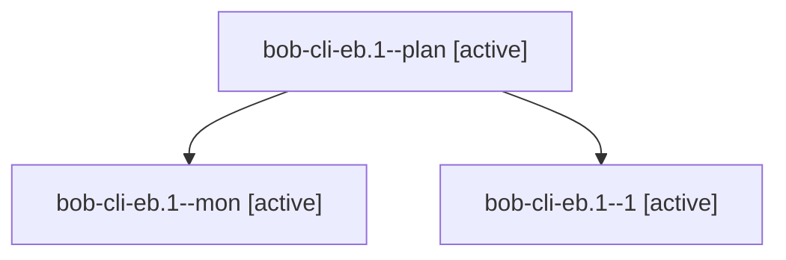

# Session: bob-cli-eb.1

[Agent Hoods](../README.md) / [bbugyi200](../users/bbugyi200/README.md) / [apollo](../users/bbugyi200/machines/apollo/README.md) / [bob-cli-eb](../users/bbugyi200/machines/apollo/hoods/bob-cli-eb/README.md) / bob-cli-eb.1

Owner: `bbugyi200.apollo` · Hood: `bob-cli-eb` · Members: 3 · Bead: [bob-cli-eb.1](https://github.com/bobs-org/bob-cli--beads/blob/main/pages/bob-cli-eb/bob-cli-eb.1.md)

## Lineage

The diagram is an optional enhancement; the ordered table below contains the same lineage in accessible text.

| Role | Agent | State | Model / provider | Timing | Commits | Prompt | Chat |
|---|---|---|---|---|---:|---|---|
| plan | bob-cli-eb.1--plan | active | grok-4.6 / grok | 2026-10-30T00:13:05.762192+00:00 | 0 | [Prompt](../agents/bbugyi200.apollo.bob-cli-eb.1--plan/prompt.md) | [Chat](../agents/bbugyi200.apollo.bob-cli-eb.1--plan/chat.md) |
| mon | bob-cli-eb.1--mon | active | grok-4.6 / grok | 2026-10-30T00:56:37.422744+00:00 | 0 | — | [Chat](../agents/bbugyi200.apollo.bob-cli-eb.1--mon/chat.md) |
| 1 | bob-cli-eb.1--1 | active | grok-4.6 / grok | 2026-10-30T01:41:23.731276+00:00 | [1](../agents/bbugyi200.apollo.bob-cli-eb.1--1/README.md#commits) | [Prompt](../agents/bbugyi200.apollo.bob-cli-eb.1--1/prompt.md) | [Chat](../agents/bbugyi200.apollo.bob-cli-eb.1--1/chat.md) |

## Commits

| Role | Repo | Commit | Subject | Committed |
|---|---|---|---|---|
| 1 | bob-cli | [`b47617d`](https://github.com/bobs-org/bob-cli/commit/b47617dc9e066a9bb0c53ddf724f01f81b7007f0) | feat(ref): embed table-layout Lua pass for prose-table records | 2026-10-29 21:53:00 EDT |

## Neighbors

| Agent | Relation | State |
|---|---|---|
| [bob-cli-eb.2](../agents/bbugyi200.apollo.bob-cli-eb.2/README.md) | bob-cli-eb hood | active |
| [bob-cli-eb.3](bbugyi200.apollo.bob-cli-eb.3.md) (session · 3) | bob-cli-eb hood | active 3 |
| [bob-cli-eb.4](bbugyi200.apollo.bob-cli-eb.4.md) (session · 9) | bob-cli-eb hood | active 9 |
| [bob-cli-eb.5](../agents/bbugyi200.apollo.bob-cli-eb.5/README.md) | bob-cli-eb hood | active |
| [bob-cli-eb.6](bbugyi200.apollo.bob-cli-eb.6.md) (session · 7) | bob-cli-eb hood | active 7 |
| [bob-cli-eb.land](bbugyi200.apollo.bob-cli-eb.land.md) (session · 5) | bob-cli-eb hood | active 3, completed 2 |
