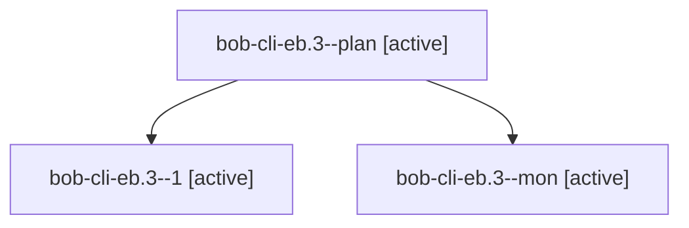

# Session: bob-cli-eb.3

[Agent Hoods](../README.md) / [bbugyi200](../users/bbugyi200/README.md) / [apollo](../users/bbugyi200/machines/apollo/README.md) / [bob-cli-eb](../users/bbugyi200/machines/apollo/hoods/bob-cli-eb/README.md) / bob-cli-eb.3

Owner: `bbugyi200.apollo` · Hood: `bob-cli-eb` · Members: 3 · Bead: [bob-cli-eb.3](https://github.com/bobs-org/bob-cli--beads/blob/main/pages/bob-cli-eb/bob-cli-eb.3.md)

## Lineage

The diagram is an optional enhancement; the ordered table below contains the same lineage in accessible text.

| Role | Agent | State | Model / provider | Timing | Commits | Prompt | Chat |
|---|---|---|---|---|---:|---|---|
| plan | bob-cli-eb.3--plan | active | gpt-6-luna / codex | 2026-10-30T03:45:44.538068+00:00 | 0 | [Prompt](../agents/bbugyi200.apollo.bob-cli-eb.3--plan/prompt.md) | [Chat](../agents/bbugyi200.apollo.bob-cli-eb.3--plan/chat.md) |
| 1 | bob-cli-eb.3--1 | active | gpt-6-luna / codex | 2026-10-30T04:14:14.968980+00:00 | [1](../agents/bbugyi200.apollo.bob-cli-eb.3--1/README.md#commits) | [Prompt](../agents/bbugyi200.apollo.bob-cli-eb.3--1/prompt.md) | [Chat](../agents/bbugyi200.apollo.bob-cli-eb.3--1/chat.md) |
| mon | bob-cli-eb.3--mon | active | gpt-6-luna / codex | 2026-10-30T04:05:14.714325+00:00 | 0 | — | [Chat](../agents/bbugyi200.apollo.bob-cli-eb.3--mon/chat.md) |

## Commits

| Role | Repo | Commit | Subject | Committed |
|---|---|---|---|---|
| 1 | bob-cli | [`66bdd21`](https://github.com/bobs-org/bob-cli/commit/66bdd211e8e8c366b4b53af9828ce2e2e594d029) | feat(highlights): improve grid table widths and row spacing | 2026-10-30 00:22:24 EDT |

## Neighbors

| Agent | Relation | State |
|---|---|---|
| [bob-cli-eb.1](bbugyi200.apollo.bob-cli-eb.1.md) (session · 3) | bob-cli-eb hood | active 3 |
| [bob-cli-eb.2](../agents/bbugyi200.apollo.bob-cli-eb.2/README.md) | bob-cli-eb hood | active |
| [bob-cli-eb.4](bbugyi200.apollo.bob-cli-eb.4.md) (session · 9) | bob-cli-eb hood | active 9 |
| [bob-cli-eb.5](../agents/bbugyi200.apollo.bob-cli-eb.5/README.md) | bob-cli-eb hood | active |
| [bob-cli-eb.6](bbugyi200.apollo.bob-cli-eb.6.md) (session · 7) | bob-cli-eb hood | active 7 |
| [bob-cli-eb.land](bbugyi200.apollo.bob-cli-eb.land.md) (session · 5) | bob-cli-eb hood | active 3, completed 2 |
