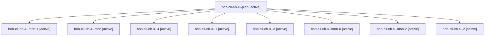

# Session: bob-cli-eb.4

[Agent Hoods](../README.md) / [bbugyi200](../users/bbugyi200/README.md) / [apollo](../users/bbugyi200/machines/apollo/README.md) / [bob-cli-eb](../users/bbugyi200/machines/apollo/hoods/bob-cli-eb/README.md) / bob-cli-eb.4

Owner: `bbugyi200.apollo` · Hood: `bob-cli-eb` · Members: 9 · Bead: [bob-cli-eb.4](https://github.com/bobs-org/bob-cli--beads/blob/main/pages/bob-cli-eb/bob-cli-eb.4.md)

## Lineage

The diagram is an optional enhancement; the ordered table below contains the same lineage in accessible text.

| Role | Agent | State | Model / provider | Timing | Commits | Prompt | Chat |
|---|---|---|---|---|---:|---|---|
| plan | bob-cli-eb.4--plan | active | gpt-6-luna / codex | 2026-10-30T03:49:59.892717+00:00 | 0 | [Prompt](../agents/bbugyi200.apollo.bob-cli-eb.4--plan/prompt.md) | [Chat](../agents/bbugyi200.apollo.bob-cli-eb.4--plan/chat.md) |
| mon-1 | bob-cli-eb.4--mon-1 | active | gpt-6-luna / codex | 2026-10-30T04:30:02.631632+00:00 | 0 | — | [Chat](../agents/bbugyi200.apollo.bob-cli-eb.4--mon-1/chat.md) |
| mon | bob-cli-eb.4--mon | active | gpt-6-luna / codex | 2026-10-30T04:01:22.828609+00:00 | 0 | — | [Chat](../agents/bbugyi200.apollo.bob-cli-eb.4--mon/chat.md) |
| 4 | bob-cli-eb.4--4 | active | muse-spark-1.3-contributor / muse | 2026-10-30T04:51:39.689434+00:00 | [1](../agents/bbugyi200.apollo.bob-cli-eb.4--4/README.md#commits) | [Prompt](../agents/bbugyi200.apollo.bob-cli-eb.4--4/prompt.md) | [Chat](../agents/bbugyi200.apollo.bob-cli-eb.4--4/chat.md) |
| 1 | bob-cli-eb.4--1 | active | gpt-6-luna / codex | 2026-10-30T04:05:14.963528+00:00 | 0 | [Prompt](../agents/bbugyi200.apollo.bob-cli-eb.4--1/prompt.md) | [Chat](../agents/bbugyi200.apollo.bob-cli-eb.4--1/chat.md) |
| 3 | bob-cli-eb.4--3 | active | gpt-6-luna / codex | 2026-10-30T04:36:40.527271+00:00 | 0 | [Prompt](../agents/bbugyi200.apollo.bob-cli-eb.4--3/prompt.md) | [Chat](../agents/bbugyi200.apollo.bob-cli-eb.4--3/chat.md) |
| mon-0 | bob-cli-eb.4--mon-0 | active | gpt-6-luna / codex | 2026-10-30T04:10:25.351683+00:00 | 0 | — | [Chat](../agents/bbugyi200.apollo.bob-cli-eb.4--mon-0/chat.md) |
| mon-2 | bob-cli-eb.4--mon-2 | active | gpt-6-luna / codex | 2026-10-30T04:38:44.726609+00:00 | 0 | — | [Chat](../agents/bbugyi200.apollo.bob-cli-eb.4--mon-2/chat.md) |
| 2 | bob-cli-eb.4--2 | active | gpt-6-luna / codex | 2026-10-30T04:25:17.820533+00:00 | 0 | [Prompt](../agents/bbugyi200.apollo.bob-cli-eb.4--2/prompt.md) | [Chat](../agents/bbugyi200.apollo.bob-cli-eb.4--2/chat.md) |

## Commits

| Role | Repo | Commit | Subject | Committed |
|---|---|---|---|---|
| 4 | bob-cli | [`a984ec5`](https://github.com/bobs-org/bob-cli/commit/a984ec5755138c678842aa2fd39ce6c38c8863e7) | feat(web-clip): records and grid cleanup on print route | 2026-10-30 00:59:41 EDT |

## Neighbors

| Agent | Relation | State |
|---|---|---|
| [bob-cli-eb.1](bbugyi200.apollo.bob-cli-eb.1.md) (session · 3) | bob-cli-eb hood | active 3 |
| [bob-cli-eb.2](../agents/bbugyi200.apollo.bob-cli-eb.2/README.md) | bob-cli-eb hood | active |
| [bob-cli-eb.3](bbugyi200.apollo.bob-cli-eb.3.md) (session · 3) | bob-cli-eb hood | active 3 |
| [bob-cli-eb.5](../agents/bbugyi200.apollo.bob-cli-eb.5/README.md) | bob-cli-eb hood | active |
| [bob-cli-eb.6](bbugyi200.apollo.bob-cli-eb.6.md) (session · 7) | bob-cli-eb hood | active 7 |
| [bob-cli-eb.land](bbugyi200.apollo.bob-cli-eb.land.md) (session · 5) | bob-cli-eb hood | active 3, completed 2 |
