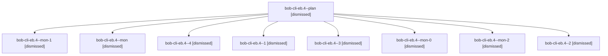

# Session: bob-cli-eb.4

[Agent Hoods](../README.md) / [bbugyi200](../users/bbugyi200/README.md) / [apollo](../users/bbugyi200/machines/apollo/README.md) / [bob-cli-eb](../users/bbugyi200/machines/apollo/hoods/bob-cli-eb/README.md) / bob-cli-eb.4

Owner: `bbugyi200.apollo` · Hood: `bob-cli-eb` · Members: 9 · Bead: [bob-cli-eb.4](https://github.com/bobs-org/bob-cli--beads/blob/main/pages/bob-cli-eb/bob-cli-eb.4.md)

## Lineage

The diagram is an optional enhancement; the ordered table below contains the same lineage in accessible text.

| Role | Agent | State | Model / provider | Timing | Commits | Prompt | Chat |
|---|---|---|---|---|---:|---|---|
| plan | bob-cli-eb.4--plan | dismissed | gpt-6-luna / codex | 2026-10-29T23:49:59.892717 → 2026-10-30T00:01:34.979224 | 0 | [Prompt](../agents/bbugyi200.apollo.bob-cli-eb.4--plan/prompt.md) | [Chat](../agents/bbugyi200.apollo.bob-cli-eb.4--plan/chat.md) |
| mon-1 | bob-cli-eb.4--mon-1 | dismissed | gpt-6-luna / codex | 2026-10-30T00:30:02.631632 → 2026-10-30T00:35:35.914916 | 0 | — | [Chat](../agents/bbugyi200.apollo.bob-cli-eb.4--mon-1/chat.md) |
| mon | bob-cli-eb.4--mon | dismissed | gpt-6-luna / codex | 2026-10-30T00:01:22.828609 → 2026-10-30T00:03:44.779734 | 0 | — | [Chat](../agents/bbugyi200.apollo.bob-cli-eb.4--mon/chat.md) |
| 4 | bob-cli-eb.4--4 | dismissed | muse-spark-1.3-contributor / muse | 2026-10-30T00:51:39.689434 → 2026-10-30T01:02:45.968927 | [1](../agents/bbugyi200.apollo.bob-cli-eb.4--4/README.md#commits) | [Prompt](../agents/bbugyi200.apollo.bob-cli-eb.4--4/prompt.md) | [Chat](../agents/bbugyi200.apollo.bob-cli-eb.4--4/chat.md) |
| 1 | bob-cli-eb.4--1 | dismissed | gpt-6-luna / codex | 2026-10-30T00:05:14.963528 → 2026-10-30T00:10:43.093890 | 0 | [Prompt](../agents/bbugyi200.apollo.bob-cli-eb.4--1/prompt.md) | [Chat](../agents/bbugyi200.apollo.bob-cli-eb.4--1/chat.md) |
| 3 | bob-cli-eb.4--3 | dismissed | gpt-6-luna / codex | 2026-10-30T00:36:40.527271 → 2026-10-30T00:38:57.378743 | 0 | [Prompt](../agents/bbugyi200.apollo.bob-cli-eb.4--3/prompt.md) | [Chat](../agents/bbugyi200.apollo.bob-cli-eb.4--3/chat.md) |
| mon-0 | bob-cli-eb.4--mon-0 | dismissed | gpt-6-luna / codex | 2026-10-30T00:10:25.351683 → 2026-10-30T00:24:06.534814 | 0 | — | [Chat](../agents/bbugyi200.apollo.bob-cli-eb.4--mon-0/chat.md) |
| mon-2 | bob-cli-eb.4--mon-2 | dismissed | gpt-6-luna / codex | 2026-10-30T00:38:44.726609 → 2026-10-30T00:50:34.203768 | 0 | — | [Chat](../agents/bbugyi200.apollo.bob-cli-eb.4--mon-2/chat.md) |
| 2 | bob-cli-eb.4--2 | dismissed | gpt-6-luna / codex | 2026-10-30T00:25:17.820533 → 2026-10-30T00:30:14.177052 | 0 | [Prompt](../agents/bbugyi200.apollo.bob-cli-eb.4--2/prompt.md) | [Chat](../agents/bbugyi200.apollo.bob-cli-eb.4--2/chat.md) |

## Commits

| Role | Repo | Commit | Subject | Committed |
|---|---|---|---|---|
| 4 | — | `a984ec5` | feat(web-clip): records and grid cleanup on print route | 2026-10-30 00:59:41 EDT |

## Neighbors

| Agent | Relation | State |
|---|---|---|
| [bob-cli-eb.1](bbugyi200.apollo.bob-cli-eb.1.md) (session · 3) | bob-cli-eb hood | dismissed 3 |
| [bob-cli-eb.2](../agents/bbugyi200.apollo.bob-cli-eb.2/README.md) | bob-cli-eb hood | dismissed |
| [bob-cli-eb.3](bbugyi200.apollo.bob-cli-eb.3.md) (session · 3) | bob-cli-eb hood | dismissed 3 |
| [bob-cli-eb.5](../agents/bbugyi200.apollo.bob-cli-eb.5/README.md) | bob-cli-eb hood | dismissed |
| [bob-cli-eb.6](bbugyi200.apollo.bob-cli-eb.6.md) (session · 7) | bob-cli-eb hood | dismissed 7 |
| [bob-cli-eb.land](bbugyi200.apollo.bob-cli-eb.land.md) (session · 5) | bob-cli-eb hood | completed 2, dismissed 3 |
