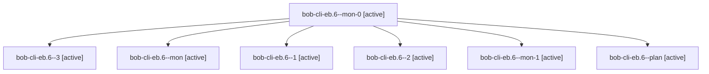

# Session: bob-cli-eb.6

[Agent Hoods](../README.md) / [bbugyi200](../users/bbugyi200/README.md) / [apollo](../users/bbugyi200/machines/apollo/README.md) / [bob-cli-eb](../users/bbugyi200/machines/apollo/hoods/bob-cli-eb/README.md) / bob-cli-eb.6

Owner: `bbugyi200.apollo` · Hood: `bob-cli-eb` · Members: 7 · Bead: [bob-cli-eb.6](https://github.com/bobs-org/bob-cli--beads/blob/main/pages/bob-cli-eb/bob-cli-eb.6.md)

## Lineage

The diagram is an optional enhancement; the ordered table below contains the same lineage in accessible text.

| Role | Agent | State | Model / provider | Timing | Commits | Prompt | Chat |
|---|---|---|---|---|---:|---|---|
| mon-0 | bob-cli-eb.6--mon-0 | active | gpt-6-luna / codex | 2026-10-30T05:24:23.691518+00:00 | 0 | — | [Chat](../agents/bbugyi200.apollo.bob-cli-eb.6--mon-0/chat.md) |
| 3 | bob-cli-eb.6--3 | active | gpt-6-luna / codex | 2026-10-30T05:53:05.342008+00:00 | [1](../agents/bbugyi200.apollo.bob-cli-eb.6--3/README.md#commits) | — | — |
| mon | bob-cli-eb.6--mon | active | gpt-6-luna / codex | 2026-10-30T05:10:22.625597+00:00 | 0 | — | [Chat](../agents/bbugyi200.apollo.bob-cli-eb.6--mon/chat.md) |
| 1 | bob-cli-eb.6--1 | active | gpt-6-luna / codex | 2026-10-30T05:17:58.144755+00:00 | 0 | [Prompt](../agents/bbugyi200.apollo.bob-cli-eb.6--1/prompt.md) | — |
| 2 | bob-cli-eb.6--2 | active | gpt-6-luna / codex | 2026-10-30T05:29:30.788229+00:00 | 0 | — | — |
| mon-1 | bob-cli-eb.6--mon-1 | active | gpt-6-luna / codex | 2026-10-30T05:44:45.867232+00:00 | 0 | — | [Chat](../agents/bbugyi200.apollo.bob-cli-eb.6--mon-1/chat.md) |
| plan | bob-cli-eb.6--plan | active | gpt-6-luna / codex | 2026-10-30T05:03:02.667749+00:00 | 0 | [Prompt](../agents/bbugyi200.apollo.bob-cli-eb.6--plan/prompt.md) | [Chat](../agents/bbugyi200.apollo.bob-cli-eb.6--plan/chat.md) |

## Commits

| Role | Repo | Commit | Subject | Committed |
|---|---|---|---|---|
| 3 | bob-cli | [`a3735b9`](https://github.com/bobs-org/bob-cli/commit/a3735b914939d208f038dd96573c4359b00eff53) | fix(ref): reduce record spacing for table PDFs | 2026-10-30 01:59:39 EDT |

## Neighbors

| Agent | Relation | State |
|---|---|---|
| [bob-cli-eb.1](bbugyi200.apollo.bob-cli-eb.1.md) (session · 3) | bob-cli-eb hood | active 3 |
| [bob-cli-eb.2](../agents/bbugyi200.apollo.bob-cli-eb.2/README.md) | bob-cli-eb hood | active |
| [bob-cli-eb.3](bbugyi200.apollo.bob-cli-eb.3.md) (session · 3) | bob-cli-eb hood | active 3 |
| [bob-cli-eb.4](bbugyi200.apollo.bob-cli-eb.4.md) (session · 9) | bob-cli-eb hood | active 9 |
| [bob-cli-eb.5](../agents/bbugyi200.apollo.bob-cli-eb.5/README.md) | bob-cli-eb hood | active |
| [bob-cli-eb.land](bbugyi200.apollo.bob-cli-eb.land.md) (session · 5) | bob-cli-eb hood | active 3, completed 2 |
