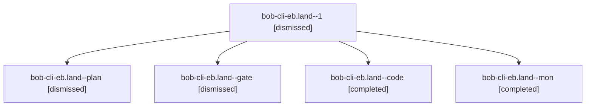

# Session: bob-cli-eb.land

[Agent Hoods](../README.md) / [bbugyi200](../users/bbugyi200/README.md) / [apollo](../users/bbugyi200/machines/apollo/README.md) / [bob-cli-eb](../users/bbugyi200/machines/apollo/hoods/bob-cli-eb/README.md) / bob-cli-eb.land

Owner: `bbugyi200.apollo` · Hood: `bob-cli-eb` · Members: 5 · Bead: [bob-cli-eb](https://github.com/bobs-org/bob-cli--beads/blob/main/pages/bob-cli-eb/README.md)

## Lineage

The diagram is an optional enhancement; the ordered table below contains the same lineage in accessible text.

| Role | Agent | State | Model / provider | Timing | Commits | Prompt | Chat |
|---|---|---|---|---|---:|---|---|
| 1 | bob-cli-eb.land--1 | dismissed | muse-spark-1.3-contributor / muse | 2026-10-30T03:10:40.714113 → 2026-10-30T03:45:40.478278 | [1](../agents/bbugyi200.apollo.bob-cli-eb.land--1/README.md#commits) | [Prompt](../agents/bbugyi200.apollo.bob-cli-eb.land--1/prompt.md) | [Chat](../agents/bbugyi200.apollo.bob-cli-eb.land--1/chat.md) |
| plan | bob-cli-eb.land--plan | dismissed | opus / claude | 2026-10-30T02:02:25.391242 → 2026-10-30T03:06:30.505050 | 0 | [Prompt](../agents/bbugyi200.apollo.bob-cli-eb.land--plan/prompt.md) | [Chat](../agents/bbugyi200.apollo.bob-cli-eb.land--plan/chat.md) |
| gate | bob-cli-eb.land--gate | dismissed | opus / claude | 2026-10-30T02:35:28.063446 → 2026-10-30T02:35:37 | 0 | — | [Chat](../agents/bbugyi200.apollo.bob-cli-eb.land--gate/chat.md) |
| code | bob-cli-eb.land--code | completed | muse-spark-1.3-contributor / muse | 2026-10-30T06:35:50.881631+00:00 → 2026-10-30T07:06:30.475954+00:00 | 0 | — | [Chat](../agents/bbugyi200.apollo.bob-cli-eb.land--code/chat.md) |
| mon | bob-cli-eb.land--mon | completed | muse-spark-1.3-contributor / muse | 2026-10-30T07:06:21.781669+00:00 → 2026-10-30T07:10:40.750571+00:00 | 0 | — | [Chat](../agents/bbugyi200.apollo.bob-cli-eb.land--mon/chat.md) |

## Commits

| Role | Repo | Commit | Subject | Committed |
|---|---|---|---|---|
| 1 | — | `8e7fa97` | feat(highlights): pack short record fields to meet the page budget | 2026-10-30 03:43:57 EDT |

## Neighbors

| Agent | Relation | State |
|---|---|---|
| [bob-cli-eb.1](bbugyi200.apollo.bob-cli-eb.1.md) (session · 3) | bob-cli-eb hood | dismissed 3 |
| [bob-cli-eb.2](../agents/bbugyi200.apollo.bob-cli-eb.2/README.md) | bob-cli-eb hood | dismissed |
| [bob-cli-eb.3](bbugyi200.apollo.bob-cli-eb.3.md) (session · 3) | bob-cli-eb hood | dismissed 3 |
| [bob-cli-eb.4](bbugyi200.apollo.bob-cli-eb.4.md) (session · 9) | bob-cli-eb hood | dismissed 9 |
| [bob-cli-eb.5](../agents/bbugyi200.apollo.bob-cli-eb.5/README.md) | bob-cli-eb hood | dismissed |
| [bob-cli-eb.6](bbugyi200.apollo.bob-cli-eb.6.md) (session · 7) | bob-cli-eb hood | dismissed 7 |
