# Session: bob-cli-ee.3

[Agent Hoods](../README.md) / [bbugyi200](../users/bbugyi200/README.md) / [apollo](../users/bbugyi200/machines/apollo/README.md) / [bob-cli-ee](../users/bbugyi200/machines/apollo/hoods/bob-cli-ee/README.md) / bob-cli-ee.3

Owner: `bbugyi200.apollo` · Hood: `bob-cli-ee` · Members: 13 · Bead: [bob-cli-ee.3](https://github.com/bobs-org/bob-cli--beads/blob/main/pages/bob-cli-ee/bob-cli-ee.3.md)

## Lineage

```mermaid
flowchart TD
  n0["bob-cli-ee.3--mon-4 [dismissed]"]
  n1["bob-cli-ee.3--mon-0 [dismissed]"]
  n0 --> n1
  n2["bob-cli-ee.3--mon [dismissed]"]
  n0 --> n2
  n3["bob-cli-ee.3--plan [dismissed]"]
  n0 --> n3
  n4["bob-cli-ee.3--4 [dismissed]"]
  n0 --> n4
  n5["bob-cli-ee.3--2 [dismissed]"]
  n0 --> n5
  n6["bob-cli-ee.3--5 [dismissed]"]
  n0 --> n6
  n7["bob-cli-ee.3--mon-2 [dismissed]"]
  n0 --> n7
  n8["bob-cli-ee.3--mon-3 [dismissed]"]
  n0 --> n8
  n9["bob-cli-ee.3--1 [dismissed]"]
  n0 --> n9
  n10["bob-cli-ee.3--mon-1 [dismissed]"]
  n0 --> n10
  n11["bob-cli-ee.3--3 [dismissed]"]
  n0 --> n11
  n12["bob-cli-ee.3--6 [dismissed]"]
  n0 --> n12
```

The diagram is an optional enhancement; the ordered table below contains the same lineage in accessible text.

| Role | Agent | State | Model / provider | Timing | Commits | Prompt | Chat |
|---|---|---|---|---|---:|---|---|
| mon-4 | bob-cli-ee.3--mon-4 | dismissed | gpt-6-luna / codex | 2026-10-30T10:58:15.940433 → 2026-10-30T11:11:46.174351 | 0 | — | [Chat](../agents/bbugyi200.apollo.bob-cli-ee.3--mon-4/chat.md) |
| mon-0 | bob-cli-ee.3--mon-0 | dismissed | gpt-6-luna / codex | 2026-10-30T10:02:20.747493 → 2026-10-30T10:05:44.966326 | 0 | — | [Chat](../agents/bbugyi200.apollo.bob-cli-ee.3--mon-0/chat.md) |
| mon | bob-cli-ee.3--mon | dismissed | gpt-6-luna / codex | 2026-10-30T09:57:52.460136 → 2026-10-30T09:58:52.428797 | 0 | — | [Chat](../agents/bbugyi200.apollo.bob-cli-ee.3--mon/chat.md) |
| plan | bob-cli-ee.3--plan | dismissed | gpt-6-luna / codex | 2026-10-30T09:36:30.800011 → 2026-10-30T09:58:08.702612 | 0 | [Prompt](../agents/bbugyi200.apollo.bob-cli-ee.3--plan/prompt.md) | [Chat](../agents/bbugyi200.apollo.bob-cli-ee.3--plan/chat.md) |
| 4 | bob-cli-ee.3--4 | dismissed | gpt-6-luna / codex | 2026-10-30T10:44:51.652402 → 2026-10-30T10:47:00.313641 | 0 | [Prompt](../agents/bbugyi200.apollo.bob-cli-ee.3--4/prompt.md) | [Chat](../agents/bbugyi200.apollo.bob-cli-ee.3--4/chat.md) |
| 2 | bob-cli-ee.3--2 | dismissed | gpt-6-luna / codex | 2026-10-30T10:07:27.249790 → 2026-10-30T10:26:58.313894 | 0 | [Prompt](../agents/bbugyi200.apollo.bob-cli-ee.3--2/prompt.md) | [Chat](../agents/bbugyi200.apollo.bob-cli-ee.3--2/chat.md) |
| 5 | bob-cli-ee.3--5 | dismissed | gpt-6-luna / codex | 2026-10-30T10:52:27.943563 → 2026-10-30T10:58:34.732609 | 0 | [Prompt](../agents/bbugyi200.apollo.bob-cli-ee.3--5/prompt.md) | [Chat](../agents/bbugyi200.apollo.bob-cli-ee.3--5/chat.md) |
| mon-2 | bob-cli-ee.3--mon-2 | dismissed | gpt-6-luna / codex | 2026-10-30T10:40:33.246832 → 2026-10-30T10:43:39.547090 | 0 | — | [Chat](../agents/bbugyi200.apollo.bob-cli-ee.3--mon-2/chat.md) |
| mon-3 | bob-cli-ee.3--mon-3 | dismissed | gpt-6-luna / codex | 2026-10-30T10:46:28.651170 → 2026-10-30T10:50:48.765686 | 0 | — | [Chat](../agents/bbugyi200.apollo.bob-cli-ee.3--mon-3/chat.md) |
| 1 | bob-cli-ee.3--1 | dismissed | gpt-6-luna / codex | 2026-10-30T10:00:21.718420 → 2026-10-30T10:02:42.966441 | 0 | [Prompt](../agents/bbugyi200.apollo.bob-cli-ee.3--1/prompt.md) | [Chat](../agents/bbugyi200.apollo.bob-cli-ee.3--1/chat.md) |
| mon-1 | bob-cli-ee.3--mon-1 | dismissed | gpt-6-luna / codex | 2026-10-30T10:26:41.532507 → 2026-10-30T10:36:25.492890 | 0 | — | [Chat](../agents/bbugyi200.apollo.bob-cli-ee.3--mon-1/chat.md) |
| 3 | bob-cli-ee.3--3 | dismissed | gpt-6-luna / codex | 2026-10-30T10:37:48.500754 → 2026-10-30T10:41:03.804290 | 0 | [Prompt](../agents/bbugyi200.apollo.bob-cli-ee.3--3/prompt.md) | [Chat](../agents/bbugyi200.apollo.bob-cli-ee.3--3/chat.md) |
| 6 | bob-cli-ee.3--6 | dismissed | gpt-6-luna / codex | 2026-10-30T11:12:56.126521 → 2026-10-30T11:35:55.665065 | [1](../agents/bbugyi200.apollo.bob-cli-ee.3--6/README.md#commits) | [Prompt](../agents/bbugyi200.apollo.bob-cli-ee.3--6/prompt.md) | [Chat](../agents/bbugyi200.apollo.bob-cli-ee.3--6/chat.md) |

## Commits

| Role | Repo | Commit | Subject | Committed |
|---|---|---|---|---|
| 6 | — | `03a3497` | feat(capture): add task type completion context | 2026-10-30 11:34:49 EDT |

## Neighbors

| Agent | Relation | State |
|---|---|---|
| [bob-cli-ee.1](bbugyi200.apollo.bob-cli-ee.1.md) (session · 3) | bob-cli-ee hood | dismissed 3 |
| [bob-cli-ee.1.1.1](../agents/bbugyi200.apollo.bob-cli-ee.1.1.1/README.md) | bob-cli-ee hood | dismissed |
| [bob-cli-ee.1.1.2](../agents/bbugyi200.apollo.bob-cli-ee.1.1.2/README.md) | bob-cli-ee hood | dismissed |
| [bob-cli-ee.1.1.3](../agents/bbugyi200.apollo.bob-cli-ee.1.1.3/README.md) | bob-cli-ee hood | dismissed |
| [bob-cli-ee.1.1.land](bbugyi200.apollo.bob-cli-ee.1.1.land.md) (session · 5) | bob-cli-ee hood | completed 2, dismissed 3 |
| [bob-cli-ee.2](../agents/bbugyi200.apollo.bob-cli-ee.2/README.md) | bob-cli-ee hood | dismissed |
| [bob-cli-ee.4](bbugyi200.apollo.bob-cli-ee.4.md) (session · 3) | bob-cli-ee hood | completed 1, dismissed 2 |
| [bob-cli-ee.land](bbugyi200.apollo.bob-cli-ee.land.md) (session · 3) | bob-cli-ee hood | completed 1, dismissed 2 |
