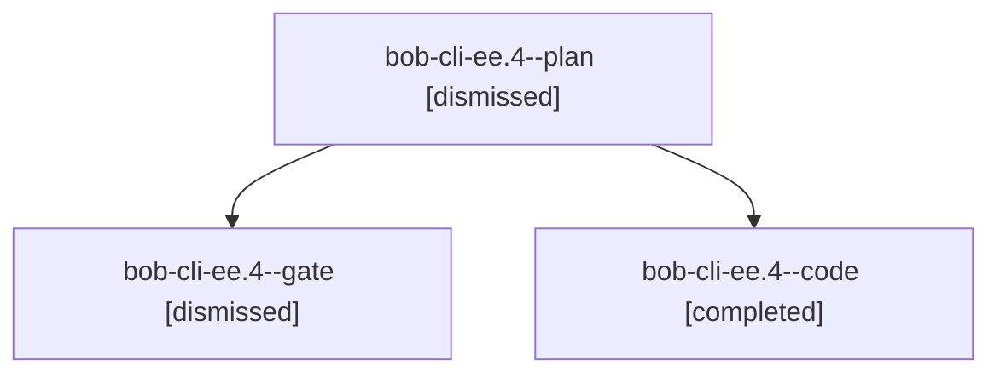

# Session: bob-cli-ee.4

[Agent Hoods](../README.md) / [bbugyi200](../users/bbugyi200/README.md) / [apollo](../users/bbugyi200/machines/apollo/README.md) / [bob-cli-ee](../users/bbugyi200/machines/apollo/hoods/bob-cli-ee/README.md) / bob-cli-ee.4

Owner: `bbugyi200.apollo` · Hood: `bob-cli-ee` · Members: 3 · Bead: [bob-cli-ee.4](https://github.com/bobs-org/bob-cli--beads/blob/main/pages/bob-cli-ee/bob-cli-ee.4.md)

## Lineage

The diagram is an optional enhancement; the ordered table below contains the same lineage in accessible text.

| Role | Agent | State | Model / provider | Timing | Commits | Prompt | Chat |
|---|---|---|---|---|---:|---|---|
| plan | bob-cli-ee.4--plan | dismissed | gpt-6-astra / codex | 2026-10-30T11:36:14.967846 → 2026-10-30T13:24:39.681433 | 0 | [Prompt](../agents/bbugyi200.apollo.bob-cli-ee.4--plan/prompt.md) | [Chat](../agents/bbugyi200.apollo.bob-cli-ee.4--plan/chat.md) |
| gate | bob-cli-ee.4--gate | dismissed | gpt-6-astra / codex | 2026-10-30T11:42:55.167383 → 2026-10-30T11:43:06 | 0 | — | [Chat](../agents/bbugyi200.apollo.bob-cli-ee.4--gate/chat.md) |
| code | bob-cli-ee.4--code | completed | grok-4.6 / grok | 2026-10-30T15:43:21.925523+00:00 → 2026-10-30T17:24:39.308449+00:00 | 0 | — | [Chat](../agents/bbugyi200.apollo.bob-cli-ee.4--code/chat.md) |

## Neighbors

| Agent | Relation | State |
|---|---|---|
| [bob-cli-ee.1](bbugyi200.apollo.bob-cli-ee.1.md) (session · 3) | bob-cli-ee hood | dismissed 3 |
| [bob-cli-ee.1.1.1](../agents/bbugyi200.apollo.bob-cli-ee.1.1.1/README.md) | bob-cli-ee hood | dismissed |
| [bob-cli-ee.1.1.2](../agents/bbugyi200.apollo.bob-cli-ee.1.1.2/README.md) | bob-cli-ee hood | dismissed |
| [bob-cli-ee.1.1.3](../agents/bbugyi200.apollo.bob-cli-ee.1.1.3/README.md) | bob-cli-ee hood | dismissed |
| [bob-cli-ee.1.1.land](bbugyi200.apollo.bob-cli-ee.1.1.land.md) (session · 5) | bob-cli-ee hood | completed 2, dismissed 3 |
| [bob-cli-ee.2](../agents/bbugyi200.apollo.bob-cli-ee.2/README.md) | bob-cli-ee hood | dismissed |
| [bob-cli-ee.3](bbugyi200.apollo.bob-cli-ee.3.md) (session · 13) | bob-cli-ee hood | dismissed 13 |
| [bob-cli-ee.land](bbugyi200.apollo.bob-cli-ee.land.md) (session · 3) | bob-cli-ee hood | completed 1, dismissed 2 |
