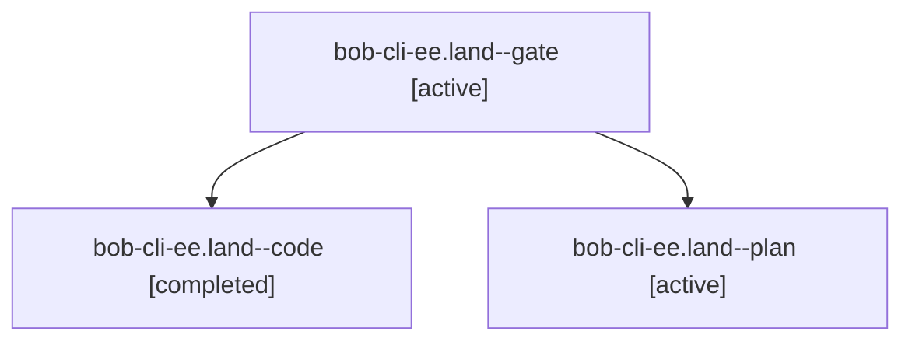

# Session: bob-cli-ee.land

[Agent Hoods](../README.md) / [bbugyi200](../users/bbugyi200/README.md) / [apollo](../users/bbugyi200/machines/apollo/README.md) / [bob-cli-ee](../users/bbugyi200/machines/apollo/hoods/bob-cli-ee/README.md) / bob-cli-ee.land

Owner: `bbugyi200.apollo` · Hood: `bob-cli-ee` · Members: 3 · Bead: [bob-cli-ee](https://github.com/bobs-org/bob-cli--beads/blob/main/pages/bob-cli-ee/README.md)

## Lineage

The diagram is an optional enhancement; the ordered table below contains the same lineage in accessible text.

| Role | Agent | State | Model / provider | Timing | Commits | Prompt | Chat |
|---|---|---|---|---|---:|---|---|
| gate | bob-cli-ee.land--gate | active | gpt-6-astra / codex | 2026-10-30T17:36:53.141620+00:00 | 0 | — | [Chat](../agents/bbugyi200.apollo.bob-cli-ee.land--gate/chat.md) |
| code | bob-cli-ee.land--code | completed | grok-4.6 / grok | 2026-10-30T17:37:22.509477+00:00 → 2026-10-30T18:34:47.992541+00:00 | [1](../agents/bbugyi200.apollo.bob-cli-ee.land--code/README.md#commits) | — | [Chat](../agents/bbugyi200.apollo.bob-cli-ee.land--code/chat.md) |
| plan | bob-cli-ee.land--plan | active | gpt-6-astra / codex | 2026-10-30T17:25:06.060597+00:00 | 0 | [Prompt](../agents/bbugyi200.apollo.bob-cli-ee.land--plan/prompt.md) | [Chat](../agents/bbugyi200.apollo.bob-cli-ee.land--plan/chat.md) |

## Commits

| Role | Repo | Commit | Subject | Committed |
|---|---|---|---|---|
| code | bob-cli | [`6990e89`](https://github.com/bobs-org/bob-cli/commit/6990e89b1ad1b9d1984f37adc29bfb5129a6d2d3) | fix(capture): pin D8 relocation identity and named type-marker agreement | 2026-10-30 14:32:23 EDT |

## Neighbors

| Agent | Relation | State |
|---|---|---|
| [bob-cli-ee.1](bbugyi200.apollo.bob-cli-ee.1.md) (session · 3) | bob-cli-ee hood | active 3 |
| [bob-cli-ee.1.1.1](../agents/bbugyi200.apollo.bob-cli-ee.1.1.1/README.md) | bob-cli-ee hood | active |
| [bob-cli-ee.1.1.2](../agents/bbugyi200.apollo.bob-cli-ee.1.1.2/README.md) | bob-cli-ee hood | active |
| [bob-cli-ee.1.1.3](../agents/bbugyi200.apollo.bob-cli-ee.1.1.3/README.md) | bob-cli-ee hood | active |
| [bob-cli-ee.1.1.land](bbugyi200.apollo.bob-cli-ee.1.1.land.md) (session · 5) | bob-cli-ee hood | active 3, completed 2 |
| [bob-cli-ee.2](../agents/bbugyi200.apollo.bob-cli-ee.2/README.md) | bob-cli-ee hood | active |
| [bob-cli-ee.3](bbugyi200.apollo.bob-cli-ee.3.md) (session · 13) | bob-cli-ee hood | active 13 |
| [bob-cli-ee.4](bbugyi200.apollo.bob-cli-ee.4.md) (session · 3) | bob-cli-ee hood | active 2, completed 1 |
