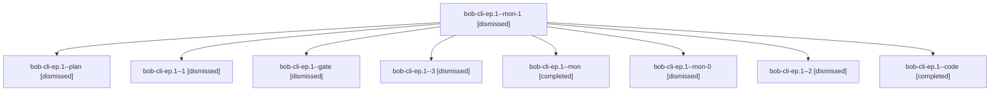

# Session: bob-cli-ep.1

[Agent Hoods](../README.md) / [bbugyi200](../users/bbugyi200/README.md) / [apollo](../users/bbugyi200/machines/apollo/README.md) / [bob-cli-ep](../users/bbugyi200/machines/apollo/hoods/bob-cli-ep/README.md) / bob-cli-ep.1

Owner: `bbugyi200.apollo` · Hood: `bob-cli-ep` · Members: 9 · Bead: [bob-cli-ep.1](https://github.com/bobs-org/bob-cli--beads/blob/main/pages/bob-cli-ep/bob-cli-ep.1.md)

## Lineage

The diagram is an optional enhancement; the ordered table below contains the same lineage in accessible text.

| Role | Agent | State | Model / provider | Timing | Commits | Prompt | Chat |
|---|---|---|---|---|---:|---|---|
| mon-1 | bob-cli-ep.1--mon-1 | dismissed | gpt-6-luna / codex | 2026-10-31T08:54:12.389501 → 2026-10-31T09:08:40.945778 | 0 | — | [Chat](../agents/bbugyi200.apollo.bob-cli-ep.1--mon-1/chat.md) |
| plan | bob-cli-ep.1--plan | dismissed | opus / claude | 2026-10-31T08:01:40.966683 → 2026-10-31T08:41:30.380415 | 0 | [Prompt](../agents/bbugyi200.apollo.bob-cli-ep.1--plan/prompt.md) | [Chat](../agents/bbugyi200.apollo.bob-cli-ep.1--plan/chat.md) |
| 1 | bob-cli-ep.1--1 | dismissed | gpt-6-luna / codex | 2026-10-31T08:44:46.746450 → 2026-10-31T08:47:44.669455 | 0 | [Prompt](../agents/bbugyi200.apollo.bob-cli-ep.1--1/prompt.md) | [Chat](../agents/bbugyi200.apollo.bob-cli-ep.1--1/chat.md) |
| gate | bob-cli-ep.1--gate | dismissed | opus / claude | 2026-10-31T08:16:12.282533 → 2026-10-31T08:16:22 | 0 | — | [Chat](../agents/bbugyi200.apollo.bob-cli-ep.1--gate/chat.md) |
| 3 | bob-cli-ep.1--3 | dismissed | gpt-6-luna / codex | 2026-10-31T09:09:46.210739 → 2026-10-31T09:14:37.712258 | [1](../agents/bbugyi200.apollo.bob-cli-ep.1--3/README.md#commits) | [Prompt](../agents/bbugyi200.apollo.bob-cli-ep.1--3/prompt.md) | [Chat](../agents/bbugyi200.apollo.bob-cli-ep.1--3/chat.md) |
| mon | bob-cli-ep.1--mon | completed | gpt-6-luna / codex | 2026-10-31T12:41:11.744012+00:00 → 2026-10-31T12:44:47.024860+00:00 | 0 | — | [Chat](../agents/bbugyi200.apollo.bob-cli-ep.1--mon/chat.md) |
| mon-0 | bob-cli-ep.1--mon-0 | dismissed | gpt-6-luna / codex | 2026-10-31T08:47:18.379369 → 2026-10-31T08:50:04.098082 | 0 | — | [Chat](../agents/bbugyi200.apollo.bob-cli-ep.1--mon-0/chat.md) |
| 2 | bob-cli-ep.1--2 | dismissed | gpt-6-luna / codex | 2026-10-31T08:51:14.636883 → 2026-10-31T08:54:32.860994 | 0 | [Prompt](../agents/bbugyi200.apollo.bob-cli-ep.1--2/prompt.md) | [Chat](../agents/bbugyi200.apollo.bob-cli-ep.1--2/chat.md) |
| code | bob-cli-ep.1--code | completed | gpt-6-luna / codex | 2026-10-31T12:16:36.467977+00:00 → 2026-10-31T12:41:29.575973+00:00 | 0 | — | [Chat](../agents/bbugyi200.apollo.bob-cli-ep.1--code/chat.md) |

## Commits

| Role | Repo | Commit | Subject | Committed |
|---|---|---|---|---|
| — | — | `4a95e5b` | feat(capture)!: replace t: type markers with #\<type\> | 2026-10-30 19:05:00 EDT |
| 3 | — | `d1dd23e` | fix(capture): finish attached #\<type\> forms, refusal hints, and docs | 2026-10-31 09:13:37 EDT |

## Neighbors

| Agent | Relation | State |
|---|---|---|
| [bob-cli-ep.2](../agents/bbugyi200.apollo.bob-cli-ep.2/README.md) | bob-cli-ep hood | dismissed |
| [bob-cli-ep.land](bbugyi200.apollo.bob-cli-ep.land.md) (session · 3) | bob-cli-ep hood | completed 1, dismissed 2 |
