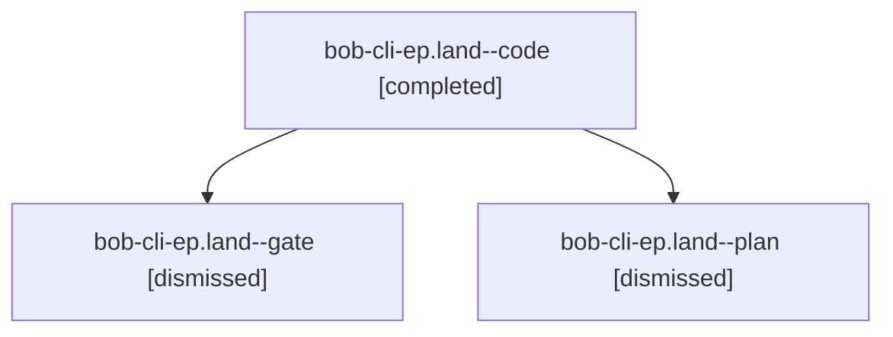

# Session: bob-cli-ep.land

[Agent Hoods](../README.md) / [bbugyi200](../users/bbugyi200/README.md) / [apollo](../users/bbugyi200/machines/apollo/README.md) / [bob-cli-ep](../users/bbugyi200/machines/apollo/hoods/bob-cli-ep/README.md) / bob-cli-ep.land

Owner: `bbugyi200.apollo` · Hood: `bob-cli-ep` · Members: 3 · Bead: [bob-cli-ep](https://github.com/bobs-org/bob-cli--beads/blob/main/pages/bob-cli-ep/README.md)

## Lineage

The diagram is an optional enhancement; the ordered table below contains the same lineage in accessible text.

| Role | Agent | State | Model / provider | Timing | Commits | Prompt | Chat |
|---|---|---|---|---|---:|---|---|
| code | bob-cli-ep.land--code | completed | sonnet / claude | 2026-10-31T14:05:59.808066+00:00 → 2026-10-31T14:25:15.161355+00:00 | [1](../agents/bbugyi200.apollo.bob-cli-ep.land--code/README.md#commits) | — | [Chat](../agents/bbugyi200.apollo.bob-cli-ep.land--code/chat.md) |
| gate | bob-cli-ep.land--gate | dismissed | opus / claude | 2026-10-31T10:05:14.860321 → 2026-10-31T10:05:34 | 0 | — | [Chat](../agents/bbugyi200.apollo.bob-cli-ep.land--gate/chat.md) |
| plan | bob-cli-ep.land--plan | dismissed | opus / claude | 2026-10-31T09:49:30.499527 → 2026-10-31T10:25:15.568790 | 0 | [Prompt](../agents/bbugyi200.apollo.bob-cli-ep.land--plan/prompt.md) | [Chat](../agents/bbugyi200.apollo.bob-cli-ep.land--plan/chat.md) |

## Commits

| Role | Repo | Commit | Subject | Committed |
|---|---|---|---|---|
| code | — | `c7e1f62` | docs(capture): fix stale @route+id# completion help after #\<type\> | 2026-10-31 10:23:28 EDT |

## Neighbors

| Agent | Relation | State |
|---|---|---|
| [bob-cli-ep.1](bbugyi200.apollo.bob-cli-ep.1.md) (session · 9) | bob-cli-ep hood | completed 2, dismissed 7 |
| [bob-cli-ep.2](../agents/bbugyi200.apollo.bob-cli-ep.2/README.md) | bob-cli-ep hood | dismissed |
