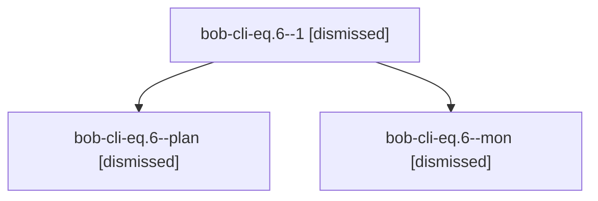

# Session: bob-cli-eq.6

[Agent Hoods](../README.md) / [bbugyi200](../users/bbugyi200/README.md) / [apollo](../users/bbugyi200/machines/apollo/README.md) / [bob-cli-eq](../users/bbugyi200/machines/apollo/hoods/bob-cli-eq/README.md) / bob-cli-eq.6

Owner: `bbugyi200.apollo` · Hood: `bob-cli-eq` · Members: 3 · Bead: [bob-cli-eq.6](https://github.com/bobs-org/bob-cli--beads/blob/main/pages/bob-cli-eq/bob-cli-eq.6.md)

## Lineage

The diagram is an optional enhancement; the ordered table below contains the same lineage in accessible text.

| Role | Agent | State | Model / provider | Timing | Commits | Prompt | Chat |
|---|---|---|---|---|---:|---|---|
| 1 | bob-cli-eq.6--1 | dismissed | muse-spark-1.3-contributor / muse | 2026-10-30T19:36:08.985018 → 2026-10-30T19:56:17.666535 | 0 | [Prompt](../agents/bbugyi200.apollo.bob-cli-eq.6--1/prompt.md) | [Chat](../agents/bbugyi200.apollo.bob-cli-eq.6--1/chat.md) |
| plan | bob-cli-eq.6--plan | dismissed | muse-spark-1.3-contributor / muse | 2026-10-30T18:44:55.378209 → 2026-10-30T19:24:29.948682 | 0 | [Prompt](../agents/bbugyi200.apollo.bob-cli-eq.6--plan/prompt.md) | [Chat](../agents/bbugyi200.apollo.bob-cli-eq.6--plan/chat.md) |
| mon | bob-cli-eq.6--mon | dismissed | muse-spark-1.3-contributor / muse | 2026-10-30T19:24:23.908389 → 2026-10-30T19:34:44.495694 | 0 | — | [Chat](../agents/bbugyi200.apollo.bob-cli-eq.6--mon/chat.md) |

## Neighbors

| Agent | Relation | State |
|---|---|---|
| [bob-cli-eq.1](../agents/bbugyi200.apollo.bob-cli-eq.1/README.md) | bob-cli-eq hood | dismissed |
| [bob-cli-eq.2](../agents/bbugyi200.apollo.bob-cli-eq.2/README.md) | bob-cli-eq hood | dismissed |
| [bob-cli-eq.3](../agents/bbugyi200.apollo.bob-cli-eq.3/README.md) | bob-cli-eq hood | dismissed |
| [bob-cli-eq.4](../agents/bbugyi200.apollo.bob-cli-eq.4/README.md) | bob-cli-eq hood | dismissed |
| [bob-cli-eq.5](../agents/bbugyi200.apollo.bob-cli-eq.5/README.md) | bob-cli-eq hood | dismissed |
| [bob-cli-eq.7](../agents/bbugyi200.apollo.bob-cli-eq.7/README.md) | bob-cli-eq hood | dismissed |
| [bob-cli-eq.land](bbugyi200.apollo.bob-cli-eq.land.md) (session · 3) | bob-cli-eq hood | completed 1, dismissed 2 |
