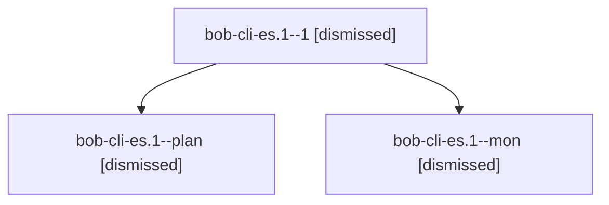

# Session: bob-cli-es.1

[Agent Hoods](../README.md) / [bbugyi200](../users/bbugyi200/README.md) / [apollo](../users/bbugyi200/machines/apollo/README.md) / [bob-cli-es](../users/bbugyi200/machines/apollo/hoods/bob-cli-es/README.md) / bob-cli-es.1

Owner: `bbugyi200.apollo` · Hood: `bob-cli-es` · Members: 3 · Bead: [bob-cli-es.1](https://github.com/bobs-org/bob-cli--beads/blob/main/pages/bob-cli-es/bob-cli-es.1.md)

## Lineage

The diagram is an optional enhancement; the ordered table below contains the same lineage in accessible text.

| Role | Agent | State | Model / provider | Timing | Commits | Prompt | Chat |
|---|---|---|---|---|---:|---|---|
| 1 | bob-cli-es.1--1 | dismissed | grok-4.6 / grok | 2026-10-30T19:16:22.699947 → 2026-10-30T19:34:38.961122 | [1](../agents/bbugyi200.apollo.bob-cli-es.1--1/README.md#commits) | [Prompt](../agents/bbugyi200.apollo.bob-cli-es.1--1/prompt.md) | [Chat](../agents/bbugyi200.apollo.bob-cli-es.1--1/chat.md) |
| plan | bob-cli-es.1--plan | dismissed | grok-4.6 / grok | 2026-10-30T18:32:12.710426 → 2026-10-30T19:10:08.161780 | 0 | [Prompt](../agents/bbugyi200.apollo.bob-cli-es.1--plan/prompt.md) | [Chat](../agents/bbugyi200.apollo.bob-cli-es.1--plan/chat.md) |
| mon | bob-cli-es.1--mon | dismissed | grok-4.6 / grok | 2026-10-30T19:09:58.728333 → 2026-10-30T19:14:50.638957 | 0 | — | [Chat](../agents/bbugyi200.apollo.bob-cli-es.1--mon/chat.md) |

## Commits

| Role | Repo | Commit | Subject | Committed |
|---|---|---|---|---|
| 1 | — | `4f29a82` | feat(gcal): stamp each Events section with account and last change | 2026-10-30 19:34:07 EDT |

## Neighbors

| Agent | Relation | State |
|---|---|---|
| [bob-cli-es.2](../agents/bbugyi200.apollo.bob-cli-es.2/README.md) | bob-cli-es hood | dismissed |
| [bob-cli-es.land](bbugyi200.apollo.bob-cli-es.land.md) (session · 3) | bob-cli-es hood | completed 1, dismissed 2 |
