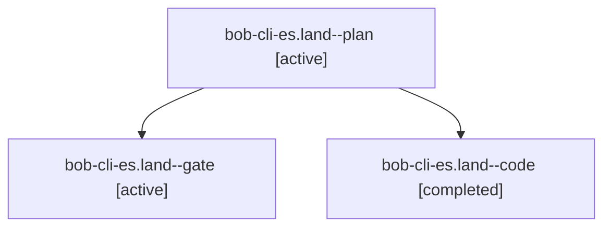

# Session: bob-cli-es.land

[Agent Hoods](../README.md) / [bbugyi200](../users/bbugyi200/README.md) / [apollo](../users/bbugyi200/machines/apollo/README.md) / [bob-cli-es](../users/bbugyi200/machines/apollo/hoods/bob-cli-es/README.md) / bob-cli-es.land

Owner: `bbugyi200.apollo` · Hood: `bob-cli-es` · Members: 3 · Bead: [bob-cli-es](https://github.com/bobs-org/bob-cli--beads/blob/main/pages/bob-cli-es/README.md)

## Lineage



The diagram is an optional enhancement; the ordered table below contains the same lineage in accessible text.

| Role | Agent | State | Model / provider | Timing | Commits | Prompt | Chat |
|---|---|---|---|---|---:|---|---|
| <a id="member-plan"></a>plan | bob-cli-es.land--plan | active | gpt-6-astra / codex | 2026-10-30T23:51:15.978428+00:00 | 0 | [Prompt](../agents/bbugyi200.apollo.bob-cli-es.land--plan/prompt.md) | [Chat](../agents/bbugyi200.apollo.bob-cli-es.land--plan/chat.md) |
| <a id="member-gate"></a>gate | bob-cli-es.land--gate | active | gpt-6-astra / codex | 2026-10-31T00:01:13.494744+00:00 | 0 | — | [Chat](../agents/bbugyi200.apollo.bob-cli-es.land--gate/chat.md) |
| <a id="member-code"></a>code | bob-cli-es.land--code | completed | muse-spark-1.3-contributor / muse | 2026-10-31T00:01:39.138953+00:00 → 2026-10-31T00:34:04.082049+00:00 | [1](../agents/bbugyi200.apollo.bob-cli-es.land--code/README.md#commits) | — | [Chat](../agents/bbugyi200.apollo.bob-cli-es.land--code/chat.md) |

## Commits

| Role | Repo | Commit | Subject | Committed |
|---|---|---|---|---|
| code | bob-cli | [`45b8346`](https://github.com/bobs-org/bob-cli/commit/45b8346ddbf0d21c698bdf52ce9f8731c4f631de) | fix(gcal): repair Events stamp spacing and finish landing | 2026-10-30 20:33:02 EDT |

## Variables

| Role | Variable | Value |
|---|---|---|
| plan | `artifacts` | \[{kind: file, label: bob-cli-es landing: focused plugin failures and stamp passes, path: /home/bryan/.sase/artifacts/agents/gh\_bobs-org\_\_bob-cli/20261030183128/bob-cli-es-plugin-audit-3b8c476b19ff.lo… |

#### artifacts

**Role:** `plan`

```yaml
- kind: file
  label: bob-cli-es landing: focused plugin failures and stamp passes
  path: /home/bryan/.sase/artifacts/agents/gh_bobs-org__bob-cli/20261030183128/bob-cli-es-plugin-audit-3b8c476b19ff.log
  ref: file:explicit:78360ee1c9c0ed50f7648b3a
  source_path: /tmp/bob-cli-es-plugin-audit.log
- kind: file
  label: bob-cli-es landing: task-wikilink ranker passes unchanged in isolation
  path: /home/bryan/.sase/artifacts/agents/gh_bobs-org__bob-cli/20261030183128/bob-cli-es-rank-alone-769da7fa2545.log
  ref: file:explicit:ce587d56b66df46f0b04012a
  source_path: /tmp/bob-cli-es-rank-alone.log
```

Values are truncated for display; see each member's agent meta.json for the full values.

## Neighbors

| Agent | Relation | State |
|---|---|---|
| [bob-cli-es.1](bbugyi200.apollo.bob-cli-es.1.md) (session · 3) | bob-cli-es hood | active 3 |
| [bob-cli-es.2](../agents/bbugyi200.apollo.bob-cli-es.2/README.md) | bob-cli-es hood | active |
