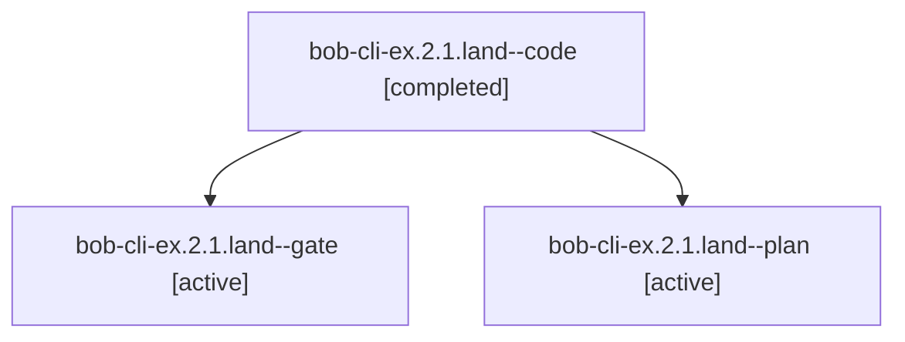

# Session: bob-cli-ex.2.1.land

[Agent Hoods](../README.md) / [bbugyi200](../users/bbugyi200/README.md) / [apollo](../users/bbugyi200/machines/apollo/README.md) / [bob-cli-ex](../users/bbugyi200/machines/apollo/hoods/bob-cli-ex/README.md) / bob-cli-ex.2.1.land

Owner: `bbugyi200.apollo` · Hood: `bob-cli-ex` · Members: 3 · Bead: [bob-cli-ex.2.1](https://github.com/bobs-org/bob-cli--beads/blob/main/pages/bob-cli-ex/bob-cli-ex.2.1.md)

## Lineage

The diagram is an optional enhancement; the ordered table below contains the same lineage in accessible text.

| Role | Agent | State | Model / provider | Timing | Commits | Prompt | Chat |
|---|---|---|---|---|---:|---|---|
| code | bob-cli-ex.2.1.land--code | completed | sonnet / claude | 2026-11-01T14:10:44.472474+00:00 → 2026-11-01T14:53:56.087285+00:00 | [1](../agents/bbugyi200.apollo.bob-cli-ex.2.1.land--code/README.md#commits) | — | [Chat](../agents/bbugyi200.apollo.bob-cli-ex.2.1.land--code/chat.md) |
| gate | bob-cli-ex.2.1.land--gate | active | gpt-6-astra / codex | 2026-11-01T14:09:55.752974+00:00 | 0 | — | [Chat](../agents/bbugyi200.apollo.bob-cli-ex.2.1.land--gate/chat.md) |
| plan | bob-cli-ex.2.1.land--plan | active | gpt-6-astra / codex | 2026-11-01T13:53:19.173800+00:00 | 0 | [Prompt](../agents/bbugyi200.apollo.bob-cli-ex.2.1.land--plan/prompt.md) | [Chat](../agents/bbugyi200.apollo.bob-cli-ex.2.1.land--plan/chat.md) |

## Commits

| Role | Repo | Commit | Subject | Committed |
|---|---|---|---|---|
| — | bob-cli | [`42dd92b`](https://github.com/bobs-org/bob-cli/commit/42dd92bc66193dfc3ad16fc6ff0b9813d51c92c9) | fix(capture): finish project-offer landing repairs for bob-cli-ex.2.1 | 2026-10-31 17:52:51 EDT |
| code | bob-cli | [`f411232`](https://github.com/bobs-org/bob-cli/commit/f41123201f285887d63e1ed50802c7bd118e38d0) | fix(capture): refuse route-less sealed offers and keep offer mode while incomplete | 2026-11-01 09:53:08 EST |

## Neighbors

| Agent | Relation | State |
|---|---|---|
| [bob-cli-ex.2](bbugyi200.apollo.bob-cli-ex.2.md) (session · 3) | ancestor | active 3 |
| [bob-cli-ex.2.1.1](../agents/bbugyi200.apollo.bob-cli-ex.2.1.1/README.md) | bob-cli-ex.2.1 hood | active |
| [bob-cli-ex.2.1.2](../agents/bbugyi200.apollo.bob-cli-ex.2.1.2/README.md) | bob-cli-ex.2.1 hood | active |
| [bob-cli-ex.2.1.3](../agents/bbugyi200.apollo.bob-cli-ex.2.1.3/README.md) | bob-cli-ex.2.1 hood | active |
| [bob-cli-ex.1](../agents/bbugyi200.apollo.bob-cli-ex.1/README.md) | bob-cli-ex hood | active |
| [bob-cli-ex.3](../agents/bbugyi200.apollo.bob-cli-ex.3/README.md) | bob-cli-ex hood | active |
| [bob-cli-ex.4](bbugyi200.apollo.bob-cli-ex.4.md) (session · 13) | bob-cli-ex hood | active 13 |
| [bob-cli-ex.land](bbugyi200.apollo.bob-cli-ex.land.md) (session · 7) | bob-cli-ex hood | active 5, completed 1, failed 1 |
