# Session: bob-cli-ex.4

[Agent Hoods](../README.md) / [bbugyi200](../users/bbugyi200/README.md) / [apollo](../users/bbugyi200/machines/apollo/README.md) / [bob-cli-ex](../users/bbugyi200/machines/apollo/hoods/bob-cli-ex/README.md) / bob-cli-ex.4

Owner: `bbugyi200.apollo` · Hood: `bob-cli-ex` · Members: 13 · Bead: [bob-cli-ex.4](https://github.com/bobs-org/bob-cli--beads/blob/main/pages/bob-cli-ex/bob-cli-ex.4.md)

## Lineage

```mermaid
flowchart TD
  n0["bob-cli-ex.4--mon-1 [dismissed]"]
  n1["bob-cli-ex.4--mon-3 [dismissed]"]
  n0 --> n1
  n2["bob-cli-ex.4--1 [dismissed]"]
  n0 --> n2
  n3["bob-cli-ex.4--mon-0 [dismissed]"]
  n0 --> n3
  n4["bob-cli-ex.4--3 [dismissed]"]
  n0 --> n4
  n5["bob-cli-ex.4--mon-2 [dismissed]"]
  n0 --> n5
  n6["bob-cli-ex.4--6 [dismissed]"]
  n0 --> n6
  n7["bob-cli-ex.4--plan [dismissed]"]
  n0 --> n7
  n8["bob-cli-ex.4--5 [dismissed]"]
  n0 --> n8
  n9["bob-cli-ex.4--4 [dismissed]"]
  n0 --> n9
  n10["bob-cli-ex.4--2 [dismissed]"]
  n0 --> n10
  n11["bob-cli-ex.4--mon [dismissed]"]
  n0 --> n11
  n12["bob-cli-ex.4--mon-4 [dismissed]"]
  n0 --> n12
```

The diagram is an optional enhancement; the ordered table below contains the same lineage in accessible text.

| Role | Agent | State | Model / provider | Timing | Commits | Prompt | Chat |
|---|---|---|---|---|---:|---|---|
| mon-1 | bob-cli-ex.4--mon-1 | dismissed | gpt-6-luna / codex | 2026-10-31T18:31:03.026985 → 2026-10-31T18:33:19.670911 | 0 | — | [Chat](../agents/bbugyi200.apollo.bob-cli-ex.4--mon-1/chat.md) |
| mon-3 | bob-cli-ex.4--mon-3 | dismissed | gpt-6-luna / codex | 2026-10-31T18:50:24.657616 → 2026-10-31T18:52:22.396840 | 0 | — | [Chat](../agents/bbugyi200.apollo.bob-cli-ex.4--mon-3/chat.md) |
| 1 | bob-cli-ex.4--1 | dismissed | gpt-6-luna / codex | 2026-10-31T18:05:58.571791 → 2026-10-31T18:22:00.654287 | 0 | [Prompt](../agents/bbugyi200.apollo.bob-cli-ex.4--1/prompt.md) | [Chat](../agents/bbugyi200.apollo.bob-cli-ex.4--1/chat.md) |
| mon-0 | bob-cli-ex.4--mon-0 | dismissed | gpt-6-luna / codex | 2026-10-31T18:21:49.353416 → 2026-10-31T18:23:46.949697 | 0 | — | [Chat](../agents/bbugyi200.apollo.bob-cli-ex.4--mon-0/chat.md) |
| 3 | bob-cli-ex.4--3 | dismissed | gpt-6-luna / codex | 2026-10-31T18:34:35.169464 → 2026-10-31T18:42:58.468994 | 0 | [Prompt](../agents/bbugyi200.apollo.bob-cli-ex.4--3/prompt.md) | [Chat](../agents/bbugyi200.apollo.bob-cli-ex.4--3/chat.md) |
| mon-2 | bob-cli-ex.4--mon-2 | dismissed | gpt-6-luna / codex | 2026-10-31T18:42:49.349783 → 2026-10-31T18:45:05.681712 | 0 | — | [Chat](../agents/bbugyi200.apollo.bob-cli-ex.4--mon-2/chat.md) |
| 6 | bob-cli-ex.4--6 | dismissed | gpt-6-luna / codex | 2026-10-31T19:03:24.551759 → 2026-10-31T19:07:25.974657 | [1](../agents/bbugyi200.apollo.bob-cli-ex.4--6/README.md#commits) | [Prompt](../agents/bbugyi200.apollo.bob-cli-ex.4--6/prompt.md) | [Chat](../agents/bbugyi200.apollo.bob-cli-ex.4--6/chat.md) |
| plan | bob-cli-ex.4--plan | dismissed | gpt-6-luna / codex | 2026-10-31T17:51:51.839914 → 2026-10-31T18:01:58.987831 | 0 | [Prompt](../agents/bbugyi200.apollo.bob-cli-ex.4--plan/prompt.md) | [Chat](../agents/bbugyi200.apollo.bob-cli-ex.4--plan/chat.md) |
| 5 | bob-cli-ex.4--5 | dismissed | gpt-6-luna / codex | 2026-10-31T18:53:35.287175 → 2026-10-31T18:55:57.125614 | 0 | [Prompt](../agents/bbugyi200.apollo.bob-cli-ex.4--5/prompt.md) | [Chat](../agents/bbugyi200.apollo.bob-cli-ex.4--5/chat.md) |
| 4 | bob-cli-ex.4--4 | dismissed | gpt-6-luna / codex | 2026-10-31T18:46:23.842507 → 2026-10-31T18:50:35.726861 | 0 | [Prompt](../agents/bbugyi200.apollo.bob-cli-ex.4--4/prompt.md) | [Chat](../agents/bbugyi200.apollo.bob-cli-ex.4--4/chat.md) |
| 2 | bob-cli-ex.4--2 | dismissed | gpt-6-luna / codex | 2026-10-31T18:25:00.418966 → 2026-10-31T18:31:12.222006 | 0 | [Prompt](../agents/bbugyi200.apollo.bob-cli-ex.4--2/prompt.md) | [Chat](../agents/bbugyi200.apollo.bob-cli-ex.4--2/chat.md) |
| mon | bob-cli-ex.4--mon | dismissed | gpt-6-luna / codex | 2026-10-31T18:01:46.348605 → 2026-10-31T18:04:30.748959 | 0 | — | [Chat](../agents/bbugyi200.apollo.bob-cli-ex.4--mon/chat.md) |
| mon-4 | bob-cli-ex.4--mon-4 | dismissed | gpt-6-luna / codex | 2026-10-31T18:55:46.876850 → 2026-10-31T19:02:12.665873 | 0 | — | [Chat](../agents/bbugyi200.apollo.bob-cli-ex.4--mon-4/chat.md) |

## Commits

| Role | Repo | Commit | Subject | Committed |
|---|---|---|---|---|
| 6 | — | `e2838ac` | docs(glossary): explain project successor offers | 2026-10-31 19:06:17 EDT |

## Neighbors

| Agent | Relation | State |
|---|---|---|
| [bob-cli-ex.1](../agents/bbugyi200.apollo.bob-cli-ex.1/README.md) | bob-cli-ex hood | dismissed |
| [bob-cli-ex.2](bbugyi200.apollo.bob-cli-ex.2.md) (session · 3) | bob-cli-ex hood | dismissed 3 |
| [bob-cli-ex.2.1.1](../agents/bbugyi200.apollo.bob-cli-ex.2.1.1/README.md) | bob-cli-ex hood | active |
| [bob-cli-ex.2.1.2](../agents/bbugyi200.apollo.bob-cli-ex.2.1.2/README.md) | bob-cli-ex hood | active |
| [bob-cli-ex.2.1.3](../agents/bbugyi200.apollo.bob-cli-ex.2.1.3/README.md) | bob-cli-ex hood | active |
| [bob-cli-ex.2.1.land](bbugyi200.apollo.bob-cli-ex.2.1.land.md) (session · 3) | bob-cli-ex hood | active 2, completed 1 |
| [bob-cli-ex.3](../agents/bbugyi200.apollo.bob-cli-ex.3/README.md) | bob-cli-ex hood | dismissed |
| [bob-cli-ex.land](bbugyi200.apollo.bob-cli-ex.land.md) (session · 7) | bob-cli-ex hood | completed 1, dismissed 5, failed 1 |
