# Session: bob-cli-ex.4

[Agent Hoods](../README.md) / [bbugyi200](../users/bbugyi200/README.md) / [apollo](../users/bbugyi200/machines/apollo/README.md) / [bob-cli-ex](../users/bbugyi200/machines/apollo/hoods/bob-cli-ex/README.md) / bob-cli-ex.4

Owner: `bbugyi200.apollo` · Hood: `bob-cli-ex` · Members: 13 · Bead: [bob-cli-ex.4](https://github.com/bobs-org/bob-cli--beads/blob/main/pages/bob-cli-ex/bob-cli-ex.4.md)

## Lineage

```mermaid
flowchart TD
  n0["bob-cli-ex.4--mon-1 [active]"]
  n1["bob-cli-ex.4--mon-3 [active]"]
  n0 --> n1
  n2["bob-cli-ex.4--1 [active]"]
  n0 --> n2
  n3["bob-cli-ex.4--mon-0 [active]"]
  n0 --> n3
  n4["bob-cli-ex.4--3 [active]"]
  n0 --> n4
  n5["bob-cli-ex.4--mon-2 [active]"]
  n0 --> n5
  n6["bob-cli-ex.4--6 [active]"]
  n0 --> n6
  n7["bob-cli-ex.4--plan [active]"]
  n0 --> n7
  n8["bob-cli-ex.4--5 [active]"]
  n0 --> n8
  n9["bob-cli-ex.4--4 [active]"]
  n0 --> n9
  n10["bob-cli-ex.4--2 [active]"]
  n0 --> n10
  n11["bob-cli-ex.4--mon [active]"]
  n0 --> n11
  n12["bob-cli-ex.4--mon-4 [active]"]
  n0 --> n12
```

The diagram is an optional enhancement; the ordered table below contains the same lineage in accessible text.

| Role | Agent | State | Model / provider | Timing | Commits | Prompt | Chat |
|---|---|---|---|---|---:|---|---|
| mon-1 | bob-cli-ex.4--mon-1 | active | gpt-6-luna / codex | 2026-10-31T22:31:03.026985+00:00 | 0 | — | [Chat](../agents/bbugyi200.apollo.bob-cli-ex.4--mon-1/chat.md) |
| mon-3 | bob-cli-ex.4--mon-3 | active | gpt-6-luna / codex | 2026-10-31T22:50:24.657616+00:00 | 0 | — | [Chat](../agents/bbugyi200.apollo.bob-cli-ex.4--mon-3/chat.md) |
| 1 | bob-cli-ex.4--1 | active | gpt-6-luna / codex | 2026-10-31T22:05:58.571791+00:00 | 0 | [Prompt](../agents/bbugyi200.apollo.bob-cli-ex.4--1/prompt.md) | [Chat](../agents/bbugyi200.apollo.bob-cli-ex.4--1/chat.md) |
| mon-0 | bob-cli-ex.4--mon-0 | active | gpt-6-luna / codex | 2026-10-31T22:21:49.353416+00:00 | 0 | — | [Chat](../agents/bbugyi200.apollo.bob-cli-ex.4--mon-0/chat.md) |
| 3 | bob-cli-ex.4--3 | active | gpt-6-luna / codex | 2026-10-31T22:34:35.169464+00:00 | 0 | [Prompt](../agents/bbugyi200.apollo.bob-cli-ex.4--3/prompt.md) | [Chat](../agents/bbugyi200.apollo.bob-cli-ex.4--3/chat.md) |
| mon-2 | bob-cli-ex.4--mon-2 | active | gpt-6-luna / codex | 2026-10-31T22:42:49.349783+00:00 | 0 | — | [Chat](../agents/bbugyi200.apollo.bob-cli-ex.4--mon-2/chat.md) |
| 6 | bob-cli-ex.4--6 | active | gpt-6-luna / codex | 2026-10-31T23:03:24.551759+00:00 | [1](../agents/bbugyi200.apollo.bob-cli-ex.4--6/README.md#commits) | [Prompt](../agents/bbugyi200.apollo.bob-cli-ex.4--6/prompt.md) | [Chat](../agents/bbugyi200.apollo.bob-cli-ex.4--6/chat.md) |
| plan | bob-cli-ex.4--plan | active | gpt-6-luna / codex | 2026-10-31T21:51:51.839914+00:00 | 0 | [Prompt](../agents/bbugyi200.apollo.bob-cli-ex.4--plan/prompt.md) | [Chat](../agents/bbugyi200.apollo.bob-cli-ex.4--plan/chat.md) |
| 5 | bob-cli-ex.4--5 | active | gpt-6-luna / codex | 2026-10-31T22:53:35.287175+00:00 | 0 | [Prompt](../agents/bbugyi200.apollo.bob-cli-ex.4--5/prompt.md) | [Chat](../agents/bbugyi200.apollo.bob-cli-ex.4--5/chat.md) |
| 4 | bob-cli-ex.4--4 | active | gpt-6-luna / codex | 2026-10-31T22:46:23.842507+00:00 | 0 | [Prompt](../agents/bbugyi200.apollo.bob-cli-ex.4--4/prompt.md) | [Chat](../agents/bbugyi200.apollo.bob-cli-ex.4--4/chat.md) |
| 2 | bob-cli-ex.4--2 | active | gpt-6-luna / codex | 2026-10-31T22:25:00.418966+00:00 | 0 | [Prompt](../agents/bbugyi200.apollo.bob-cli-ex.4--2/prompt.md) | [Chat](../agents/bbugyi200.apollo.bob-cli-ex.4--2/chat.md) |
| mon | bob-cli-ex.4--mon | active | gpt-6-luna / codex | 2026-10-31T22:01:46.348605+00:00 | 0 | — | [Chat](../agents/bbugyi200.apollo.bob-cli-ex.4--mon/chat.md) |
| mon-4 | bob-cli-ex.4--mon-4 | active | gpt-6-luna / codex | 2026-10-31T22:55:46.876850+00:00 | 0 | — | [Chat](../agents/bbugyi200.apollo.bob-cli-ex.4--mon-4/chat.md) |

## Commits

| Role | Repo | Commit | Subject | Committed |
|---|---|---|---|---|
| 6 | bob-cli | [`e2838ac`](https://github.com/bobs-org/bob-cli/commit/e2838ac33654a440b3d9568b984ca4e39fd7129d) | docs(glossary): explain project successor offers | 2026-10-31 19:06:17 EDT |

## Neighbors

| Agent | Relation | State |
|---|---|---|
| [bob-cli-ex.1](../agents/bbugyi200.apollo.bob-cli-ex.1/README.md) | bob-cli-ex hood | active |
| [bob-cli-ex.2](bbugyi200.apollo.bob-cli-ex.2.md) (session · 3) | bob-cli-ex hood | active 3 |
| [bob-cli-ex.2.1.1](../agents/bbugyi200.apollo.bob-cli-ex.2.1.1/README.md) | bob-cli-ex hood | active |
| [bob-cli-ex.2.1.2](../agents/bbugyi200.apollo.bob-cli-ex.2.1.2/README.md) | bob-cli-ex hood | active |
| [bob-cli-ex.2.1.3](../agents/bbugyi200.apollo.bob-cli-ex.2.1.3/README.md) | bob-cli-ex hood | active |
| [bob-cli-ex.2.1.land](bbugyi200.apollo.bob-cli-ex.2.1.land.md) (session · 3) | bob-cli-ex hood | active 2, completed 1 |
| [bob-cli-ex.3](../agents/bbugyi200.apollo.bob-cli-ex.3/README.md) | bob-cli-ex hood | active |
| [bob-cli-ex.land](bbugyi200.apollo.bob-cli-ex.land.md) (session · 7) | bob-cli-ex hood | active 5, completed 1, failed 1 |
