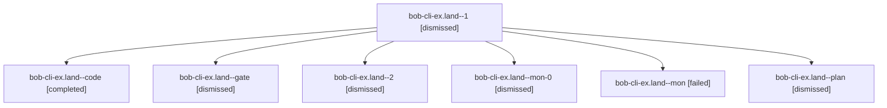

# Session: bob-cli-ex.land

[Agent Hoods](../README.md) / [bbugyi200](../users/bbugyi200/README.md) / [apollo](../users/bbugyi200/machines/apollo/README.md) / [bob-cli-ex](../users/bbugyi200/machines/apollo/hoods/bob-cli-ex/README.md) / bob-cli-ex.land

Owner: `bbugyi200.apollo` · Hood: `bob-cli-ex` · Members: 7 · Bead: [bob-cli-ex](https://github.com/bobs-org/bob-cli--beads/blob/main/pages/bob-cli-ex/README.md)

## Lineage

The diagram is an optional enhancement; the ordered table below contains the same lineage in accessible text.

| Role | Agent | State | Model / provider | Timing | Commits | Prompt | Chat |
|---|---|---|---|---|---:|---|---|
| 1 | bob-cli-ex.land--1 | dismissed | sonnet / claude | 2026-10-31T20:36:58.150372 → 2026-10-31T20:41:22.362753 | 0 | [Prompt](../agents/bbugyi200.apollo.bob-cli-ex.land--1/prompt.md) | [Chat](../agents/bbugyi200.apollo.bob-cli-ex.land--1/chat.md) |
| code | bob-cli-ex.land--code | completed | sonnet / claude | 2026-10-31T23:19:24.856850+00:00 → 2026-11-01T00:25:16.020148+00:00 | 0 | — | [Chat](../agents/bbugyi200.apollo.bob-cli-ex.land--code/chat.md) |
| gate | bob-cli-ex.land--gate | dismissed | gpt-6-astra / codex | 2026-10-31T19:18:57.996035 → 2026-10-31T19:19:09 | 0 | — | [Chat](../agents/bbugyi200.apollo.bob-cli-ex.land--gate/chat.md) |
| 2 | bob-cli-ex.land--2 | dismissed | sonnet / claude | 2026-10-31T20:53:14.371218 → 2026-10-31T21:15:22.251559 | [1](../agents/bbugyi200.apollo.bob-cli-ex.land--2/README.md#commits) | [Prompt](../agents/bbugyi200.apollo.bob-cli-ex.land--2/prompt.md) | [Chat](../agents/bbugyi200.apollo.bob-cli-ex.land--2/chat.md) |
| mon-0 | bob-cli-ex.land--mon-0 | dismissed | sonnet / claude | 2026-10-31T20:41:06.658320 → 2026-10-31T20:52:13.832880 | 0 | — | [Chat](../agents/bbugyi200.apollo.bob-cli-ex.land--mon-0/chat.md) |
| mon | bob-cli-ex.land--mon | failed | sonnet / claude | 2026-11-01T00:24:59.228536+00:00 → 2026-11-01T00:36:54.912694+00:00 | 0 | — | [Chat](../agents/bbugyi200.apollo.bob-cli-ex.land--mon/chat.md) |
| plan | bob-cli-ex.land--plan | dismissed | gpt-6-astra / codex | 2026-10-31T19:08:31.892694 → 2026-10-31T20:25:16.673564 | 0 | [Prompt](../agents/bbugyi200.apollo.bob-cli-ex.land--plan/prompt.md) | [Chat](../agents/bbugyi200.apollo.bob-cli-ex.land--plan/chat.md) |

## Commits

| Role | Repo | Commit | Subject | Committed |
|---|---|---|---|---|
| 2 | — | `86a63e8` | fix(capture): keep unpicked duplicate project offers after picks mint IDs | 2026-10-31 21:13:52 EDT |

## Neighbors

| Agent | Relation | State |
|---|---|---|
| [bob-cli-ex.1](../agents/bbugyi200.apollo.bob-cli-ex.1/README.md) | bob-cli-ex hood | dismissed |
| [bob-cli-ex.2](bbugyi200.apollo.bob-cli-ex.2.md) (session · 3) | bob-cli-ex hood | dismissed 3 |
| [bob-cli-ex.2.1.1](../agents/bbugyi200.apollo.bob-cli-ex.2.1.1/README.md) | bob-cli-ex hood | active |
| [bob-cli-ex.2.1.2](../agents/bbugyi200.apollo.bob-cli-ex.2.1.2/README.md) | bob-cli-ex hood | active |
| [bob-cli-ex.2.1.3](../agents/bbugyi200.apollo.bob-cli-ex.2.1.3/README.md) | bob-cli-ex hood | active |
| [bob-cli-ex.2.1.land](bbugyi200.apollo.bob-cli-ex.2.1.land.md) (session · 3) | bob-cli-ex hood | active 2, completed 1 |
| [bob-cli-ex.3](../agents/bbugyi200.apollo.bob-cli-ex.3/README.md) | bob-cli-ex hood | dismissed |
| [bob-cli-ex.4](bbugyi200.apollo.bob-cli-ex.4.md) (session · 13) | bob-cli-ex hood | dismissed 13 |
