# Session: bob-cli-ey.1.1.1

[Agent Hoods](../README.md) / [bbugyi200](../users/bbugyi200/README.md) / [apollo](../users/bbugyi200/machines/apollo/README.md) / [bob-cli-ey](../users/bbugyi200/machines/apollo/hoods/bob-cli-ey/README.md) / bob-cli-ey.1.1.1

Owner: `bbugyi200.apollo` · Hood: `bob-cli-ey` · Members: 21 · Bead: [bob-cli-ey.1.1.1](https://github.com/bobs-org/bob-cli--beads/blob/main/pages/bob-cli-ey/bob-cli-ey.1.1.1.md)

## Lineage

```mermaid
flowchart TD
  n0["bob-cli-ey.1.1.1--9 [active]"]
  n1["bob-cli-ey.1.1.1--mon-3 [active]"]
  n0 --> n1
  n2["bob-cli-ey.1.1.1--8 [active]"]
  n0 --> n2
  n3["bob-cli-ey.1.1.1--mon-7 [active]"]
  n0 --> n3
  n4["bob-cli-ey.1.1.1--3 [active]"]
  n0 --> n4
  n5["bob-cli-ey.1.1.1--mon-0 [active]"]
  n0 --> n5
  n6["bob-cli-ey.1.1.1--2 [active]"]
  n0 --> n6
  n7["bob-cli-ey.1.1.1--mon [active]"]
  n0 --> n7
  n8["bob-cli-ey.1.1.1--a [active]"]
  n0 --> n8
  n9["bob-cli-ey.1.1.1--7 [active]"]
  n0 --> n9
  n10["bob-cli-ey.1.1.1--4 [active]"]
  n0 --> n10
  n11["bob-cli-ey.1.1.1--6 [active]"]
  n0 --> n11
  n12["bob-cli-ey.1.1.1--mon-4 [active]"]
  n0 --> n12
  n13["bob-cli-ey.1.1.1--mon-6 [active]"]
  n0 --> n13
  n14["bob-cli-ey.1.1.1--mon-8 [active]"]
  n0 --> n14
  n15["bob-cli-ey.1.1.1--1 [active]"]
  n0 --> n15
  n16["bob-cli-ey.1.1.1--plan [active]"]
  n0 --> n16
  n17["bob-cli-ey.1.1.1--mon-2 [active]"]
  n0 --> n17
  n18["bob-cli-ey.1.1.1--mon-1 [active]"]
  n0 --> n18
  n19["bob-cli-ey.1.1.1--mon-5 [active]"]
  n0 --> n19
  n20["bob-cli-ey.1.1.1--5 [active]"]
  n0 --> n20
```

The diagram is an optional enhancement; the ordered table below contains the same lineage in accessible text.

| Role | Agent | State | Model / provider | Timing | Commits | Prompt | Chat |
|---|---|---|---|---|---:|---|---|
| 9 | bob-cli-ey.1.1.1--9 | active | gpt-6-luna / codex | 2026-10-31T19:09:09.864173+00:00 | 0 | [Prompt](../agents/bbugyi200.apollo.bob-cli-ey.1.1.1--9/prompt.md) | [Chat](../agents/bbugyi200.apollo.bob-cli-ey.1.1.1--9/chat.md) |
| mon-3 | bob-cli-ey.1.1.1--mon-3 | active | gpt-6-luna / codex | 2026-10-31T18:33:05.886793+00:00 | 0 | — | [Chat](../agents/bbugyi200.apollo.bob-cli-ey.1.1.1--mon-3/chat.md) |
| 8 | bob-cli-ey.1.1.1--8 | active | gpt-6-luna / codex | 2026-10-31T19:06:30.536148+00:00 | 0 | [Prompt](../agents/bbugyi200.apollo.bob-cli-ey.1.1.1--8/prompt.md) | [Chat](../agents/bbugyi200.apollo.bob-cli-ey.1.1.1--8/chat.md) |
| mon-7 | bob-cli-ey.1.1.1--mon-7 | active | gpt-6-luna / codex | 2026-10-31T19:07:32.321418+00:00 | 0 | — | [Chat](../agents/bbugyi200.apollo.bob-cli-ey.1.1.1--mon-7/chat.md) |
| 3 | bob-cli-ey.1.1.1--3 | active | gpt-6-luna / codex | 2026-10-31T18:05:18.971364+00:00 | 0 | [Prompt](../agents/bbugyi200.apollo.bob-cli-ey.1.1.1--3/prompt.md) | [Chat](../agents/bbugyi200.apollo.bob-cli-ey.1.1.1--3/chat.md) |
| mon-0 | bob-cli-ey.1.1.1--mon-0 | active | gpt-6-luna / codex | 2026-10-31T17:53:25.326560+00:00 | 0 | — | [Chat](../agents/bbugyi200.apollo.bob-cli-ey.1.1.1--mon-0/chat.md) |
| 2 | bob-cli-ey.1.1.1--2 | active | gpt-6-luna / codex | 2026-10-31T18:01:51.500941+00:00 | 0 | [Prompt](../agents/bbugyi200.apollo.bob-cli-ey.1.1.1--2/prompt.md) | [Chat](../agents/bbugyi200.apollo.bob-cli-ey.1.1.1--2/chat.md) |
| mon | bob-cli-ey.1.1.1--mon | active | gpt-6-luna / codex | 2026-10-31T17:17:00.636144+00:00 | 0 | — | [Chat](../agents/bbugyi200.apollo.bob-cli-ey.1.1.1--mon/chat.md) |
| a | bob-cli-ey.1.1.1--a | active | grok-4.6 / grok | 2026-10-31T19:11:59.274628+00:00 | 0 | [Prompt](../agents/bbugyi200.apollo.bob-cli-ey.1.1.1--a/prompt.md) | [Chat](../agents/bbugyi200.apollo.bob-cli-ey.1.1.1--a/chat.md) |
| 7 | bob-cli-ey.1.1.1--7 | active | gpt-6-luna / codex | 2026-10-31T18:53:22.050803+00:00 | 0 | [Prompt](../agents/bbugyi200.apollo.bob-cli-ey.1.1.1--7/prompt.md) | [Chat](../agents/bbugyi200.apollo.bob-cli-ey.1.1.1--7/chat.md) |
| 4 | bob-cli-ey.1.1.1--4 | active | gpt-6-luna / codex | 2026-10-31T18:24:05.050874+00:00 | 0 | [Prompt](../agents/bbugyi200.apollo.bob-cli-ey.1.1.1--4/prompt.md) | [Chat](../agents/bbugyi200.apollo.bob-cli-ey.1.1.1--4/chat.md) |
| 6 | bob-cli-ey.1.1.1--6 | active | gpt-6-luna / codex | 2026-10-31T18:40:51.544801+00:00 | 0 | [Prompt](../agents/bbugyi200.apollo.bob-cli-ey.1.1.1--6/prompt.md) | [Chat](../agents/bbugyi200.apollo.bob-cli-ey.1.1.1--6/chat.md) |
| mon-4 | bob-cli-ey.1.1.1--mon-4 | active | gpt-6-luna / codex | 2026-10-31T18:39:22.080638+00:00 | 0 | — | [Chat](../agents/bbugyi200.apollo.bob-cli-ey.1.1.1--mon-4/chat.md) |
| mon-6 | bob-cli-ey.1.1.1--mon-6 | active | gpt-6-luna / codex | 2026-10-31T18:54:29.989091+00:00 | 0 | — | [Chat](../agents/bbugyi200.apollo.bob-cli-ey.1.1.1--mon-6/chat.md) |
| mon-8 | bob-cli-ey.1.1.1--mon-8 | active | gpt-6-luna / codex | 2026-10-31T19:10:30.206490+00:00 | 0 | — | [Chat](../agents/bbugyi200.apollo.bob-cli-ey.1.1.1--mon-8/chat.md) |
| 1 | bob-cli-ey.1.1.1--1 | active | gpt-6-luna / codex | 2026-10-31T17:33:40.930672+00:00 | 0 | [Prompt](../agents/bbugyi200.apollo.bob-cli-ey.1.1.1--1/prompt.md) | [Chat](../agents/bbugyi200.apollo.bob-cli-ey.1.1.1--1/chat.md) |
| plan | bob-cli-ey.1.1.1--plan | active | gpt-6-luna / codex | 2026-10-31T16:59:48.950294+00:00 | 0 | [Prompt](../agents/bbugyi200.apollo.bob-cli-ey.1.1.1--plan/prompt.md) | [Chat](../agents/bbugyi200.apollo.bob-cli-ey.1.1.1--plan/chat.md) |
| mon-2 | bob-cli-ey.1.1.1--mon-2 | active | gpt-6-luna / codex | 2026-10-31T18:13:58.253208+00:00 | 0 | — | [Chat](../agents/bbugyi200.apollo.bob-cli-ey.1.1.1--mon-2/chat.md) |
| mon-1 | bob-cli-ey.1.1.1--mon-1 | active | gpt-6-luna / codex | 2026-10-31T18:03:40.481916+00:00 | 0 | — | [Chat](../agents/bbugyi200.apollo.bob-cli-ey.1.1.1--mon-1/chat.md) |
| mon-5 | bob-cli-ey.1.1.1--mon-5 | active | gpt-6-luna / codex | 2026-10-31T18:47:49.673543+00:00 | 0 | — | [Chat](../agents/bbugyi200.apollo.bob-cli-ey.1.1.1--mon-5/chat.md) |
| 5 | bob-cli-ey.1.1.1--5 | active | gpt-6-luna / codex | 2026-10-31T18:36:34.700964+00:00 | 0 | [Prompt](../agents/bbugyi200.apollo.bob-cli-ey.1.1.1--5/prompt.md) | [Chat](../agents/bbugyi200.apollo.bob-cli-ey.1.1.1--5/chat.md) |

## Neighbors

| Agent | Relation | State |
|---|---|---|
| [bob-cli-ey.1](bbugyi200.apollo.bob-cli-ey.1.md) (session · 3) | ancestor | active 3 |
| [bob-cli-ey.1.1.2](bbugyi200.apollo.bob-cli-ey.1.1.2.md) (session · 7) | bob-cli-ey.1.1 hood | active 7 |
| [bob-cli-ey.1.1.3](../agents/bbugyi200.apollo.bob-cli-ey.1.1.3/README.md) | bob-cli-ey.1.1 hood | active |
| [bob-cli-ey.1.1.4](bbugyi200.apollo.bob-cli-ey.1.1.4.md) (session · 5) | bob-cli-ey.1.1 hood | active 5 |
| [bob-cli-ey.1.1.5](../agents/bbugyi200.apollo.bob-cli-ey.1.1.5/README.md) | bob-cli-ey.1.1 hood | active |
| [bob-cli-ey.1.1.6](bbugyi200.apollo.bob-cli-ey.1.1.6.md) (session · 9) | bob-cli-ey.1.1 hood | active 9 |
| [bob-cli-ey.1.1.land](bbugyi200.apollo.bob-cli-ey.1.1.land.md) (session · 3) | bob-cli-ey.1.1 hood | active 2, completed 1 |
| [bob-cli-ey.2](bbugyi200.apollo.bob-cli-ey.2.md) (session · 9) | bob-cli-ey hood | active 7, completed 1, failed 1 |
| [bob-cli-ey.3](bbugyi200.apollo.bob-cli-ey.3.md) (session · 3) | bob-cli-ey hood | active 3 |
| [bob-cli-ey.3.1.1](../agents/bbugyi200.apollo.bob-cli-ey.3.1.1/README.md) | bob-cli-ey hood | active |
| [bob-cli-ey.3.1.2](bbugyi200.apollo.bob-cli-ey.3.1.2.md) (session · 21) | bob-cli-ey hood | active 21 |
| [bob-cli-ey.3.1.3](../agents/bbugyi200.apollo.bob-cli-ey.3.1.3/README.md) | bob-cli-ey hood | active |
| [bob-cli-ey.3.1.4](../agents/bbugyi200.apollo.bob-cli-ey.3.1.4/README.md) | bob-cli-ey hood | active |
| [bob-cli-ey.3.1.land](bbugyi200.apollo.bob-cli-ey.3.1.land.md) (session · 9) | bob-cli-ey hood | active 7, completed 2 |
| [bob-cli-ey.4](../agents/bbugyi200.apollo.bob-cli-ey.4/README.md) | bob-cli-ey hood | active |
| [bob-cli-ey.5](../agents/bbugyi200.apollo.bob-cli-ey.5/README.md) | bob-cli-ey hood | active |
| [bob-cli-ey.6](../agents/bbugyi200.apollo.bob-cli-ey.6/README.md) | bob-cli-ey hood | active |
| [bob-cli-ey.7.1](../agents/bbugyi200.apollo.bob-cli-ey.7.1/README.md) | bob-cli-ey hood | active |
| [bob-cli-ey.7.2](../agents/bbugyi200.apollo.bob-cli-ey.7.2/README.md) | bob-cli-ey hood | active |
| [bob-cli-ey.7.3](bbugyi200.apollo.bob-cli-ey.7.3.md) (session · 5) | bob-cli-ey hood | active 5 |
| [bob-cli-ey.7.4](bbugyi200.apollo.bob-cli-ey.7.4.md) (session · 25) | bob-cli-ey hood | active 13, completed 9, failed 3 |
| [bob-cli-ey.7.land](bbugyi200.apollo.bob-cli-ey.7.land.md) (session · 5) | bob-cli-ey hood | active 3, completed 2 |
| [bob-cli-ey.land](bbugyi200.apollo.bob-cli-ey.land.md) (session · 3) | bob-cli-ey hood | active 3 |
