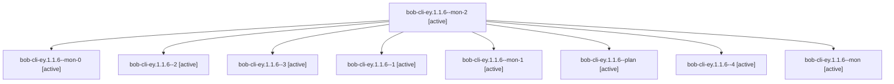

# Session: bob-cli-ey.1.1.6

[Agent Hoods](../README.md) / [bbugyi200](../users/bbugyi200/README.md) / [apollo](../users/bbugyi200/machines/apollo/README.md) / [bob-cli-ey](../users/bbugyi200/machines/apollo/hoods/bob-cli-ey/README.md) / bob-cli-ey.1.1.6

Owner: `bbugyi200.apollo` · Hood: `bob-cli-ey` · Members: 9 · Bead: [bob-cli-ey.1.1.6](https://github.com/bobs-org/bob-cli--beads/blob/main/pages/bob-cli-ey/bob-cli-ey.1.1.6.md)

## Lineage

The diagram is an optional enhancement; the ordered table below contains the same lineage in accessible text.

| Role | Agent | State | Model / provider | Timing | Commits | Prompt | Chat |
|---|---|---|---|---|---:|---|---|
| mon-2 | bob-cli-ey.1.1.6--mon-2 | active | gpt-6-luna / codex | 2026-11-01T01:56:47.026988+00:00 | 0 | — | [Chat](../agents/bbugyi200.apollo.bob-cli-ey.1.1.6--mon-2/chat.md) |
| mon-0 | bob-cli-ey.1.1.6--mon-0 | active | gpt-6-luna / codex | 2026-11-01T01:33:21.515292+00:00 | 0 | — | [Chat](../agents/bbugyi200.apollo.bob-cli-ey.1.1.6--mon-0/chat.md) |
| 2 | bob-cli-ey.1.1.6--2 | active | gpt-6-luna / codex | 2026-11-01T01:38:27.311743+00:00 | 0 | [Prompt](../agents/bbugyi200.apollo.bob-cli-ey.1.1.6--2/prompt.md) | [Chat](../agents/bbugyi200.apollo.bob-cli-ey.1.1.6--2/chat.md) |
| 3 | bob-cli-ey.1.1.6--3 | active | gpt-6-luna / codex | 2026-11-01T01:52:39.114069+00:00 | 0 | [Prompt](../agents/bbugyi200.apollo.bob-cli-ey.1.1.6--3/prompt.md) | [Chat](../agents/bbugyi200.apollo.bob-cli-ey.1.1.6--3/chat.md) |
| 1 | bob-cli-ey.1.1.6--1 | active | gpt-6-luna / codex | 2026-11-01T01:30:14.883952+00:00 | 0 | [Prompt](../agents/bbugyi200.apollo.bob-cli-ey.1.1.6--1/prompt.md) | [Chat](../agents/bbugyi200.apollo.bob-cli-ey.1.1.6--1/chat.md) |
| mon-1 | bob-cli-ey.1.1.6--mon-1 | active | gpt-6-luna / codex | 2026-11-01T01:40:18.267150+00:00 | 0 | — | [Chat](../agents/bbugyi200.apollo.bob-cli-ey.1.1.6--mon-1/chat.md) |
| plan | bob-cli-ey.1.1.6--plan | active | gpt-6-luna / codex | 2026-11-01T01:00:54.849897+00:00 | 0 | [Prompt](../agents/bbugyi200.apollo.bob-cli-ey.1.1.6--plan/prompt.md) | [Chat](../agents/bbugyi200.apollo.bob-cli-ey.1.1.6--plan/chat.md) |
| 4 | bob-cli-ey.1.1.6--4 | active | gpt-6-luna / codex | 2026-11-01T02:09:28.287422+00:00 | [1](../agents/bbugyi200.apollo.bob-cli-ey.1.1.6--4/README.md#commits) | [Prompt](../agents/bbugyi200.apollo.bob-cli-ey.1.1.6--4/prompt.md) | [Chat](../agents/bbugyi200.apollo.bob-cli-ey.1.1.6--4/chat.md) |
| mon | bob-cli-ey.1.1.6--mon | active | gpt-6-luna / codex | 2026-11-01T01:28:15.387644+00:00 | 0 | — | [Chat](../agents/bbugyi200.apollo.bob-cli-ey.1.1.6--mon/chat.md) |

## Commits

| Role | Repo | Commit | Subject | Committed |
|---|---|---|---|---|
| 4 | bob-cli | [`b290d83`](https://github.com/bobs-org/bob-cli/commit/b290d833008347581c121f72cf70b6edb3e38810) | feat(capture): add directive completion and grammar revision | 2026-10-31 22:12:08 EDT |

## Neighbors

| Agent | Relation | State |
|---|---|---|
| [bob-cli-ey.1](bbugyi200.apollo.bob-cli-ey.1.md) (session · 3) | ancestor | active 3 |
| [bob-cli-ey.1.1.1](bbugyi200.apollo.bob-cli-ey.1.1.1.md) (session · 21) | bob-cli-ey.1.1 hood | active 21 |
| [bob-cli-ey.1.1.2](bbugyi200.apollo.bob-cli-ey.1.1.2.md) (session · 7) | bob-cli-ey.1.1 hood | active 7 |
| [bob-cli-ey.1.1.3](../agents/bbugyi200.apollo.bob-cli-ey.1.1.3/README.md) | bob-cli-ey.1.1 hood | active |
| [bob-cli-ey.1.1.4](bbugyi200.apollo.bob-cli-ey.1.1.4.md) (session · 5) | bob-cli-ey.1.1 hood | active 5 |
| [bob-cli-ey.1.1.5](../agents/bbugyi200.apollo.bob-cli-ey.1.1.5/README.md) | bob-cli-ey.1.1 hood | active |
| [bob-cli-ey.1.1.land](bbugyi200.apollo.bob-cli-ey.1.1.land.md) (session · 3) | bob-cli-ey.1.1 hood | active 2, completed 1 |
| [bob-cli-ey.2](bbugyi200.apollo.bob-cli-ey.2.md) (session · 9) | bob-cli-ey hood | active 7, completed 1, failed 1 |
| [bob-cli-ey.3](bbugyi200.apollo.bob-cli-ey.3.md) (session · 3) | bob-cli-ey hood | active 3 |
| [bob-cli-ey.3.1.1](../agents/bbugyi200.apollo.bob-cli-ey.3.1.1/README.md) | bob-cli-ey hood | active |
| [bob-cli-ey.3.1.2](bbugyi200.apollo.bob-cli-ey.3.1.2.md) (session · 21) | bob-cli-ey hood | active 21 |
| [bob-cli-ey.3.1.3](../agents/bbugyi200.apollo.bob-cli-ey.3.1.3/README.md) | bob-cli-ey hood | active |
| [bob-cli-ey.3.1.4](../agents/bbugyi200.apollo.bob-cli-ey.3.1.4/README.md) | bob-cli-ey hood | active |
| [bob-cli-ey.3.1.land](bbugyi200.apollo.bob-cli-ey.3.1.land.md) (session · 9) | bob-cli-ey hood | active 7, completed 2 |
| [bob-cli-ey.4](../agents/bbugyi200.apollo.bob-cli-ey.4/README.md) | bob-cli-ey hood | active |
| [bob-cli-ey.5](../agents/bbugyi200.apollo.bob-cli-ey.5/README.md) | bob-cli-ey hood | active |
| [bob-cli-ey.6](../agents/bbugyi200.apollo.bob-cli-ey.6/README.md) | bob-cli-ey hood | active |
| [bob-cli-ey.7.1](../agents/bbugyi200.apollo.bob-cli-ey.7.1/README.md) | bob-cli-ey hood | active |
| [bob-cli-ey.7.2](../agents/bbugyi200.apollo.bob-cli-ey.7.2/README.md) | bob-cli-ey hood | active |
| [bob-cli-ey.7.3](bbugyi200.apollo.bob-cli-ey.7.3.md) (session · 5) | bob-cli-ey hood | active 5 |
| [bob-cli-ey.7.4](bbugyi200.apollo.bob-cli-ey.7.4.md) (session · 25) | bob-cli-ey hood | active 13, completed 9, failed 3 |
| [bob-cli-ey.7.land](bbugyi200.apollo.bob-cli-ey.7.land.md) (session · 5) | bob-cli-ey hood | active 3, completed 2 |
| [bob-cli-ey.land](bbugyi200.apollo.bob-cli-ey.land.md) (session · 3) | bob-cli-ey hood | active 3 |
