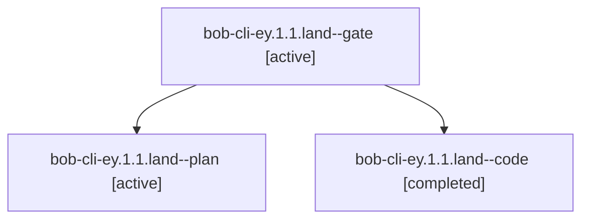

# Session: bob-cli-ey.1.1.land

[Agent Hoods](../README.md) / [bbugyi200](../users/bbugyi200/README.md) / [apollo](../users/bbugyi200/machines/apollo/README.md) / [bob-cli-ey](../users/bbugyi200/machines/apollo/hoods/bob-cli-ey/README.md) / bob-cli-ey.1.1.land

Owner: `bbugyi200.apollo` · Hood: `bob-cli-ey` · Members: 3 · Bead: [bob-cli-ey.1.1](https://github.com/bobs-org/bob-cli--beads/blob/main/pages/bob-cli-ey/bob-cli-ey.1.1.md)

## Lineage

The diagram is an optional enhancement; the ordered table below contains the same lineage in accessible text.

| Role | Agent | State | Model / provider | Timing | Commits | Prompt | Chat |
|---|---|---|---|---|---:|---|---|
| gate | bob-cli-ey.1.1.land--gate | active | opus / claude | 2026-11-01T02:37:06.653421+00:00 | 0 | — | [Chat](../agents/bbugyi200.apollo.bob-cli-ey.1.1.land--gate/chat.md) |
| plan | bob-cli-ey.1.1.land--plan | active | opus / claude | 2026-11-01T02:12:53.990416+00:00 | 0 | [Prompt](../agents/bbugyi200.apollo.bob-cli-ey.1.1.land--plan/prompt.md) | [Chat](../agents/bbugyi200.apollo.bob-cli-ey.1.1.land--plan/chat.md) |
| code | bob-cli-ey.1.1.land--code | completed | grok-4.6 / grok | 2026-11-01T02:37:33.356007+00:00 → 2026-11-01T03:29:29.206707+00:00 | [1](../agents/bbugyi200.apollo.bob-cli-ey.1.1.land--code/README.md#commits) | — | [Chat](../agents/bbugyi200.apollo.bob-cli-ey.1.1.land--code/chat.md) |

## Commits

| Role | Repo | Commit | Subject | Committed |
|---|---|---|---|---|
| code | bob-cli | [`a1dcb64`](https://github.com/bobs-org/bob-cli/commit/a1dcb64eee30a3e7f45b0555be8cf60b940d85e1) | refactor(capture): finish cli-directives cleanup | 2026-10-31 23:28:06 EDT |

## Neighbors

| Agent | Relation | State |
|---|---|---|
| [bob-cli-ey.1](bbugyi200.apollo.bob-cli-ey.1.md) (session · 3) | ancestor | active 3 |
| [bob-cli-ey.1.1.1](bbugyi200.apollo.bob-cli-ey.1.1.1.md) (session · 21) | bob-cli-ey.1.1 hood | active 21 |
| [bob-cli-ey.1.1.2](bbugyi200.apollo.bob-cli-ey.1.1.2.md) (session · 7) | bob-cli-ey.1.1 hood | active 7 |
| [bob-cli-ey.1.1.3](../agents/bbugyi200.apollo.bob-cli-ey.1.1.3/README.md) | bob-cli-ey.1.1 hood | active |
| [bob-cli-ey.1.1.4](bbugyi200.apollo.bob-cli-ey.1.1.4.md) (session · 5) | bob-cli-ey.1.1 hood | active 5 |
| [bob-cli-ey.1.1.5](../agents/bbugyi200.apollo.bob-cli-ey.1.1.5/README.md) | bob-cli-ey.1.1 hood | active |
| [bob-cli-ey.1.1.6](bbugyi200.apollo.bob-cli-ey.1.1.6.md) (session · 9) | bob-cli-ey.1.1 hood | active 9 |
| [bob-cli-ey.2](bbugyi200.apollo.bob-cli-ey.2.md) (session · 9) | bob-cli-ey hood | active 7, completed 1, failed 1 |
| [bob-cli-ey.3](bbugyi200.apollo.bob-cli-ey.3.md) (session · 3) | bob-cli-ey hood | active 3 |
| [bob-cli-ey.3.1.1](../agents/bbugyi200.apollo.bob-cli-ey.3.1.1/README.md) | bob-cli-ey hood | active |
| [bob-cli-ey.3.1.2](bbugyi200.apollo.bob-cli-ey.3.1.2.md) (session · 21) | bob-cli-ey hood | active 21 |
| [bob-cli-ey.3.1.3](../agents/bbugyi200.apollo.bob-cli-ey.3.1.3/README.md) | bob-cli-ey hood | active |
| [bob-cli-ey.3.1.4](../agents/bbugyi200.apollo.bob-cli-ey.3.1.4/README.md) | bob-cli-ey hood | active |
| [bob-cli-ey.3.1.land](bbugyi200.apollo.bob-cli-ey.3.1.land.md) (session · 9) | bob-cli-ey hood | active 7, completed 2 |
| [bob-cli-ey.4](../agents/bbugyi200.apollo.bob-cli-ey.4/README.md) | bob-cli-ey hood | active |
| [bob-cli-ey.5](../agents/bbugyi200.apollo.bob-cli-ey.5/README.md) | bob-cli-ey hood | active |
| [bob-cli-ey.6](../agents/bbugyi200.apollo.bob-cli-ey.6/README.md) | bob-cli-ey hood | active |
| [bob-cli-ey.7.1](../agents/bbugyi200.apollo.bob-cli-ey.7.1/README.md) | bob-cli-ey hood | active |
| [bob-cli-ey.7.2](../agents/bbugyi200.apollo.bob-cli-ey.7.2/README.md) | bob-cli-ey hood | active |
| [bob-cli-ey.7.3](bbugyi200.apollo.bob-cli-ey.7.3.md) (session · 5) | bob-cli-ey hood | active 5 |
| [bob-cli-ey.7.4](bbugyi200.apollo.bob-cli-ey.7.4.md) (session · 25) | bob-cli-ey hood | active 13, completed 9, failed 3 |
| [bob-cli-ey.7.land](bbugyi200.apollo.bob-cli-ey.7.land.md) (session · 5) | bob-cli-ey hood | active 3, completed 2 |
| [bob-cli-ey.land](bbugyi200.apollo.bob-cli-ey.land.md) (session · 3) | bob-cli-ey hood | active 3 |
