# Session: bob-cli-ey.3.1.2

[Agent Hoods](../README.md) / [bbugyi200](../users/bbugyi200/README.md) / [apollo](../users/bbugyi200/machines/apollo/README.md) / [bob-cli-ey](../users/bbugyi200/machines/apollo/hoods/bob-cli-ey/README.md) / bob-cli-ey.3.1.2

Owner: `bbugyi200.apollo` · Hood: `bob-cli-ey` · Members: 21 · Bead: [bob-cli-ey.3.1.2](https://github.com/bobs-org/bob-cli--beads/blob/main/pages/bob-cli-ey/bob-cli-ey.3.1.2.md)

## Lineage

```mermaid
flowchart TD
  n0["bob-cli-ey.3.1.2--mon-4 [dismissed]"]
  n1["bob-cli-ey.3.1.2--mon-1 [dismissed]"]
  n0 --> n1
  n2["bob-cli-ey.3.1.2--mon-2 [dismissed]"]
  n0 --> n2
  n3["bob-cli-ey.3.1.2--4 [dismissed]"]
  n0 --> n3
  n4["bob-cli-ey.3.1.2--mon-7 [dismissed]"]
  n0 --> n4
  n5["bob-cli-ey.3.1.2--a [dismissed]"]
  n0 --> n5
  n6["bob-cli-ey.3.1.2--5 [dismissed]"]
  n0 --> n6
  n7["bob-cli-ey.3.1.2--9 [dismissed]"]
  n0 --> n7
  n8["bob-cli-ey.3.1.2--8 [dismissed]"]
  n0 --> n8
  n9["bob-cli-ey.3.1.2--mon-3 [dismissed]"]
  n0 --> n9
  n10["bob-cli-ey.3.1.2--mon-5 [dismissed]"]
  n0 --> n10
  n11["bob-cli-ey.3.1.2--mon-0 [dismissed]"]
  n0 --> n11
  n12["bob-cli-ey.3.1.2--3 [dismissed]"]
  n0 --> n12
  n13["bob-cli-ey.3.1.2--1 [dismissed]"]
  n0 --> n13
  n14["bob-cli-ey.3.1.2--mon-6 [dismissed]"]
  n0 --> n14
  n15["bob-cli-ey.3.1.2--2 [dismissed]"]
  n0 --> n15
  n16["bob-cli-ey.3.1.2--7 [dismissed]"]
  n0 --> n16
  n17["bob-cli-ey.3.1.2--mon-8 [dismissed]"]
  n0 --> n17
  n18["bob-cli-ey.3.1.2--mon [dismissed]"]
  n0 --> n18
  n19["bob-cli-ey.3.1.2--plan [dismissed]"]
  n0 --> n19
  n20["bob-cli-ey.3.1.2--6 [dismissed]"]
  n0 --> n20
```

The diagram is an optional enhancement; the ordered table below contains the same lineage in accessible text.

| Role | Agent | State | Model / provider | Timing | Commits | Prompt | Chat |
|---|---|---|---|---|---:|---|---|
| mon-4 | bob-cli-ey.3.1.2--mon-4 | dismissed | gpt-6-luna / codex | 2026-11-01T00:36:40.941187 → 2026-11-01T00:38:55.703290 | 0 | — | [Chat](../agents/bbugyi200.apollo.bob-cli-ey.3.1.2--mon-4/chat.md) |
| mon-1 | bob-cli-ey.3.1.2--mon-1 | dismissed | gpt-6-luna / codex | 2026-11-01T00:24:35.471794 → 2026-11-01T00:26:49.941576 | 0 | — | [Chat](../agents/bbugyi200.apollo.bob-cli-ey.3.1.2--mon-1/chat.md) |
| mon-2 | bob-cli-ey.3.1.2--mon-2 | dismissed | gpt-6-luna / codex | 2026-11-01T00:29:32.332607 → 2026-11-01T00:29:33.974311 | 0 | — | [Chat](../agents/bbugyi200.apollo.bob-cli-ey.3.1.2--mon-2/chat.md) |
| 4 | bob-cli-ey.3.1.2--4 | dismissed | gpt-6-luna / codex | 2026-11-01T00:30:51.939213 → 2026-11-01T00:33:25.250496 | 0 | [Prompt](../agents/bbugyi200.apollo.bob-cli-ey.3.1.2--4/prompt.md) | [Chat](../agents/bbugyi200.apollo.bob-cli-ey.3.1.2--4/chat.md) |
| mon-7 | bob-cli-ey.3.1.2--mon-7 | dismissed | gpt-6-luna / codex | 2026-11-01T00:54:54.840181 → 2026-11-01T00:59:44.840255 | 0 | — | [Chat](../agents/bbugyi200.apollo.bob-cli-ey.3.1.2--mon-7/chat.md) |
| a | bob-cli-ey.3.1.2--a | dismissed | sonnet / claude | 2026-11-01T01:05:38.426885 → 2026-11-01T01:14:43.486049 | 0 | [Prompt](../agents/bbugyi200.apollo.bob-cli-ey.3.1.2--a/prompt.md) | [Chat](../agents/bbugyi200.apollo.bob-cli-ey.3.1.2--a/chat.md) |
| 5 | bob-cli-ey.3.1.2--5 | dismissed | gpt-6-luna / codex | 2026-11-01T00:34:34.361147 → 2026-11-01T00:36:54.542672 | 0 | [Prompt](../agents/bbugyi200.apollo.bob-cli-ey.3.1.2--5/prompt.md) | [Chat](../agents/bbugyi200.apollo.bob-cli-ey.3.1.2--5/chat.md) |
| 9 | bob-cli-ey.3.1.2--9 | dismissed | gpt-6-luna / codex | 2026-11-01T01:00:57.585293 → 2026-11-01T01:04:22.294452 | 0 | [Prompt](../agents/bbugyi200.apollo.bob-cli-ey.3.1.2--9/prompt.md) | [Chat](../agents/bbugyi200.apollo.bob-cli-ey.3.1.2--9/chat.md) |
| 8 | bob-cli-ey.3.1.2--8 | dismissed | gpt-6-luna / codex | 2026-11-01T00:47:58.785799 → 2026-11-01T00:55:05.451386 | 0 | [Prompt](../agents/bbugyi200.apollo.bob-cli-ey.3.1.2--8/prompt.md) | [Chat](../agents/bbugyi200.apollo.bob-cli-ey.3.1.2--8/chat.md) |
| mon-3 | bob-cli-ey.3.1.2--mon-3 | dismissed | gpt-6-luna / codex | 2026-11-01T00:33:17.573973 → 2026-11-01T00:33:19.195261 | 0 | — | [Chat](../agents/bbugyi200.apollo.bob-cli-ey.3.1.2--mon-3/chat.md) |
| mon-5 | bob-cli-ey.3.1.2--mon-5 | dismissed | gpt-6-luna / codex | 2026-11-01T00:41:24.822940 → 2026-11-01T00:41:27.471504 | 0 | — | [Chat](../agents/bbugyi200.apollo.bob-cli-ey.3.1.2--mon-5/chat.md) |
| mon-0 | bob-cli-ey.3.1.2--mon-0 | dismissed | gpt-6-luna / codex | 2026-11-01T00:20:31.900159 → 2026-11-01T00:20:33.669216 | 0 | — | [Chat](../agents/bbugyi200.apollo.bob-cli-ey.3.1.2--mon-0/chat.md) |
| 3 | bob-cli-ey.3.1.2--3 | dismissed | gpt-6-luna / codex | 2026-11-01T00:28:00.748592 → 2026-11-01T00:29:39.032088 | 0 | [Prompt](../agents/bbugyi200.apollo.bob-cli-ey.3.1.2--3/prompt.md) | [Chat](../agents/bbugyi200.apollo.bob-cli-ey.3.1.2--3/chat.md) |
| 1 | bob-cli-ey.3.1.2--1 | dismissed | gpt-6-luna / codex | 2026-11-01T00:19:22.267286 → 2026-11-01T00:20:39.025352 | 0 | [Prompt](../agents/bbugyi200.apollo.bob-cli-ey.3.1.2--1/prompt.md) | [Chat](../agents/bbugyi200.apollo.bob-cli-ey.3.1.2--1/chat.md) |
| mon-6 | bob-cli-ey.3.1.2--mon-6 | dismissed | gpt-6-luna / codex | 2026-11-01T00:44:28.446846 → 2026-11-01T00:46:46.641173 | 0 | — | [Chat](../agents/bbugyi200.apollo.bob-cli-ey.3.1.2--mon-6/chat.md) |
| 2 | bob-cli-ey.3.1.2--2 | dismissed | gpt-6-luna / codex | 2026-11-01T00:21:49.583602 → 2026-11-01T00:24:49.406472 | 0 | [Prompt](../agents/bbugyi200.apollo.bob-cli-ey.3.1.2--2/prompt.md) | [Chat](../agents/bbugyi200.apollo.bob-cli-ey.3.1.2--2/chat.md) |
| 7 | bob-cli-ey.3.1.2--7 | dismissed | gpt-6-luna / codex | 2026-11-01T00:42:49.384250 → 2026-11-01T00:44:41.715574 | 0 | [Prompt](../agents/bbugyi200.apollo.bob-cli-ey.3.1.2--7/prompt.md) | [Chat](../agents/bbugyi200.apollo.bob-cli-ey.3.1.2--7/chat.md) |
| mon-8 | bob-cli-ey.3.1.2--mon-8 | dismissed | gpt-6-luna / codex | 2026-11-01T01:04:13.667442 → 2026-11-01T01:04:22.091076 | 0 | — | [Chat](../agents/bbugyi200.apollo.bob-cli-ey.3.1.2--mon-8/chat.md) |
| mon | bob-cli-ey.3.1.2--mon | dismissed | gpt-6-luna / codex | 2026-11-01T00:15:53.364708 → 2026-11-01T00:18:11.696706 | 0 | — | [Chat](../agents/bbugyi200.apollo.bob-cli-ey.3.1.2--mon/chat.md) |
| plan | bob-cli-ey.3.1.2--plan | dismissed | gpt-6-luna / codex | 2026-10-31T23:59:53.492958 → 2026-11-01T00:16:05.179169 | 0 | [Prompt](../agents/bbugyi200.apollo.bob-cli-ey.3.1.2--plan/prompt.md) | [Chat](../agents/bbugyi200.apollo.bob-cli-ey.3.1.2--plan/chat.md) |
| 6 | bob-cli-ey.3.1.2--6 | dismissed | gpt-6-luna / codex | 2026-11-01T00:40:06.541490 → 2026-11-01T00:41:33.076025 | 0 | [Prompt](../agents/bbugyi200.apollo.bob-cli-ey.3.1.2--6/prompt.md) | [Chat](../agents/bbugyi200.apollo.bob-cli-ey.3.1.2--6/chat.md) |

## Neighbors

| Agent | Relation | State |
|---|---|---|
| [bob-cli-ey.3](bbugyi200.apollo.bob-cli-ey.3.md) (session · 3) | ancestor | dismissed 3 |
| [bob-cli-ey.3.1.1](../agents/bbugyi200.apollo.bob-cli-ey.3.1.1/README.md) | bob-cli-ey.3.1 hood | dismissed |
| [bob-cli-ey.3.1.3](../agents/bbugyi200.apollo.bob-cli-ey.3.1.3/README.md) | bob-cli-ey.3.1 hood | dismissed |
| [bob-cli-ey.3.1.4](../agents/bbugyi200.apollo.bob-cli-ey.3.1.4/README.md) | bob-cli-ey.3.1 hood | dismissed |
| [bob-cli-ey.3.1.land](bbugyi200.apollo.bob-cli-ey.3.1.land.md) (session · 9) | bob-cli-ey.3.1 hood | completed 2, dismissed 7 |
| [bob-cli-ey.1](bbugyi200.apollo.bob-cli-ey.1.md) (session · 3) | bob-cli-ey hood | dismissed 3 |
| [bob-cli-ey.1.1.1](bbugyi200.apollo.bob-cli-ey.1.1.1.md) (session · 21) | bob-cli-ey hood | dismissed 21 |
| [bob-cli-ey.1.1.2](bbugyi200.apollo.bob-cli-ey.1.1.2.md) (session · 7) | bob-cli-ey hood | dismissed 7 |
| [bob-cli-ey.1.1.3](../agents/bbugyi200.apollo.bob-cli-ey.1.1.3/README.md) | bob-cli-ey hood | dismissed |
| [bob-cli-ey.1.1.4](bbugyi200.apollo.bob-cli-ey.1.1.4.md) (session · 5) | bob-cli-ey hood | dismissed 5 |
| [bob-cli-ey.1.1.5](../agents/bbugyi200.apollo.bob-cli-ey.1.1.5/README.md) | bob-cli-ey hood | dismissed |
| [bob-cli-ey.1.1.6](bbugyi200.apollo.bob-cli-ey.1.1.6.md) (session · 9) | bob-cli-ey hood | dismissed 9 |
| [bob-cli-ey.1.1.land](bbugyi200.apollo.bob-cli-ey.1.1.land.md) (session · 3) | bob-cli-ey hood | completed 1, dismissed 2 |
| [bob-cli-ey.2](bbugyi200.apollo.bob-cli-ey.2.md) (session · 9) | bob-cli-ey hood | completed 1, dismissed 7, failed 1 |
| [bob-cli-ey.4](../agents/bbugyi200.apollo.bob-cli-ey.4/README.md) | bob-cli-ey hood | dismissed |
| [bob-cli-ey.5](../agents/bbugyi200.apollo.bob-cli-ey.5/README.md) | bob-cli-ey hood | dismissed |
| [bob-cli-ey.6](../agents/bbugyi200.apollo.bob-cli-ey.6/README.md) | bob-cli-ey hood | dismissed |
| [bob-cli-ey.7.1](../agents/bbugyi200.apollo.bob-cli-ey.7.1/README.md) | bob-cli-ey hood | active |
| [bob-cli-ey.7.2](../agents/bbugyi200.apollo.bob-cli-ey.7.2/README.md) | bob-cli-ey hood | active |
| [bob-cli-ey.7.3](bbugyi200.apollo.bob-cli-ey.7.3.md) (session · 5) | bob-cli-ey hood | active 5 |
| [bob-cli-ey.7.4](bbugyi200.apollo.bob-cli-ey.7.4.md) (session · 25) | bob-cli-ey hood | active 13, completed 9, failed 3 |
| [bob-cli-ey.7.land](bbugyi200.apollo.bob-cli-ey.7.land.md) (session · 5) | bob-cli-ey hood | active 3, completed 2 |
| [bob-cli-ey.land](bbugyi200.apollo.bob-cli-ey.land.md) (session · 3) | bob-cli-ey hood | dismissed 3 |
