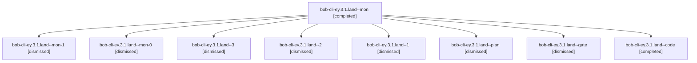

# Session: bob-cli-ey.3.1.land

[Agent Hoods](../README.md) / [bbugyi200](../users/bbugyi200/README.md) / [apollo](../users/bbugyi200/machines/apollo/README.md) / [bob-cli-ey](../users/bbugyi200/machines/apollo/hoods/bob-cli-ey/README.md) / bob-cli-ey.3.1.land

Owner: `bbugyi200.apollo` · Hood: `bob-cli-ey` · Members: 9 · Bead: [bob-cli-ey.3.1](https://github.com/bobs-org/bob-cli--beads/blob/main/pages/bob-cli-ey/bob-cli-ey.3.1.md)

## Lineage

The diagram is an optional enhancement; the ordered table below contains the same lineage in accessible text.

| Role | Agent | State | Model / provider | Timing | Commits | Prompt | Chat |
|---|---|---|---|---|---:|---|---|
| mon | bob-cli-ey.3.1.land--mon | completed | gpt-6-luna / codex | 2026-11-01T07:14:15.515438+00:00 → 2026-11-01T07:17:43.520150+00:00 | 0 | — | [Chat](../agents/bbugyi200.apollo.bob-cli-ey.3.1.land--mon/chat.md) |
| mon-1 | bob-cli-ey.3.1.land--mon-1 | dismissed | gpt-6-luna / codex | 2026-11-01T02:42:18.272011 → 2026-11-01T02:44:59.191132 | 0 | — | [Chat](../agents/bbugyi200.apollo.bob-cli-ey.3.1.land--mon-1/chat.md) |
| mon-0 | bob-cli-ey.3.1.land--mon-0 | dismissed | gpt-6-luna / codex | 2026-11-01T02:32:06.081382 → 2026-11-01T02:34:23.401912 | 0 | — | [Chat](../agents/bbugyi200.apollo.bob-cli-ey.3.1.land--mon-0/chat.md) |
| 3 | bob-cli-ey.3.1.land--3 | dismissed | gpt-6-luna / codex | 2026-11-01T02:46:16.035258 → 2026-11-01T02:55:44.754484 | 0 | [Prompt](../agents/bbugyi200.apollo.bob-cli-ey.3.1.land--3/prompt.md) | [Chat](../agents/bbugyi200.apollo.bob-cli-ey.3.1.land--3/chat.md) |
| 2 | bob-cli-ey.3.1.land--2 | dismissed | gpt-6-luna / codex | 2026-11-01T02:35:37.608599 → 2026-11-01T02:42:28.188458 | 0 | [Prompt](../agents/bbugyi200.apollo.bob-cli-ey.3.1.land--2/prompt.md) | [Chat](../agents/bbugyi200.apollo.bob-cli-ey.3.1.land--2/chat.md) |
| 1 | bob-cli-ey.3.1.land--1 | dismissed | gpt-6-luna / codex | 2026-11-01T02:17:43.412449 → 2026-11-01T02:32:13.534038 | 0 | [Prompt](../agents/bbugyi200.apollo.bob-cli-ey.3.1.land--1/prompt.md) | [Chat](../agents/bbugyi200.apollo.bob-cli-ey.3.1.land--1/chat.md) |
| plan | bob-cli-ey.3.1.land--plan | dismissed | gpt-6-astra / codex | 2026-11-01T01:45:56.385970 → 2026-11-01T02:14:28.122796 | 0 | [Prompt](../agents/bbugyi200.apollo.bob-cli-ey.3.1.land--plan/prompt.md) | [Chat](../agents/bbugyi200.apollo.bob-cli-ey.3.1.land--plan/chat.md) |
| gate | bob-cli-ey.3.1.land--gate | dismissed | gpt-6-astra / codex | 2026-11-01T01:55:48.543466 → 2026-11-01T01:56:00 | 0 | — | [Chat](../agents/bbugyi200.apollo.bob-cli-ey.3.1.land--gate/chat.md) |
| code | bob-cli-ey.3.1.land--code | completed | gpt-6-luna / codex | 2026-11-01T06:56:17.995339+00:00 → 2026-11-01T07:14:27.352243+00:00 | 0 | — | [Chat](../agents/bbugyi200.apollo.bob-cli-ey.3.1.land--code/chat.md) |

## Neighbors

| Agent | Relation | State |
|---|---|---|
| [bob-cli-ey.3](bbugyi200.apollo.bob-cli-ey.3.md) (session · 3) | ancestor | dismissed 3 |
| [bob-cli-ey.3.1.1](../agents/bbugyi200.apollo.bob-cli-ey.3.1.1/README.md) | bob-cli-ey.3.1 hood | dismissed |
| [bob-cli-ey.3.1.2](bbugyi200.apollo.bob-cli-ey.3.1.2.md) (session · 21) | bob-cli-ey.3.1 hood | dismissed 21 |
| [bob-cli-ey.3.1.3](../agents/bbugyi200.apollo.bob-cli-ey.3.1.3/README.md) | bob-cli-ey.3.1 hood | dismissed |
| [bob-cli-ey.3.1.4](../agents/bbugyi200.apollo.bob-cli-ey.3.1.4/README.md) | bob-cli-ey.3.1 hood | dismissed |
| [bob-cli-ey.1](bbugyi200.apollo.bob-cli-ey.1.md) (session · 3) | bob-cli-ey hood | dismissed 3 |
| [bob-cli-ey.1.1.1](bbugyi200.apollo.bob-cli-ey.1.1.1.md) (session · 21) | bob-cli-ey hood | dismissed 21 |
| [bob-cli-ey.1.1.2](bbugyi200.apollo.bob-cli-ey.1.1.2.md) (session · 7) | bob-cli-ey hood | dismissed 7 |
| [bob-cli-ey.1.1.3](../agents/bbugyi200.apollo.bob-cli-ey.1.1.3/README.md) | bob-cli-ey hood | dismissed |
| [bob-cli-ey.1.1.4](bbugyi200.apollo.bob-cli-ey.1.1.4.md) (session · 5) | bob-cli-ey hood | dismissed 5 |
| [bob-cli-ey.1.1.5](../agents/bbugyi200.apollo.bob-cli-ey.1.1.5/README.md) | bob-cli-ey hood | dismissed |
| [bob-cli-ey.1.1.6](bbugyi200.apollo.bob-cli-ey.1.1.6.md) (session · 9) | bob-cli-ey hood | dismissed 9 |
| [bob-cli-ey.1.1.land](bbugyi200.apollo.bob-cli-ey.1.1.land.md) (session · 3) | bob-cli-ey hood | completed 1, dismissed 2 |
| [bob-cli-ey.2](bbugyi200.apollo.bob-cli-ey.2.md) (session · 9) | bob-cli-ey hood | completed 1, dismissed 7, failed 1 |
| [bob-cli-ey.4](../agents/bbugyi200.apollo.bob-cli-ey.4/README.md) | bob-cli-ey hood | dismissed |
| [bob-cli-ey.5](../agents/bbugyi200.apollo.bob-cli-ey.5/README.md) | bob-cli-ey hood | dismissed |
| [bob-cli-ey.6](../agents/bbugyi200.apollo.bob-cli-ey.6/README.md) | bob-cli-ey hood | dismissed |
| [bob-cli-ey.7.1](../agents/bbugyi200.apollo.bob-cli-ey.7.1/README.md) | bob-cli-ey hood | active |
| [bob-cli-ey.7.2](../agents/bbugyi200.apollo.bob-cli-ey.7.2/README.md) | bob-cli-ey hood | active |
| [bob-cli-ey.7.3](bbugyi200.apollo.bob-cli-ey.7.3.md) (session · 5) | bob-cli-ey hood | active 5 |
| [bob-cli-ey.7.4](bbugyi200.apollo.bob-cli-ey.7.4.md) (session · 25) | bob-cli-ey hood | active 13, completed 9, failed 3 |
| [bob-cli-ey.7.land](bbugyi200.apollo.bob-cli-ey.7.land.md) (session · 5) | bob-cli-ey hood | active 3, completed 2 |
| [bob-cli-ey.land](bbugyi200.apollo.bob-cli-ey.land.md) (session · 3) | bob-cli-ey hood | dismissed 3 |
