# Session: bob-cli-ey.7.4

[Agent Hoods](../README.md) / [bbugyi200](../users/bbugyi200/README.md) / [apollo](../users/bbugyi200/machines/apollo/README.md) / [bob-cli-ey](../users/bbugyi200/machines/apollo/hoods/bob-cli-ey/README.md) / bob-cli-ey.7.4

Owner: `bbugyi200.apollo` · Hood: `bob-cli-ey` · Members: 25 · Bead: [bob-cli-ey.7.4](https://github.com/bobs-org/bob-cli--beads/blob/main/pages/bob-cli-ey/bob-cli-ey.7.4.md)

## Lineage

```mermaid
flowchart TD
  n0["bob-cli-ey.7.4--7 [completed]"]
  n1["bob-cli-ey.7.4--mon-9 [failed]"]
  n0 --> n1
  n2["bob-cli-ey.7.4--1 [active]"]
  n0 --> n2
  n3["bob-cli-ey.7.4--mon-8 [completed]"]
  n0 --> n3
  n4["bob-cli-ey.7.4--b [completed]"]
  n0 --> n4
  n5["bob-cli-ey.7.4--5 [active]"]
  n0 --> n5
  n6["bob-cli-ey.7.4--2 [active]"]
  n0 --> n6
  n7["bob-cli-ey.7.4--mon-0 [active]"]
  n0 --> n7
  n8["bob-cli-ey.7.4--mon-6 [failed]"]
  n0 --> n8
  n9["bob-cli-ey.7.4--mon-5 [failed]"]
  n0 --> n9
  n10["bob-cli-ey.7.4--3 [active]"]
  n0 --> n10
  n11["bob-cli-ey.7.4--8 [completed]"]
  n0 --> n11
  n12["bob-cli-ey.7.4--c [completed]"]
  n0 --> n12
  n13["bob-cli-ey.7.4--mon-7 [completed]"]
  n0 --> n13
  n14["bob-cli-ey.7.4--4 [active]"]
  n0 --> n14
  n15["bob-cli-ey.7.4--a [completed]"]
  n0 --> n15
  n16["bob-cli-ey.7.4--plan [active]"]
  n0 --> n16
  n17["bob-cli-ey.7.4--9 [completed]"]
  n0 --> n17
  n18["bob-cli-ey.7.4--mon-2 [active]"]
  n0 --> n18
  n19["bob-cli-ey.7.4--6 [active]"]
  n0 --> n19
  n20["bob-cli-ey.7.4--mon-a [completed]"]
  n0 --> n20
  n21["bob-cli-ey.7.4--mon-4 [active]"]
  n0 --> n21
  n22["bob-cli-ey.7.4--mon-3 [active]"]
  n0 --> n22
  n23["bob-cli-ey.7.4--mon [active]"]
  n0 --> n23
  n24["bob-cli-ey.7.4--mon-1 [active]"]
  n0 --> n24
```

The diagram is an optional enhancement; the ordered table below contains the same lineage in accessible text.

| Role | Agent | State | Model / provider | Timing | Commits | Prompt | Chat |
|---|---|---|---|---|---:|---|---|
| 7 | bob-cli-ey.7.4--7 | completed | gpt-6-luna / codex | 2026-11-01T12:22:11.277598+00:00 → 2026-11-01T12:29:13.842982+00:00 | 0 | [Prompt](../agents/bbugyi200.apollo.bob-cli-ey.7.4--7/prompt.md) | [Chat](../agents/bbugyi200.apollo.bob-cli-ey.7.4--7/chat.md) |
| mon-9 | bob-cli-ey.7.4--mon-9 | failed | gpt-6-luna / codex | 2026-11-01T12:46:02.157999+00:00 → 2026-11-01T13:01:08.266447+00:00 | 0 | — | [Chat](../agents/bbugyi200.apollo.bob-cli-ey.7.4--mon-9/chat.md) |
| 1 | bob-cli-ey.7.4--1 | active | gpt-6-luna / codex | 2026-11-01T11:06:43.463940+00:00 | 0 | [Prompt](../agents/bbugyi200.apollo.bob-cli-ey.7.4--1/prompt.md) | [Chat](../agents/bbugyi200.apollo.bob-cli-ey.7.4--1/chat.md) |
| mon-8 | bob-cli-ey.7.4--mon-8 | completed | gpt-6-luna / codex | 2026-11-01T12:40:28.122434+00:00 → 2026-11-01T12:44:01.385210+00:00 | 0 | — | [Chat](../agents/bbugyi200.apollo.bob-cli-ey.7.4--mon-8/chat.md) |
| b | bob-cli-ey.7.4--b | completed | gpt-6-luna / codex | 2026-11-01T13:01:09.690239+00:00 → 2026-11-01T13:03:29.588306+00:00 | 0 | [Prompt](../agents/bbugyi200.apollo.bob-cli-ey.7.4--b/prompt.md) | [Chat](../agents/bbugyi200.apollo.bob-cli-ey.7.4--b/chat.md) |
| 5 | bob-cli-ey.7.4--5 | active | gpt-6-luna / codex | 2026-11-01T11:45:05.501454+00:00 | 0 | [Prompt](../agents/bbugyi200.apollo.bob-cli-ey.7.4--5/prompt.md) | [Chat](../agents/bbugyi200.apollo.bob-cli-ey.7.4--5/chat.md) |
| 2 | bob-cli-ey.7.4--2 | active | gpt-6-luna / codex | 2026-11-01T11:28:10.962656+00:00 | 0 | [Prompt](../agents/bbugyi200.apollo.bob-cli-ey.7.4--2/prompt.md) | [Chat](../agents/bbugyi200.apollo.bob-cli-ey.7.4--2/chat.md) |
| mon-0 | bob-cli-ey.7.4--mon-0 | active | gpt-6-luna / codex | 2026-11-01T11:19:06.330091+00:00 | 0 | — | — |
| mon-6 | bob-cli-ey.7.4--mon-6 | failed | gpt-6-luna / codex | 2026-11-01T12:29:04.942941+00:00 → 2026-11-01T12:32:42.913384+00:00 | 0 | — | [Chat](../agents/bbugyi200.apollo.bob-cli-ey.7.4--mon-6/chat.md) |
| mon-5 | bob-cli-ey.7.4--mon-5 | failed | gpt-6-luna / codex | 2026-11-01T12:08:36.224455+00:00 → 2026-11-01T12:22:11.760808+00:00 | 0 | — | [Chat](../agents/bbugyi200.apollo.bob-cli-ey.7.4--mon-5/chat.md) |
| 3 | bob-cli-ey.7.4--3 | active | gpt-6-luna / codex | 2026-11-01T11:32:12.640782+00:00 | 0 | [Prompt](../agents/bbugyi200.apollo.bob-cli-ey.7.4--3/prompt.md) | [Chat](../agents/bbugyi200.apollo.bob-cli-ey.7.4--3/chat.md) |
| 8 | bob-cli-ey.7.4--8 | completed | gpt-6-luna / codex | 2026-11-01T12:32:42.438907+00:00 → 2026-11-01T12:35:19.912665+00:00 | 0 | [Prompt](../agents/bbugyi200.apollo.bob-cli-ey.7.4--8/prompt.md) | [Chat](../agents/bbugyi200.apollo.bob-cli-ey.7.4--8/chat.md) |
| c | bob-cli-ey.7.4--c | completed | gpt-6-luna / codex | 2026-11-01T13:07:23.108619+00:00 → 2026-11-01T13:10:43.397870+00:00 | 0 | [Prompt](../agents/bbugyi200.apollo.bob-cli-ey.7.4--c/prompt.md) | [Chat](../agents/bbugyi200.apollo.bob-cli-ey.7.4--c/chat.md) |
| mon-7 | bob-cli-ey.7.4--mon-7 | completed | gpt-6-luna / codex | 2026-11-01T12:35:08.014489+00:00 → 2026-11-01T12:39:04.847303+00:00 | 0 | — | [Chat](../agents/bbugyi200.apollo.bob-cli-ey.7.4--mon-7/chat.md) |
| 4 | bob-cli-ey.7.4--4 | active | gpt-6-luna / codex | 2026-11-01T11:35:46.206846+00:00 | 0 | [Prompt](../agents/bbugyi200.apollo.bob-cli-ey.7.4--4/prompt.md) | [Chat](../agents/bbugyi200.apollo.bob-cli-ey.7.4--4/chat.md) |
| a | bob-cli-ey.7.4--a | completed | gpt-6-luna / codex | 2026-11-01T12:44:01.084592+00:00 → 2026-11-01T12:46:10.919084+00:00 | 0 | [Prompt](../agents/bbugyi200.apollo.bob-cli-ey.7.4--a/prompt.md) | [Chat](../agents/bbugyi200.apollo.bob-cli-ey.7.4--a/chat.md) |
| plan | bob-cli-ey.7.4--plan | active | gpt-6-luna / codex | 2026-11-01T10:49:12.614796+00:00 | 0 | [Prompt](../agents/bbugyi200.apollo.bob-cli-ey.7.4--plan/prompt.md) | [Chat](../agents/bbugyi200.apollo.bob-cli-ey.7.4--plan/chat.md) |
| 9 | bob-cli-ey.7.4--9 | completed | gpt-6-luna / codex | 2026-11-01T12:39:04.393777+00:00 → 2026-11-01T12:40:39.345818+00:00 | 0 | [Prompt](../agents/bbugyi200.apollo.bob-cli-ey.7.4--9/prompt.md) | [Chat](../agents/bbugyi200.apollo.bob-cli-ey.7.4--9/chat.md) |
| mon-2 | bob-cli-ey.7.4--mon-2 | active | gpt-6-luna / codex | 2026-11-01T11:34:28.753636+00:00 | 0 | — | — |
| 6 | bob-cli-ey.7.4--6 | active | gpt-6-luna / codex | 2026-11-01T12:02:04.371681+00:00 | 0 | [Prompt](../agents/bbugyi200.apollo.bob-cli-ey.7.4--6/prompt.md) | [Chat](../agents/bbugyi200.apollo.bob-cli-ey.7.4--6/chat.md) |
| mon-a | bob-cli-ey.7.4--mon-a | completed | gpt-6-luna / codex | 2026-11-01T13:03:13.894552+00:00 → 2026-11-01T13:07:23.255028+00:00 | 0 | — | [Chat](../agents/bbugyi200.apollo.bob-cli-ey.7.4--mon-a/chat.md) |
| mon-4 | bob-cli-ey.7.4--mon-4 | active | gpt-6-luna / codex | 2026-11-01T11:47:50.366358+00:00 | 0 | — | — |
| mon-3 | bob-cli-ey.7.4--mon-3 | active | gpt-6-luna / codex | 2026-11-01T11:41:36.249114+00:00 | 0 | — | — |
| mon | bob-cli-ey.7.4--mon | active | gpt-6-luna / codex | 2026-11-01T11:05:23.205387+00:00 | 0 | — | — |
| mon-1 | bob-cli-ey.7.4--mon-1 | active | gpt-6-luna / codex | 2026-11-01T11:30:54.551408+00:00 | 0 | — | — |

## Neighbors

| Agent | Relation | State |
|---|---|---|
| [bob-cli-ey.7.1](../agents/bbugyi200.apollo.bob-cli-ey.7.1/README.md) | bob-cli-ey.7 hood | active |
| [bob-cli-ey.7.2](../agents/bbugyi200.apollo.bob-cli-ey.7.2/README.md) | bob-cli-ey.7 hood | active |
| [bob-cli-ey.7.3](bbugyi200.apollo.bob-cli-ey.7.3.md) (session · 5) | bob-cli-ey.7 hood | active 5 |
| [bob-cli-ey.7.land](bbugyi200.apollo.bob-cli-ey.7.land.md) (session · 5) | bob-cli-ey.7 hood | active 3, completed 2 |
| [bob-cli-ey.1](bbugyi200.apollo.bob-cli-ey.1.md) (session · 3) | bob-cli-ey hood | active 2, dismissed 1 |
| [bob-cli-ey.1.1.1](bbugyi200.apollo.bob-cli-ey.1.1.1.md) (session · 21) | bob-cli-ey hood | active 13, dismissed 8 |
| [bob-cli-ey.1.1.2](bbugyi200.apollo.bob-cli-ey.1.1.2.md) (session · 7) | bob-cli-ey hood | active 5, dismissed 2 |
| [bob-cli-ey.1.1.3](../agents/bbugyi200.apollo.bob-cli-ey.1.1.3/README.md) | bob-cli-ey hood | active |
| [bob-cli-ey.1.1.4](bbugyi200.apollo.bob-cli-ey.1.1.4.md) (session · 5) | bob-cli-ey hood | active 4, dismissed 1 |
| [bob-cli-ey.1.1.5](../agents/bbugyi200.apollo.bob-cli-ey.1.1.5/README.md) | bob-cli-ey hood | dismissed |
| [bob-cli-ey.1.1.6](bbugyi200.apollo.bob-cli-ey.1.1.6.md) (session · 9) | bob-cli-ey hood | active 4, dismissed 5 |
| [bob-cli-ey.1.1.land](bbugyi200.apollo.bob-cli-ey.1.1.land.md) (session · 3) | bob-cli-ey hood | active 2, completed 1 |
| [bob-cli-ey.2](bbugyi200.apollo.bob-cli-ey.2.md) (session · 9) | bob-cli-ey hood | active 5, completed 1, dismissed 2, failed 1 |
| [bob-cli-ey.3](bbugyi200.apollo.bob-cli-ey.3.md) (session · 3) | bob-cli-ey hood | active 2, dismissed 1 |
| [bob-cli-ey.3.1.1](../agents/bbugyi200.apollo.bob-cli-ey.3.1.1/README.md) | bob-cli-ey hood | active |
| [bob-cli-ey.3.1.2](bbugyi200.apollo.bob-cli-ey.3.1.2.md) (session · 21) | bob-cli-ey hood | active 15, dismissed 6 |
| [bob-cli-ey.3.1.3](../agents/bbugyi200.apollo.bob-cli-ey.3.1.3/README.md) | bob-cli-ey hood | active |
| [bob-cli-ey.3.1.4](../agents/bbugyi200.apollo.bob-cli-ey.3.1.4/README.md) | bob-cli-ey hood | active |
| [bob-cli-ey.3.1.land](bbugyi200.apollo.bob-cli-ey.3.1.land.md) (session · 9) | bob-cli-ey hood | active 6, completed 2, dismissed 1 |
| [bob-cli-ey.4](../agents/bbugyi200.apollo.bob-cli-ey.4/README.md) | bob-cli-ey hood | active |
| [bob-cli-ey.5](../agents/bbugyi200.apollo.bob-cli-ey.5/README.md) | bob-cli-ey hood | active |
| [bob-cli-ey.6](../agents/bbugyi200.apollo.bob-cli-ey.6/README.md) | bob-cli-ey hood | dismissed |
| [bob-cli-ey.land](bbugyi200.apollo.bob-cli-ey.land.md) (session · 3) | bob-cli-ey hood | active 2, dismissed 1 |
