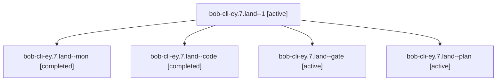

# Session: bob-cli-ey.7.land

[Agent Hoods](../README.md) / [bbugyi200](../users/bbugyi200/README.md) / [apollo](../users/bbugyi200/machines/apollo/README.md) / [bob-cli-ey](../users/bbugyi200/machines/apollo/hoods/bob-cli-ey/README.md) / bob-cli-ey.7.land

Owner: `bbugyi200.apollo` · Hood: `bob-cli-ey` · Members: 5 · Bead: [bob-cli-ey.7](https://github.com/bobs-org/bob-cli--beads/blob/main/pages/bob-cli-ey/bob-cli-ey.7.md)

## Lineage

The diagram is an optional enhancement; the ordered table below contains the same lineage in accessible text.

| Role | Agent | State | Model / provider | Timing | Commits | Prompt | Chat |
|---|---|---|---|---|---:|---|---|
| 1 | bob-cli-ey.7.land--1 | active | muse-spark-1.3-contributor / muse | 2026-11-01T14:15:38.455184+00:00 | [1](../agents/bbugyi200.apollo.bob-cli-ey.7.land--1/README.md#commits) | [Prompt](../agents/bbugyi200.apollo.bob-cli-ey.7.land--1/prompt.md) | — |
| mon | bob-cli-ey.7.land--mon | completed | muse-spark-1.3-contributor / muse | 2026-11-01T14:13:01.987191+00:00 → 2026-11-01T14:15:38.688167+00:00 | 0 | — | [Chat](../agents/bbugyi200.apollo.bob-cli-ey.7.land--mon/chat.md) |
| code | bob-cli-ey.7.land--code | completed | muse-spark-1.3-contributor / muse | 2026-11-01T13:32:23.316925+00:00 → 2026-11-01T14:13:12.964614+00:00 | 0 | — | [Chat](../agents/bbugyi200.apollo.bob-cli-ey.7.land--code/chat.md) |
| gate | bob-cli-ey.7.land--gate | active | gpt-6-astra / codex | 2026-11-01T13:31:53.809596+00:00 | 0 | — | [Chat](../agents/bbugyi200.apollo.bob-cli-ey.7.land--gate/chat.md) |
| plan | bob-cli-ey.7.land--plan | active | gpt-6-astra / codex | 2026-11-01T13:12:00.381211+00:00 | 0 | [Prompt](../agents/bbugyi200.apollo.bob-cli-ey.7.land--plan/prompt.md) | [Chat](../agents/bbugyi200.apollo.bob-cli-ey.7.land--plan/chat.md) |

## Commits

| Role | Repo | Commit | Subject | Committed |
|---|---|---|---|---|
| 1 | — | `12078cc` | fix(capture): retype ID-less picker refs, bare-marker existing subject, near-duplicate override | 2026-11-01 09:21:54 EST |

## Neighbors

| Agent | Relation | State |
|---|---|---|
| [bob-cli-ey.7.1](../agents/bbugyi200.apollo.bob-cli-ey.7.1/README.md) | bob-cli-ey.7 hood | active |
| [bob-cli-ey.7.2](../agents/bbugyi200.apollo.bob-cli-ey.7.2/README.md) | bob-cli-ey.7 hood | active |
| [bob-cli-ey.7.3](bbugyi200.apollo.bob-cli-ey.7.3.md) (session · 5) | bob-cli-ey.7 hood | active 5 |
| [bob-cli-ey.7.4](bbugyi200.apollo.bob-cli-ey.7.4.md) (session · 25) | bob-cli-ey.7 hood | active 13, completed 9, failed 3 |
| [bob-cli-ey.1](bbugyi200.apollo.bob-cli-ey.1.md) (session · 3) | bob-cli-ey hood | dismissed 3 |
| [bob-cli-ey.1.1.1](bbugyi200.apollo.bob-cli-ey.1.1.1.md) (session · 21) | bob-cli-ey hood | dismissed 21 |
| [bob-cli-ey.1.1.2](bbugyi200.apollo.bob-cli-ey.1.1.2.md) (session · 7) | bob-cli-ey hood | dismissed 7 |
| [bob-cli-ey.1.1.3](../agents/bbugyi200.apollo.bob-cli-ey.1.1.3/README.md) | bob-cli-ey hood | dismissed |
| [bob-cli-ey.1.1.4](bbugyi200.apollo.bob-cli-ey.1.1.4.md) (session · 5) | bob-cli-ey hood | dismissed 5 |
| [bob-cli-ey.1.1.5](../agents/bbugyi200.apollo.bob-cli-ey.1.1.5/README.md) | bob-cli-ey hood | dismissed |
| [bob-cli-ey.1.1.6](bbugyi200.apollo.bob-cli-ey.1.1.6.md) (session · 9) | bob-cli-ey hood | dismissed 9 |
| [bob-cli-ey.1.1.land](bbugyi200.apollo.bob-cli-ey.1.1.land.md) (session · 3) | bob-cli-ey hood | completed 1, dismissed 2 |
| [bob-cli-ey.2](bbugyi200.apollo.bob-cli-ey.2.md) (session · 9) | bob-cli-ey hood | completed 1, dismissed 7, failed 1 |
| [bob-cli-ey.3](bbugyi200.apollo.bob-cli-ey.3.md) (session · 3) | bob-cli-ey hood | dismissed 3 |
| [bob-cli-ey.3.1.1](../agents/bbugyi200.apollo.bob-cli-ey.3.1.1/README.md) | bob-cli-ey hood | dismissed |
| [bob-cli-ey.3.1.2](bbugyi200.apollo.bob-cli-ey.3.1.2.md) (session · 21) | bob-cli-ey hood | dismissed 21 |
| [bob-cli-ey.3.1.3](../agents/bbugyi200.apollo.bob-cli-ey.3.1.3/README.md) | bob-cli-ey hood | dismissed |
| [bob-cli-ey.3.1.4](../agents/bbugyi200.apollo.bob-cli-ey.3.1.4/README.md) | bob-cli-ey hood | dismissed |
| [bob-cli-ey.3.1.land](bbugyi200.apollo.bob-cli-ey.3.1.land.md) (session · 9) | bob-cli-ey hood | completed 2, dismissed 7 |
| [bob-cli-ey.4](../agents/bbugyi200.apollo.bob-cli-ey.4/README.md) | bob-cli-ey hood | dismissed |
| [bob-cli-ey.5](../agents/bbugyi200.apollo.bob-cli-ey.5/README.md) | bob-cli-ey hood | dismissed |
| [bob-cli-ey.6](../agents/bbugyi200.apollo.bob-cli-ey.6/README.md) | bob-cli-ey hood | dismissed |
| [bob-cli-ey.land](bbugyi200.apollo.bob-cli-ey.land.md) (session · 3) | bob-cli-ey hood | dismissed 3 |
