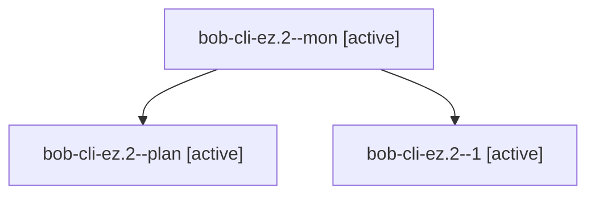

# Session: bob-cli-ez.2

[Agent Hoods](../README.md) / [bbugyi200](../users/bbugyi200/README.md) / [apollo](../users/bbugyi200/machines/apollo/README.md) / [bob-cli-ez](../users/bbugyi200/machines/apollo/hoods/bob-cli-ez/README.md) / bob-cli-ez.2

Owner: `bbugyi200.apollo` · Hood: `bob-cli-ez` · Members: 3 · Bead: [bob-cli-ez.2](https://github.com/bobs-org/bob-cli--beads/blob/main/pages/bob-cli-ez/bob-cli-ez.2.md)

## Lineage

The diagram is an optional enhancement; the ordered table below contains the same lineage in accessible text.

| Role | Agent | State | Model / provider | Timing | Commits | Prompt | Chat |
|---|---|---|---|---|---:|---|---|
| mon | bob-cli-ez.2--mon | active | grok-4.6 / grok | 2026-10-31T18:02:39.441511+00:00 | 0 | — | [Chat](../agents/bbugyi200.apollo.bob-cli-ez.2--mon/chat.md) |
| plan | bob-cli-ez.2--plan | active | grok-4.6 / grok | 2026-10-31T17:34:09.452332+00:00 | 0 | [Prompt](../agents/bbugyi200.apollo.bob-cli-ez.2--plan/prompt.md) | [Chat](../agents/bbugyi200.apollo.bob-cli-ez.2--plan/chat.md) |
| 1 | bob-cli-ez.2--1 | active | grok-4.6 / grok | 2026-10-31T18:11:24.818219+00:00 | [1](../agents/bbugyi200.apollo.bob-cli-ez.2--1/README.md#commits) | [Prompt](../agents/bbugyi200.apollo.bob-cli-ez.2--1/prompt.md) | [Chat](../agents/bbugyi200.apollo.bob-cli-ez.2--1/chat.md) |

## Commits

| Role | Repo | Commit | Subject | Committed |
|---|---|---|---|---|
| 1 | bob-cli | [`ecffd6f`](https://github.com/bobs-org/bob-cli/commit/ecffd6fa8fa8fbc444d276a434cac43b3b4df75b) | feat(gkeep): persist host-local Keep status cache | 2026-10-31 14:28:03 EDT |

## Neighbors

| Agent | Relation | State |
|---|---|---|
| [bob-cli-ez.1](../agents/bbugyi200.apollo.bob-cli-ez.1/README.md) | bob-cli-ez hood | active |
| [bob-cli-ez.3](../agents/bbugyi200.apollo.bob-cli-ez.3/README.md) | bob-cli-ez hood | active |
| [bob-cli-ez.4](../agents/bbugyi200.apollo.bob-cli-ez.4/README.md) | bob-cli-ez hood | active |
| [bob-cli-ez.5](../agents/bbugyi200.apollo.bob-cli-ez.5/README.md) | bob-cli-ez hood | active |
| [bob-cli-ez.6](../agents/bbugyi200.apollo.bob-cli-ez.6/README.md) | bob-cli-ez hood | active |
| [bob-cli-ez.land](bbugyi200.apollo.bob-cli-ez.land.md) (session · 3) | bob-cli-ez hood | active 2, completed 1 |
