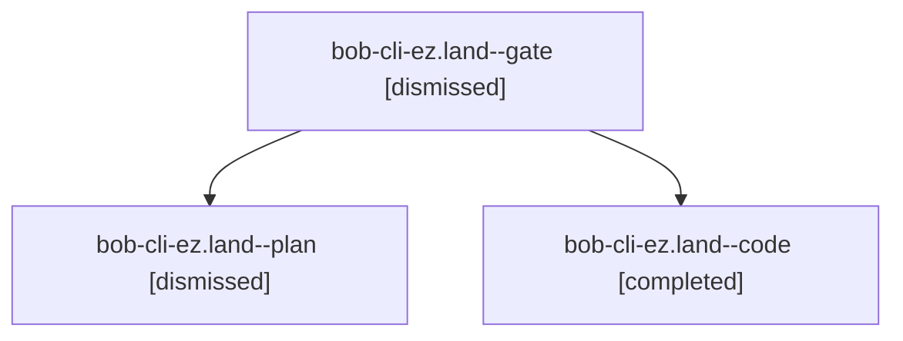

# Session: bob-cli-ez.land

[Agent Hoods](../README.md) / [bbugyi200](../users/bbugyi200/README.md) / [apollo](../users/bbugyi200/machines/apollo/README.md) / [bob-cli-ez](../users/bbugyi200/machines/apollo/hoods/bob-cli-ez/README.md) / bob-cli-ez.land

Owner: `bbugyi200.apollo` · Hood: `bob-cli-ez` · Members: 3 · Bead: [bob-cli-ez](https://github.com/bobs-org/bob-cli--beads/blob/main/pages/bob-cli-ez/README.md)

## Lineage

The diagram is an optional enhancement; the ordered table below contains the same lineage in accessible text.

| Role | Agent | State | Model / provider | Timing | Commits | Prompt | Chat |
|---|---|---|---|---|---:|---|---|
| gate | bob-cli-ez.land--gate | dismissed | opus / claude | 2026-10-31T16:39:59.842528 → 2026-10-31T16:40:12 | 0 | — | [Chat](../agents/bbugyi200.apollo.bob-cli-ez.land--gate/chat.md) |
| plan | bob-cli-ez.land--plan | dismissed | opus / claude | 2026-10-31T16:21:49.916810 → 2026-10-31T16:51:17.206920 | 0 | [Prompt](../agents/bbugyi200.apollo.bob-cli-ez.land--plan/prompt.md) | [Chat](../agents/bbugyi200.apollo.bob-cli-ez.land--plan/chat.md) |
| code | bob-cli-ez.land--code | completed | gpt-6-luna / codex | 2026-10-31T20:40:37.591042+00:00 → 2026-10-31T20:51:16.876456+00:00 | 0 | — | [Chat](../agents/bbugyi200.apollo.bob-cli-ez.land--code/chat.md) |

## Neighbors

| Agent | Relation | State |
|---|---|---|
| [bob-cli-ez.1](../agents/bbugyi200.apollo.bob-cli-ez.1/README.md) | bob-cli-ez hood | dismissed |
| [bob-cli-ez.2](bbugyi200.apollo.bob-cli-ez.2.md) (session · 3) | bob-cli-ez hood | active 2, dismissed 1 |
| [bob-cli-ez.3](../agents/bbugyi200.apollo.bob-cli-ez.3/README.md) | bob-cli-ez hood | active |
| [bob-cli-ez.4](../agents/bbugyi200.apollo.bob-cli-ez.4/README.md) | bob-cli-ez hood | dismissed |
| [bob-cli-ez.5](../agents/bbugyi200.apollo.bob-cli-ez.5/README.md) | bob-cli-ez hood | active |
| [bob-cli-ez.6](../agents/bbugyi200.apollo.bob-cli-ez.6/README.md) | bob-cli-ez hood | active |
