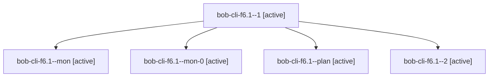

# Session: bob-cli-f6.1

[Agent Hoods](../README.md) / [bbugyi200](../users/bbugyi200/README.md) / [apollo](../users/bbugyi200/machines/apollo/README.md) / [bob-cli-f6](../users/bbugyi200/machines/apollo/hoods/bob-cli-f6/README.md) / bob-cli-f6.1

Owner: `bbugyi200.apollo` · Hood: `bob-cli-f6` · Members: 5 · Bead: [bob-cli-f6.1](https://github.com/bobs-org/bob-cli--beads/blob/main/pages/bob-cli-f6/bob-cli-f6.1.md)

## Lineage

The diagram is an optional enhancement; the ordered table below contains the same lineage in accessible text.

| Role | Agent | State | Model / provider | Timing | Commits | Prompt | Chat |
|---|---|---|---|---|---:|---|---|
| 1 | bob-cli-f6.1--1 | active | grok-4.6 / grok | 2026-11-01T17:36:38.086290+00:00 | 0 | [Prompt](../agents/bbugyi200.apollo.bob-cli-f6.1--1/prompt.md) | [Chat](../agents/bbugyi200.apollo.bob-cli-f6.1--1/chat.md) |
| mon | bob-cli-f6.1--mon | active | grok-4.6 / grok | 2026-11-01T17:25:52.940393+00:00 | 0 | — | — |
| mon-0 | bob-cli-f6.1--mon-0 | active | grok-4.6 / grok | 2026-11-01T17:48:08.888163+00:00 | 0 | — | — |
| plan | bob-cli-f6.1--plan | active | grok-4.6 / grok | 2026-11-01T16:26:04.645000+00:00 | 0 | [Prompt](../agents/bbugyi200.apollo.bob-cli-f6.1--plan/prompt.md) | [Chat](../agents/bbugyi200.apollo.bob-cli-f6.1--plan/chat.md) |
| 2 | bob-cli-f6.1--2 | active | grok-4.6 / grok | 2026-11-01T18:01:21.118047+00:00 | [1](../agents/bbugyi200.apollo.bob-cli-f6.1--2/README.md#commits) | [Prompt](../agents/bbugyi200.apollo.bob-cli-f6.1--2/prompt.md) | — |

## Commits

| Role | Repo | Commit | Subject | Committed |
|---|---|---|---|---|
| 2 | bob-cli | [`6d39305`](https://github.com/bobs-org/bob-cli/commit/6d39305a8cc4d39b2c2213c8b9e702cfacb648b4) | feat(pomodoro)!: omit untracked sessions from clocks and counts | 2026-11-01 13:19:50 EST |

## Neighbors

| Agent | Relation | State |
|---|---|---|
| [bob-cli-f6.2](../agents/bbugyi200.apollo.bob-cli-f6.2/README.md) | bob-cli-f6 hood | active |
| [bob-cli-f6.3](../agents/bbugyi200.apollo.bob-cli-f6.3/README.md) | bob-cli-f6 hood | active |
| [bob-cli-f6.4](../agents/bbugyi200.apollo.bob-cli-f6.4/README.md) | bob-cli-f6 hood | active |
| [bob-cli-f6.5](../agents/bbugyi200.apollo.bob-cli-f6.5/README.md) | bob-cli-f6 hood | active |
| [bob-cli-f6.6](../agents/bbugyi200.apollo.bob-cli-f6.6/README.md) | bob-cli-f6 hood | active |
| [bob-cli-f6.7](../agents/bbugyi200.apollo.bob-cli-f6.7/README.md) | bob-cli-f6 hood | active |
| [bob-cli-f6.8](bbugyi200.apollo.bob-cli-f6.8.md) (session · 9) | bob-cli-f6 hood | active 9 |
| [bob-cli-f6.land](bbugyi200.apollo.bob-cli-f6.land.md) (session · 5) | bob-cli-f6 hood | active 3, completed 2 |
