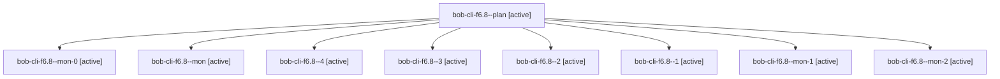

# Session: bob-cli-f6.8

[Agent Hoods](../README.md) / [bbugyi200](../users/bbugyi200/README.md) / [apollo](../users/bbugyi200/machines/apollo/README.md) / [bob-cli-f6](../users/bbugyi200/machines/apollo/hoods/bob-cli-f6/README.md) / bob-cli-f6.8

Owner: `bbugyi200.apollo` · Hood: `bob-cli-f6` · Members: 9 · Bead: [bob-cli-f6.8](https://github.com/bobs-org/bob-cli--beads/blob/main/pages/bob-cli-f6/bob-cli-f6.8.md)

## Lineage

The diagram is an optional enhancement; the ordered table below contains the same lineage in accessible text.

| Role | Agent | State | Model / provider | Timing | Commits | Prompt | Chat |
|---|---|---|---|---|---:|---|---|
| plan | bob-cli-f6.8--plan | active | gpt-6-luna / codex | 2026-11-01T22:23:11.779903+00:00 | 0 | [Prompt](../agents/bbugyi200.apollo.bob-cli-f6.8--plan/prompt.md) | [Chat](../agents/bbugyi200.apollo.bob-cli-f6.8--plan/chat.md) |
| mon-0 | bob-cli-f6.8--mon-0 | active | gpt-6-luna / codex | 2026-11-02T00:02:54.356210+00:00 | 0 | — | — |
| mon | bob-cli-f6.8--mon | active | gpt-6-luna / codex | 2026-11-01T22:45:50.399331+00:00 | 0 | — | — |
| 4 | bob-cli-f6.8--4 | active | sonnet / claude | 2026-11-02T00:50:43.394372+00:00 | 0 | [Prompt](../agents/bbugyi200.apollo.bob-cli-f6.8--4/prompt.md) | — |
| 3 | bob-cli-f6.8--3 | active | gpt-6-luna / codex | 2026-11-02T00:36:26.672232+00:00 | 0 | [Prompt](../agents/bbugyi200.apollo.bob-cli-f6.8--3/prompt.md) | [Chat](../agents/bbugyi200.apollo.bob-cli-f6.8--3/chat.md) |
| 2 | bob-cli-f6.8--2 | active | gpt-6-luna / codex | 2026-11-02T00:22:32.101887+00:00 | 0 | [Prompt](../agents/bbugyi200.apollo.bob-cli-f6.8--2/prompt.md) | [Chat](../agents/bbugyi200.apollo.bob-cli-f6.8--2/chat.md) |
| 1 | bob-cli-f6.8--1 | active | gpt-6-luna / codex | 2026-11-01T23:46:59.579461+00:00 | 0 | [Prompt](../agents/bbugyi200.apollo.bob-cli-f6.8--1/prompt.md) | [Chat](../agents/bbugyi200.apollo.bob-cli-f6.8--1/chat.md) |
| mon-1 | bob-cli-f6.8--mon-1 | active | gpt-6-luna / codex | 2026-11-02T00:25:52.866590+00:00 | 0 | — | — |
| mon-2 | bob-cli-f6.8--mon-2 | active | gpt-6-luna / codex | 2026-11-02T00:38:27.772335+00:00 | 0 | — | — |

## Neighbors

| Agent | Relation | State |
|---|---|---|
| [bob-cli-f6.1](bbugyi200.apollo.bob-cli-f6.1.md) (session · 5) | bob-cli-f6 hood | active 5 |
| [bob-cli-f6.2](../agents/bbugyi200.apollo.bob-cli-f6.2/README.md) | bob-cli-f6 hood | active |
| [bob-cli-f6.3](../agents/bbugyi200.apollo.bob-cli-f6.3/README.md) | bob-cli-f6 hood | active |
| [bob-cli-f6.4](../agents/bbugyi200.apollo.bob-cli-f6.4/README.md) | bob-cli-f6 hood | active |
| [bob-cli-f6.5](../agents/bbugyi200.apollo.bob-cli-f6.5/README.md) | bob-cli-f6 hood | active |
| [bob-cli-f6.6](../agents/bbugyi200.apollo.bob-cli-f6.6/README.md) | bob-cli-f6 hood | active |
| [bob-cli-f6.7](../agents/bbugyi200.apollo.bob-cli-f6.7/README.md) | bob-cli-f6 hood | active |
| [bob-cli-f6.land](bbugyi200.apollo.bob-cli-f6.land.md) (session · 5) | bob-cli-f6 hood | active 3, completed 2 |
