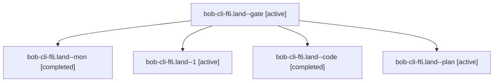

# Session: bob-cli-f6.land

[Agent Hoods](../README.md) / [bbugyi200](../users/bbugyi200/README.md) / [apollo](../users/bbugyi200/machines/apollo/README.md) / [bob-cli-f6](../users/bbugyi200/machines/apollo/hoods/bob-cli-f6/README.md) / bob-cli-f6.land

Owner: `bbugyi200.apollo` · Hood: `bob-cli-f6` · Members: 5 · Bead: [bob-cli-f6](https://github.com/bobs-org/bob-cli--beads/blob/main/pages/bob-cli-f6/README.md)

## Lineage

The diagram is an optional enhancement; the ordered table below contains the same lineage in accessible text.

| Role | Agent | State | Model / provider | Timing | Commits | Prompt | Chat |
|---|---|---|---|---|---:|---|---|
| gate | bob-cli-f6.land--gate | active | opus / claude | 2026-11-02T02:02:48.636871+00:00 | 0 | — | [Chat](../agents/bbugyi200.apollo.bob-cli-f6.land--gate/chat.md) |
| mon | bob-cli-f6.land--mon | completed | gpt-6-luna / codex | 2026-11-02T02:09:00.939202+00:00 → 2026-11-02T02:17:03.440071+00:00 | 0 | — | [Chat](../agents/bbugyi200.apollo.bob-cli-f6.land--mon/chat.md) |
| 1 | bob-cli-f6.land--1 | active | gpt-6-luna / codex | 2026-11-02T02:17:02.914260+00:00 | 0 | [Prompt](../agents/bbugyi200.apollo.bob-cli-f6.land--1/prompt.md) | — |
| code | bob-cli-f6.land--code | completed | gpt-6-luna / codex | 2026-11-02T02:03:19.857820+00:00 → 2026-11-02T02:09:12.373243+00:00 | 0 | — | [Chat](../agents/bbugyi200.apollo.bob-cli-f6.land--code/chat.md) |
| plan | bob-cli-f6.land--plan | active | opus / claude | 2026-11-02T01:10:41.385360+00:00 | 0 | [Prompt](../agents/bbugyi200.apollo.bob-cli-f6.land--plan/prompt.md) | [Chat](../agents/bbugyi200.apollo.bob-cli-f6.land--plan/chat.md) |

## Neighbors

| Agent | Relation | State |
|---|---|---|
| [bob-cli-f6.1](bbugyi200.apollo.bob-cli-f6.1.md) (session · 5) | bob-cli-f6 hood | active 5 |
| [bob-cli-f6.2](../agents/bbugyi200.apollo.bob-cli-f6.2/README.md) | bob-cli-f6 hood | active |
| [bob-cli-f6.3](../agents/bbugyi200.apollo.bob-cli-f6.3/README.md) | bob-cli-f6 hood | active |
| [bob-cli-f6.4](../agents/bbugyi200.apollo.bob-cli-f6.4/README.md) | bob-cli-f6 hood | active |
| [bob-cli-f6.5](../agents/bbugyi200.apollo.bob-cli-f6.5/README.md) | bob-cli-f6 hood | active |
| [bob-cli-f6.6](../agents/bbugyi200.apollo.bob-cli-f6.6/README.md) | bob-cli-f6 hood | active |
| [bob-cli-f6.7](../agents/bbugyi200.apollo.bob-cli-f6.7/README.md) | bob-cli-f6 hood | active |
| [bob-cli-f6.8](bbugyi200.apollo.bob-cli-f6.8.md) (session · 9) | bob-cli-f6 hood | active 9 |
