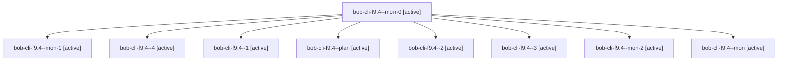

# Session: bob-cli-f9.4

[Agent Hoods](../README.md) / [bbugyi200](../users/bbugyi200/README.md) / [apollo](../users/bbugyi200/machines/apollo/README.md) / [bob-cli-f9](../users/bbugyi200/machines/apollo/hoods/bob-cli-f9/README.md) / bob-cli-f9.4

Owner: `bbugyi200.apollo` · Hood: `bob-cli-f9` · Members: 9 · Bead: [bob-cli-f9.4](https://github.com/bobs-org/bob-cli--beads/blob/main/pages/bob-cli-f9/bob-cli-f9.4.md)

## Lineage

The diagram is an optional enhancement; the ordered table below contains the same lineage in accessible text.

| Role | Agent | State | Model / provider | Timing | Commits | Prompt | Chat |
|---|---|---|---|---|---:|---|---|
| mon-0 | bob-cli-f9.4--mon-0 | active | gpt-6-luna / codex | 2026-11-01T19:35:59.129226+00:00 | 0 | — | — |
| mon-1 | bob-cli-f9.4--mon-1 | active | gpt-6-luna / codex | 2026-11-01T19:43:22.918981+00:00 | 0 | — | — |
| 4 | bob-cli-f9.4--4 | active | grok-4.6 / grok | 2026-11-01T20:14:00.616979+00:00 | 0 | [Prompt](../agents/bbugyi200.apollo.bob-cli-f9.4--4/prompt.md) | — |
| 1 | bob-cli-f9.4--1 | active | gpt-6-luna / codex | 2026-11-01T19:32:29.447168+00:00 | 0 | [Prompt](../agents/bbugyi200.apollo.bob-cli-f9.4--1/prompt.md) | [Chat](../agents/bbugyi200.apollo.bob-cli-f9.4--1/chat.md) |
| plan | bob-cli-f9.4--plan | active | gpt-6-luna / codex | 2026-11-01T19:05:37.758489+00:00 | 0 | [Prompt](../agents/bbugyi200.apollo.bob-cli-f9.4--plan/prompt.md) | [Chat](../agents/bbugyi200.apollo.bob-cli-f9.4--plan/chat.md) |
| 2 | bob-cli-f9.4--2 | active | gpt-6-luna / codex | 2026-11-01T19:38:34.002043+00:00 | 0 | [Prompt](../agents/bbugyi200.apollo.bob-cli-f9.4--2/prompt.md) | [Chat](../agents/bbugyi200.apollo.bob-cli-f9.4--2/chat.md) |
| 3 | bob-cli-f9.4--3 | active | gpt-6-luna / codex | 2026-11-01T20:07:17.686410+00:00 | 0 | [Prompt](../agents/bbugyi200.apollo.bob-cli-f9.4--3/prompt.md) | [Chat](../agents/bbugyi200.apollo.bob-cli-f9.4--3/chat.md) |
| mon-2 | bob-cli-f9.4--mon-2 | active | gpt-6-luna / codex | 2026-11-01T20:12:41.389269+00:00 | 0 | — | — |
| mon | bob-cli-f9.4--mon | active | gpt-6-luna / codex | 2026-11-01T19:16:13.547653+00:00 | 0 | — | — |

## Neighbors

| Agent | Relation | State |
|---|---|---|
| [bob-cli-f9.1](../agents/bbugyi200.apollo.bob-cli-f9.1/README.md) | bob-cli-f9 hood | active |
| [bob-cli-f9.2](../agents/bbugyi200.apollo.bob-cli-f9.2/README.md) | bob-cli-f9 hood | active |
| [bob-cli-f9.3](../agents/bbugyi200.apollo.bob-cli-f9.3/README.md) | bob-cli-f9 hood | active |
| [bob-cli-f9.5](../agents/bbugyi200.apollo.bob-cli-f9.5/README.md) | bob-cli-f9 hood | active |
| [bob-cli-f9.land](../agents/bbugyi200.apollo.bob-cli-f9.land/README.md) | bob-cli-f9 hood | active |
