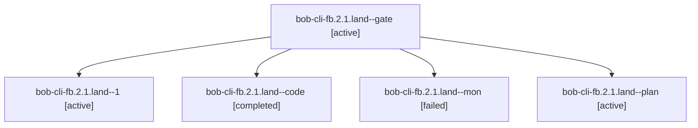

# Session: bob-cli-fb.2.1.land

[Agent Hoods](../README.md) / [bbugyi200](../users/bbugyi200/README.md) / [apollo](../users/bbugyi200/machines/apollo/README.md) / [bob-cli-fb](../users/bbugyi200/machines/apollo/hoods/bob-cli-fb/README.md) / bob-cli-fb.2.1.land

Owner: `bbugyi200.apollo` · Hood: `bob-cli-fb` · Members: 5 · Bead: [bob-cli-fb.2.1](https://github.com/bobs-org/bob-cli--beads/blob/main/pages/bob-cli-fb/bob-cli-fb.2.1.md)

## Lineage

The diagram is an optional enhancement; the ordered table below contains the same lineage in accessible text.

| Role | Agent | State | Model / provider | Timing | Commits | Prompt | Chat |
|---|---|---|---|---|---:|---|---|
| gate | bob-cli-fb.2.1.land--gate | active | gpt-6-astra / codex | 2026-11-02T00:03:54.972221+00:00 | 0 | — | [Chat](../agents/bbugyi200.apollo.bob-cli-fb.2.1.land--gate/chat.md) |
| 1 | bob-cli-fb.2.1.land--1 | active | muse-spark-1.3-contributor / muse | 2026-11-02T01:13:02.840526+00:00 | [1](../agents/bbugyi200.apollo.bob-cli-fb.2.1.land--1/README.md#commits) | [Prompt](../agents/bbugyi200.apollo.bob-cli-fb.2.1.land--1/prompt.md) | — |
| code | bob-cli-fb.2.1.land--code | completed | muse-spark-1.3-contributor / muse | 2026-11-02T00:04:32.358089+00:00 → 2026-11-02T01:02:38.436528+00:00 | 0 | — | [Chat](../agents/bbugyi200.apollo.bob-cli-fb.2.1.land--code/chat.md) |
| mon | bob-cli-fb.2.1.land--mon | failed | muse-spark-1.3-contributor / muse | 2026-11-02T01:02:08.245338+00:00 → 2026-11-02T01:10:39.352958+00:00 | 0 | — | [Chat](../agents/bbugyi200.apollo.bob-cli-fb.2.1.land--mon/chat.md) |
| plan | bob-cli-fb.2.1.land--plan | active | gpt-6-astra / codex | 2026-11-01T23:53:00.715036+00:00 | 0 | [Prompt](../agents/bbugyi200.apollo.bob-cli-fb.2.1.land--plan/prompt.md) | [Chat](../agents/bbugyi200.apollo.bob-cli-fb.2.1.land--plan/chat.md) |

## Commits

| Role | Repo | Commit | Subject | Committed |
|---|---|---|---|---|
| 1 | bob-cli | [`3986627`](https://github.com/bobs-org/bob-cli/commit/39866275931de4d7364fa4a4f7cb3f10cc37ce41) | feat(capture): land keep-moving repairs with lazy routing and lane names | 2026-11-01 21:10:59 EST |

## Neighbors

| Agent | Relation | State |
|---|---|---|
| [bob-cli-fb.2](bbugyi200.apollo.bob-cli-fb.2.md) (session · 3) | ancestor | active 3 |
| [bob-cli-fb.2.1.1](bbugyi200.apollo.bob-cli-fb.2.1.1.md) (session · 3) | bob-cli-fb.2.1 hood | active 3 |
| [bob-cli-fb.2.1.2](../agents/bbugyi200.apollo.bob-cli-fb.2.1.2/README.md) | bob-cli-fb.2.1 hood | active |
| [bob-cli-fb.2.1.3](../agents/bbugyi200.apollo.bob-cli-fb.2.1.3/README.md) | bob-cli-fb.2.1 hood | active |
| [bob-cli-fb.1](../agents/bbugyi200.apollo.bob-cli-fb.1/README.md) | bob-cli-fb hood | active |
| [bob-cli-fb.3](../agents/bbugyi200.apollo.bob-cli-fb.3/README.md) | bob-cli-fb hood | active |
| [bob-cli-fb.4](bbugyi200.apollo.bob-cli-fb.4.md) (session · 5) | bob-cli-fb hood | active 2, completed 2, failed 1 |
| [bob-cli-fb.5](bbugyi200.apollo.bob-cli-fb.5.md) (session · 15) | bob-cli-fb hood | active 5, completed 8, failed 2 |
| [bob-cli-fb.land](bbugyi200.apollo.bob-cli-fb.land.md) (session · 3) | bob-cli-fb hood | active 2, completed 1 |
