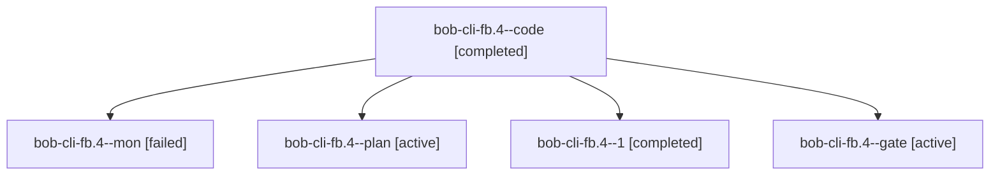

# Session: bob-cli-fb.4

[Agent Hoods](../README.md) / [bbugyi200](../users/bbugyi200/README.md) / [apollo](../users/bbugyi200/machines/apollo/README.md) / [bob-cli-fb](../users/bbugyi200/machines/apollo/hoods/bob-cli-fb/README.md) / bob-cli-fb.4

Owner: `bbugyi200.apollo` · Hood: `bob-cli-fb` · Members: 5 · Bead: [bob-cli-fb.4](https://github.com/bobs-org/bob-cli--beads/blob/main/pages/bob-cli-fb/bob-cli-fb.4.md)

## Lineage

The diagram is an optional enhancement; the ordered table below contains the same lineage in accessible text.

| Role | Agent | State | Model / provider | Timing | Commits | Prompt | Chat |
|---|---|---|---|---|---:|---|---|
| code | bob-cli-fb.4--code | completed | muse-spark-1.3-contributor / muse | 2026-11-01T21:14:33.866389+00:00 → 2026-11-01T21:32:28.725623+00:00 | 0 | — | [Chat](../agents/bbugyi200.apollo.bob-cli-fb.4--code/chat.md) |
| mon | bob-cli-fb.4--mon | failed | muse-spark-1.3-contributor / muse | 2026-11-01T21:32:06.649316+00:00 → 2026-11-01T21:36:18.025580+00:00 | 0 | — | [Chat](../agents/bbugyi200.apollo.bob-cli-fb.4--mon/chat.md) |
| plan | bob-cli-fb.4--plan | active | opus / claude | 2026-11-01T20:58:45.151890+00:00 | 0 | [Prompt](../agents/bbugyi200.apollo.bob-cli-fb.4--plan/prompt.md) | [Chat](../agents/bbugyi200.apollo.bob-cli-fb.4--plan/chat.md) |
| 1 | bob-cli-fb.4--1 | completed | muse-spark-1.3-contributor / muse | 2026-11-01T22:00:52.403455+00:00 → 2026-11-01T22:15:22.783646+00:00 | 0 | [Prompt](../agents/bbugyi200.apollo.bob-cli-fb.4--1/prompt.md) | [Chat](../agents/bbugyi200.apollo.bob-cli-fb.4--1/chat.md) |
| gate | bob-cli-fb.4--gate | active | opus / claude | 2026-11-01T21:14:06.705848+00:00 | 0 | — | [Chat](../agents/bbugyi200.apollo.bob-cli-fb.4--gate/chat.md) |

## Neighbors

| Agent | Relation | State |
|---|---|---|
| [bob-cli-fb.1](../agents/bbugyi200.apollo.bob-cli-fb.1/README.md) | bob-cli-fb hood | active |
| [bob-cli-fb.2](bbugyi200.apollo.bob-cli-fb.2.md) (session · 3) | bob-cli-fb hood | active 3 |
| [bob-cli-fb.2.1.1](bbugyi200.apollo.bob-cli-fb.2.1.1.md) (session · 3) | bob-cli-fb hood | active 3 |
| [bob-cli-fb.2.1.2](../agents/bbugyi200.apollo.bob-cli-fb.2.1.2/README.md) | bob-cli-fb hood | active |
| [bob-cli-fb.2.1.3](../agents/bbugyi200.apollo.bob-cli-fb.2.1.3/README.md) | bob-cli-fb hood | active |
| [bob-cli-fb.2.1.land](bbugyi200.apollo.bob-cli-fb.2.1.land.md) (session · 5) | bob-cli-fb hood | active 3, completed 1, failed 1 |
| [bob-cli-fb.3](../agents/bbugyi200.apollo.bob-cli-fb.3/README.md) | bob-cli-fb hood | active |
| [bob-cli-fb.5](bbugyi200.apollo.bob-cli-fb.5.md) (session · 15) | bob-cli-fb hood | active 5, completed 8, failed 2 |
| [bob-cli-fb.land](bbugyi200.apollo.bob-cli-fb.land.md) (session · 3) | bob-cli-fb hood | active 2, completed 1 |
