# Session: bob-cli-fb.5

[Agent Hoods](../README.md) / [bbugyi200](../users/bbugyi200/README.md) / [apollo](../users/bbugyi200/machines/apollo/README.md) / [bob-cli-fb](../users/bbugyi200/machines/apollo/hoods/bob-cli-fb/README.md) / bob-cli-fb.5

Owner: `bbugyi200.apollo` · Hood: `bob-cli-fb` · Members: 15 · Bead: [bob-cli-fb.5](https://github.com/bobs-org/bob-cli--beads/blob/main/pages/bob-cli-fb/bob-cli-fb.5.md)

## Lineage

```mermaid
flowchart TD
  n0["bob-cli-fb.5--2 [active]"]
  n1["bob-cli-fb.5--6 [completed]"]
  n0 --> n1
  n2["bob-cli-fb.5--plan [active]"]
  n0 --> n2
  n3["bob-cli-fb.5--1 [active]"]
  n0 --> n3
  n4["bob-cli-fb.5--mon-3 [completed]"]
  n0 --> n4
  n5["bob-cli-fb.5--5 [completed]"]
  n0 --> n5
  n6["bob-cli-fb.5--mon-5 [completed]"]
  n0 --> n6
  n7["bob-cli-fb.5--3 [completed]"]
  n0 --> n7
  n8["bob-cli-fb.5--7 [completed]"]
  n0 --> n8
  n9["bob-cli-fb.5--mon-4 [completed]"]
  n0 --> n9
  n10["bob-cli-fb.5--mon [active]"]
  n0 --> n10
  n11["bob-cli-fb.5--mon-1 [failed]"]
  n0 --> n11
  n12["bob-cli-fb.5--mon-2 [failed]"]
  n0 --> n12
  n13["bob-cli-fb.5--mon-0 [active]"]
  n0 --> n13
  n14["bob-cli-fb.5--4 [completed]"]
  n0 --> n14
```

The diagram is an optional enhancement; the ordered table below contains the same lineage in accessible text.

| Role | Agent | State | Model / provider | Timing | Commits | Prompt | Chat |
|---|---|---|---|---|---:|---|---|
| 2 | bob-cli-fb.5--2 | active | gpt-6-luna / codex | 2026-11-02T02:37:08.884212+00:00 | 0 | [Prompt](../agents/bbugyi200.apollo.bob-cli-fb.5--2/prompt.md) | [Chat](../agents/bbugyi200.apollo.bob-cli-fb.5--2/chat.md) |
| 6 | bob-cli-fb.5--6 | completed | gpt-6-luna / codex | 2026-11-02T03:27:56.234632+00:00 → 2026-11-02T03:31:49.928657+00:00 | 0 | [Prompt](../agents/bbugyi200.apollo.bob-cli-fb.5--6/prompt.md) | [Chat](../agents/bbugyi200.apollo.bob-cli-fb.5--6/chat.md) |
| plan | bob-cli-fb.5--plan | active | gpt-6-luna / codex | 2026-11-02T02:09:48.556366+00:00 | 0 | [Prompt](../agents/bbugyi200.apollo.bob-cli-fb.5--plan/prompt.md) | [Chat](../agents/bbugyi200.apollo.bob-cli-fb.5--plan/chat.md) |
| 1 | bob-cli-fb.5--1 | active | gpt-6-luna / codex | 2026-11-02T02:30:31.954820+00:00 | 0 | [Prompt](../agents/bbugyi200.apollo.bob-cli-fb.5--1/prompt.md) | [Chat](../agents/bbugyi200.apollo.bob-cli-fb.5--1/chat.md) |
| mon-3 | bob-cli-fb.5--mon-3 | completed | gpt-6-luna / codex | 2026-11-02T03:10:31.960227+00:00 → 2026-11-02T03:18:40.292264+00:00 | 0 | — | [Chat](../agents/bbugyi200.apollo.bob-cli-fb.5--mon-3/chat.md) |
| 5 | bob-cli-fb.5--5 | completed | gpt-6-luna / codex | 2026-11-02T03:19:09.110768+00:00 → 2026-11-02T03:23:03.478392+00:00 | 0 | [Prompt](../agents/bbugyi200.apollo.bob-cli-fb.5--5/prompt.md) | [Chat](../agents/bbugyi200.apollo.bob-cli-fb.5--5/chat.md) |
| mon-5 | bob-cli-fb.5--mon-5 | completed | gpt-6-luna / codex | 2026-11-02T03:31:40.845014+00:00 → 2026-11-02T03:35:23.722863+00:00 | 0 | — | [Chat](../agents/bbugyi200.apollo.bob-cli-fb.5--mon-5/chat.md) |
| 3 | bob-cli-fb.5--3 | completed | gpt-6-luna / codex | 2026-11-02T02:50:28.792451+00:00 → 2026-11-02T02:56:40.005577+00:00 | 0 | [Prompt](../agents/bbugyi200.apollo.bob-cli-fb.5--3/prompt.md) | [Chat](../agents/bbugyi200.apollo.bob-cli-fb.5--3/chat.md) |
| 7 | bob-cli-fb.5--7 | completed | gpt-6-luna / codex | 2026-11-02T03:35:23.691551+00:00 → 2026-11-02T03:38:16.006483+00:00 | 0 | [Prompt](../agents/bbugyi200.apollo.bob-cli-fb.5--7/prompt.md) | [Chat](../agents/bbugyi200.apollo.bob-cli-fb.5--7/chat.md) |
| mon-4 | bob-cli-fb.5--mon-4 | completed | gpt-6-luna / codex | 2026-11-02T03:22:49.425398+00:00 → 2026-11-02T03:27:39.014858+00:00 | 0 | — | [Chat](../agents/bbugyi200.apollo.bob-cli-fb.5--mon-4/chat.md) |
| mon | bob-cli-fb.5--mon | active | gpt-6-luna / codex | 2026-11-02T02:28:56.524574+00:00 | 0 | — | — |
| mon-1 | bob-cli-fb.5--mon-1 | failed | gpt-6-luna / codex | 2026-11-02T02:43:04.155201+00:00 → 2026-11-02T02:50:29.131588+00:00 | 0 | — | [Chat](../agents/bbugyi200.apollo.bob-cli-fb.5--mon-1/chat.md) |
| mon-2 | bob-cli-fb.5--mon-2 | failed | gpt-6-luna / codex | 2026-11-02T02:56:26.370487+00:00 → 2026-11-02T03:04:01.385565+00:00 | 0 | — | [Chat](../agents/bbugyi200.apollo.bob-cli-fb.5--mon-2/chat.md) |
| mon-0 | bob-cli-fb.5--mon-0 | active | gpt-6-luna / codex | 2026-11-02T02:33:03.404030+00:00 | 0 | — | — |
| 4 | bob-cli-fb.5--4 | completed | gpt-6-luna / codex | 2026-11-02T03:04:08.818087+00:00 → 2026-11-02T03:10:41.427253+00:00 | 0 | [Prompt](../agents/bbugyi200.apollo.bob-cli-fb.5--4/prompt.md) | [Chat](../agents/bbugyi200.apollo.bob-cli-fb.5--4/chat.md) |

## Neighbors

| Agent | Relation | State |
|---|---|---|
| [bob-cli-fb.1](../agents/bbugyi200.apollo.bob-cli-fb.1/README.md) | bob-cli-fb hood | active |
| [bob-cli-fb.2](bbugyi200.apollo.bob-cli-fb.2.md) (session · 3) | bob-cli-fb hood | active 3 |
| [bob-cli-fb.2.1.1](bbugyi200.apollo.bob-cli-fb.2.1.1.md) (session · 3) | bob-cli-fb hood | active 3 |
| [bob-cli-fb.2.1.2](../agents/bbugyi200.apollo.bob-cli-fb.2.1.2/README.md) | bob-cli-fb hood | active |
| [bob-cli-fb.2.1.3](../agents/bbugyi200.apollo.bob-cli-fb.2.1.3/README.md) | bob-cli-fb hood | active |
| [bob-cli-fb.2.1.land](bbugyi200.apollo.bob-cli-fb.2.1.land.md) (session · 5) | bob-cli-fb hood | active 3, completed 1, failed 1 |
| [bob-cli-fb.3](../agents/bbugyi200.apollo.bob-cli-fb.3/README.md) | bob-cli-fb hood | active |
| [bob-cli-fb.4](bbugyi200.apollo.bob-cli-fb.4.md) (session · 5) | bob-cli-fb hood | active 2, completed 2, failed 1 |
| [bob-cli-fb.land](bbugyi200.apollo.bob-cli-fb.land.md) (session · 3) | bob-cli-fb hood | active 2, completed 1 |
