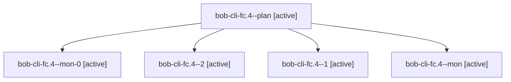

# Session: bob-cli-fc.4

[Agent Hoods](../README.md) / [bbugyi200](../users/bbugyi200/README.md) / [apollo](../users/bbugyi200/machines/apollo/README.md) / [bob-cli-fc](../users/bbugyi200/machines/apollo/hoods/bob-cli-fc/README.md) / bob-cli-fc.4

Owner: `bbugyi200.apollo` · Hood: `bob-cli-fc` · Members: 5 · Bead: [bob-cli-fc.4](https://github.com/bobs-org/bob-cli--beads/blob/main/pages/bob-cli-fc/bob-cli-fc.4.md)

## Lineage

The diagram is an optional enhancement; the ordered table below contains the same lineage in accessible text.

| Role | Agent | State | Model / provider | Timing | Commits | Prompt | Chat |
|---|---|---|---|---|---:|---|---|
| plan | bob-cli-fc.4--plan | active | gpt-6-luna / codex | 2026-11-02T01:56:20.041667+00:00 | 0 | [Prompt](../agents/bbugyi200.apollo.bob-cli-fc.4--plan/prompt.md) | [Chat](../agents/bbugyi200.apollo.bob-cli-fc.4--plan/chat.md) |
| mon-0 | bob-cli-fc.4--mon-0 | active | gpt-6-luna / codex | 2026-11-02T02:18:08.694194+00:00 | 0 | — | — |
| 2 | bob-cli-fc.4--2 | active | gpt-6-luna / codex | 2026-11-02T02:24:38.528844+00:00 | 0 | [Prompt](../agents/bbugyi200.apollo.bob-cli-fc.4--2/prompt.md) | — |
| 1 | bob-cli-fc.4--1 | active | gpt-6-luna / codex | 2026-11-02T02:15:07.105602+00:00 | 0 | [Prompt](../agents/bbugyi200.apollo.bob-cli-fc.4--1/prompt.md) | [Chat](../agents/bbugyi200.apollo.bob-cli-fc.4--1/chat.md) |
| mon | bob-cli-fc.4--mon | active | gpt-6-luna / codex | 2026-11-02T02:11:49.775859+00:00 | 0 | — | — |

## Neighbors

| Agent | Relation | State |
|---|---|---|
| [bob-cli-fc.1](../agents/bbugyi200.apollo.bob-cli-fc.1/README.md) | bob-cli-fc hood | active |
| [bob-cli-fc.2](../agents/bbugyi200.apollo.bob-cli-fc.2/README.md) | bob-cli-fc hood | active |
| [bob-cli-fc.3](../agents/bbugyi200.apollo.bob-cli-fc.3/README.md) | bob-cli-fc hood | active |
| [bob-cli-fc.land](bbugyi200.apollo.bob-cli-fc.land.md) (session · 3) | bob-cli-fc hood | active 2, completed 1 |
