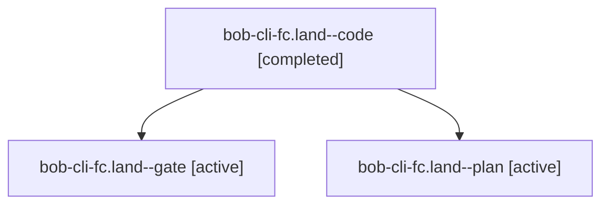

# Session: bob-cli-fc.land

[Agent Hoods](../README.md) / [bbugyi200](../users/bbugyi200/README.md) / [apollo](../users/bbugyi200/machines/apollo/README.md) / [bob-cli-fc](../users/bbugyi200/machines/apollo/hoods/bob-cli-fc/README.md) / bob-cli-fc.land

Owner: `bbugyi200.apollo` · Hood: `bob-cli-fc` · Members: 3 · Bead: [bob-cli-fc](https://github.com/bobs-org/bob-cli--beads/blob/main/pages/bob-cli-fc/README.md)

## Lineage

The diagram is an optional enhancement; the ordered table below contains the same lineage in accessible text.

| Role | Agent | State | Model / provider | Timing | Commits | Prompt | Chat |
|---|---|---|---|---|---:|---|---|
| code | bob-cli-fc.land--code | completed | sonnet / claude | 2026-11-02T02:45:44.889491+00:00 → 2026-11-02T04:04:09.283522+00:00 | [1](../agents/bbugyi200.apollo.bob-cli-fc.land--code/README.md#commits) | — | [Chat](../agents/bbugyi200.apollo.bob-cli-fc.land--code/chat.md) |
| gate | bob-cli-fc.land--gate | active | gpt-6-astra / codex | 2026-11-02T02:45:23.276150+00:00 | 0 | — | [Chat](../agents/bbugyi200.apollo.bob-cli-fc.land--gate/chat.md) |
| plan | bob-cli-fc.land--plan | active | gpt-6-astra / codex | 2026-11-02T02:31:24.269631+00:00 | 0 | [Prompt](../agents/bbugyi200.apollo.bob-cli-fc.land--plan/prompt.md) | [Chat](../agents/bbugyi200.apollo.bob-cli-fc.land--plan/chat.md) |

## Commits

| Role | Repo | Commit | Subject | Committed |
|---|---|---|---|---|
| code | bob-cli | [`50a3922`](https://github.com/bobs-org/bob-cli/commit/50a39221291b7a08b64efd0082582f2e4e9cf9f2) | fix(capture): compose multi-note captures with relation closes and report the final parent | 2026-11-01 23:02:20 EST |

## Neighbors

| Agent | Relation | State |
|---|---|---|
| [bob-cli-fc.1](../agents/bbugyi200.apollo.bob-cli-fc.1/README.md) | bob-cli-fc hood | active |
| [bob-cli-fc.2](../agents/bbugyi200.apollo.bob-cli-fc.2/README.md) | bob-cli-fc hood | active |
| [bob-cli-fc.3](../agents/bbugyi200.apollo.bob-cli-fc.3/README.md) | bob-cli-fc hood | active |
| [bob-cli-fc.4](bbugyi200.apollo.bob-cli-fc.4.md) (session · 5) | bob-cli-fc hood | active 5 |
